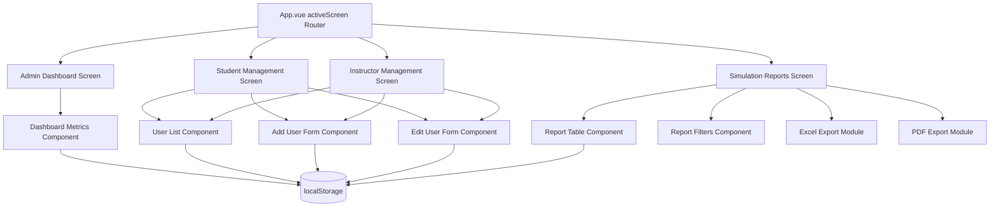
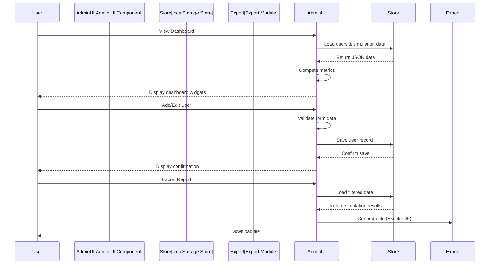

# Design Document

## Overview

The Admin Dashboard and Management System provides instructors and administrators with centralized tools for user management, system monitoring, and performance analytics within the HelmQuest maritime simulator. This feature extends the existing Vue.js-based instructor console to include comprehensive administrative capabilities while maintaining the application's glass-card aesthetic and responsive design patterns.

The system is designed to work within the existing client-side architecture using localStorage and the progressData persistence mechanism established in the current instructor console. All administrative interfaces will be implemented as Vue 3 Composition API components that integrate seamlessly with the existing `activeScreen` routing system in App.vue.

**Key Design Goals:**
- Extend existing instructor console patterns with administrative features
- Maintain consistency with established UI/UX conventions (glass-card modals, professional maritime theme)
- Leverage existing localStorage-based data persistence without backend dependencies
- Implement role-based access control using the existing authentication system
- Provide efficient data export capabilities (Excel, PDF) for offline analysis
- Ensure responsive design across desktop and tablet form factors

## Architecture

### High-Level Component Structure



### Integration with Existing App.vue

The admin features will extend the existing `activeScreen` routing system:

```javascript
// New screens added to App.vue
activeScreen.value = 'admin-dashboard'      // Dashboard overview
activeScreen.value = 'admin-students'       // Student management
activeScreen.value = 'admin-instructors'    // Instructor management
activeScreen.value = 'admin-reports'        // Simulation reports
```

Navigation will be triggered from the existing instructor console, adding admin-specific menu items when the user role is Administrator or Instructor.

### Data Flow Architecture



### localStorage Data Schema

The system will use the following localStorage keys:

- **`helmquest_users`**: Array of user account objects (students + instructors)
- **`helmquest_simulation_results`**: Array of completed simulation attempt records
- **`helmquest_missions`**: Array of available training missions
- **`helmquest_audit_log`**: Array of audit trail records for user modifications
- **`helmquest_current_user`**: Currently authenticated user object

Example user record structure:
```json
{
  "id": "usr_001",
  "firstName": "John",
  "lastName": "Doe",
  "email": "john.doe@example.com",
  "username": "jdoe",
  "passwordHash": "hashed_value",
  "role": "Student",
  "enrollmentDate": "2025-01-15",
  "status": "active",
  "department": null,
  "createdAt": "2025-01-15T10:30:00Z",
  "updatedAt": "2025-01-15T10:30:00Z"
}
```

## Components and Interfaces

### 1. Admin Dashboard Component (`AdminDashboard.vue`)
