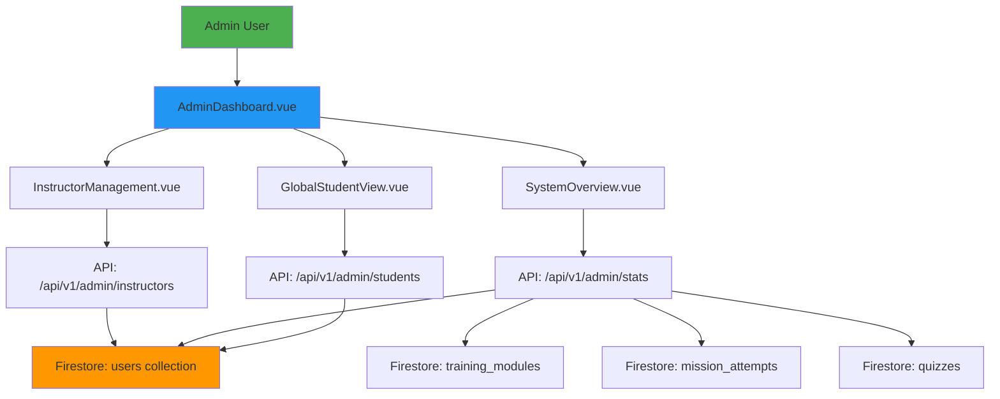
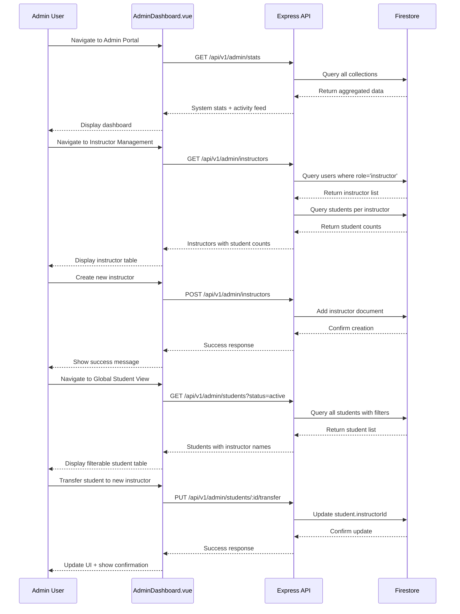

# Design Document: Admin Management Panel

## Overview

The Admin Management Panel is a comprehensive system administration interface for HelmQuest that enables administrators to manage instructors, monitor system-wide metrics, and oversee all students across the platform. The panel provides three core capabilities: (1) full CRUD operations for instructor accounts with student count visibility, (2) a real-time dashboard displaying system-wide statistics and recent activity, and (3) a global student view with advanced filtering, instructor assignment management, and bulk operations. This centralized control panel consolidates administrative tasks into a single, secure interface while maintaining proper role-based access control.

## Architecture

The admin panel follows a three-tier architecture: a Vue.js frontend component tree, an Express.js REST API middleware layer, and Firestore as the data persistence layer. The frontend uses Vue 3 Composition API with reactive state management, while the backend extends the existing Express server with new admin-specific routes. Authentication and authorization are enforced at both the client and server levels to ensure only users with `role: 'admin'` can access administrative functions.



## Main Workflow



## Data Models

### Users Collection (Firestore)
The system uses a unified `users` collection with role-based differentiation:

```javascript
// Admin Document
{
  id: "admin-root",
  name: "System Admin",
  email: "admin@helmquest.com",
  role: "admin",
  status: "active",
  createdAt: Timestamp
}

// Instructor Document (referenced in design)
{
  id: "instructor-uuid",
  name: "Helen Morgan",
  email: "helen@dnsc.edu.ph",
  role: "instructor",
  status: "active" | "inactive",
  department: "Maritime Navigation",
  createdAt: Timestamp
}

// Student Document (referenced in design)
{
  id: "student-uuid",
  studentId: "STU-2026-001",
  name: "Kevin Caidic",
  email: "kevin@dnsc.edu.ph",
  role: "student",
  status: "active" | "pending" | "inactive",
  instructorId: "instructor-uuid",
  xp: 120,
  rank: "Cadet",
  badges: [],
  certificates: [],
  completedModules: [],
  createdAt: Timestamp
}
```

### Related Collections
- **training_modules**: Missions created by instructors/admins
- **mission_attempts**: Student performance records
- **quizzes**: Quiz definitions
- **quiz_submissions**: Quiz results

## Component Structure

### Frontend Components

```
src/components/admin/
├── AdminDashboard.vue          # Main admin layout with tabs
├── SystemOverview.vue          # Priority 2: Dashboard stats
├── InstructorManagement.vue    # Priority 1: Instructor CRUD
├── GlobalStudentView.vue       # Priority 3: All students view
└── components/
    ├── InstructorForm.vue      # Add/Edit instructor modal
    ├── StudentTransferModal.vue # Transfer student dialog
    └── ConfirmDialog.vue       # Reusable confirmation dialog
```

### Backend Routes

```javascript
// backend/routes/admin.js
router.get('/stats', getSystemStats);               // System overview
router.get('/instructors', getAllInstructors);      // List instructors
router.get('/instructors/:id', getInstructorById);  // Get one instructor
router.post('/instructors', createInstructor);      // Create instructor
router.put('/instructors/:id', updateInstructor);   // Edit instructor
router.delete('/instructors/:id', deleteInstructor);// Delete instructor
router.patch('/instructors/:id/status', toggleInstructorStatus); // Activate/Deactivate

router.get('/students', getAllStudentsGlobal);      // Global student list
router.put('/students/:id/transfer', transferStudent); // Transfer to instructor
router.patch('/students/bulk-status', bulkUpdateStatus); // Bulk activate/deactivate
```

## API Specifications

### Priority 1: Instructor Management

#### GET /api/v1/admin/instructors
**Response:**
```json
{
  "instructors": [
    {
      "id": "instructor-uuid",
      "name": "Helen Morgan",
      "email": "helen@dnsc.edu.ph",
      "department": "Maritime Navigation",
      "status": "active",
      "studentCount": 15,
      "createdAt": "2026-01-10T08:00:00Z"
    }
  ],
  "count": 5
}
```

#### POST /api/v1/admin/instructors
**Request:**
```json
{
  "name": "John Smith",
  "email": "john@dnsc.edu.ph",
  "department": "Maritime Safety",
  "password": "SecurePass123"
}
```

#### PUT /api/v1/admin/instructors/:id
**Request:**
```json
{
  "name": "Helen Morgan-Updated",
  "email": "helen.morgan@dnsc.edu.ph",
  "department": "Advanced Navigation"
}
```

#### PATCH /api/v1/admin/instructors/:id/status
**Request:**
```json
{
  "status": "inactive"
}
```

#### DELETE /api/v1/admin/instructors/:id
**Response:**
```json
{
  "message": "Instructor deleted successfully",
  "deletedId": "instructor-uuid"
}
```

### Priority 2: System Overview Dashboard

#### GET /api/v1/admin/stats
**Response:**
```json
{
  "students": {
    "total": 150,
    "active": 120,
    "pending": 20,
    "inactive": 10
  },
  "instructors": {
    "total": 8,
    "active": 7,
    "inactive": 1
  },
  "missions": {
    "total": 45
  },
  "quizzes": {
    "total": 30
  },
  "recentActivity": [
    {
      "id": "activity-1",
      "type": "student_enrolled",
      "message": "Kevin Caidic enrolled",
      "timestamp": "2026-01-15T10:30:00Z"
    },
    {
      "id": "activity-2",
      "type": "mission_completed",
      "message": "Alex completed Mission 1",
      "timestamp": "2026-01-15T09:15:00Z"
    }
  ]
}
```

### Priority 3: Global Student View

#### GET /api/v1/admin/students
**Query Parameters:**
- `status`: filter by status (active, pending, inactive)
- `instructorId`: filter by assigned instructor
- `search`: search by name or email

**Response:**
```json
{
  "students": [
    {
      "id": "student-uuid",
      "studentId": "STU-2026-001",
      "name": "Kevin Caidic",
      "email": "kevin@dnsc.edu.ph",
      "status": "active",
      "instructorId": "instructor-uuid",
      "instructorName": "Helen Morgan",
      "xp": 120,
      "rank": "Cadet",
      "completedModules": 5,
      "averageScore": 85
    }
  ],
  "count": 120
}
```

#### PUT /api/v1/admin/students/:id/transfer
**Request:**
```json
{
  "newInstructorId": "instructor-uuid-2"
}
```

#### PATCH /api/v1/admin/students/bulk-status
**Request:**
```json
{
  "studentIds": ["student-1", "student-2"],
  "status": "inactive"
}
```

## UI/UX Design

### AdminDashboard.vue Layout
```
┌────────────────────────────────────────────────────┐
│  🎓 HelmQuest Admin Portal                    [👤] │
├────────────────────────────────────────────────────┤
│  [Dashboard] [Instructors] [Students] [Reports]    │
├────────────────────────────────────────────────────┤
│                                                    │
│  <Tab Content Renders Here>                       │
│                                                    │
└────────────────────────────────────────────────────┘
```

### Priority 2: System Overview (Default Tab)
```
┌─────────────────────────────────────────────┐
│  📊 System Overview                         │
├─────────────────────────────────────────────┤
│  ┌─────────┐ ┌─────────┐ ┌─────────┐       │
│  │ 👥 150  │ │ 👨‍🏫 8   │ │ 🎯 45   │       │
│  │Students │ │Instruct.│ │Missions │       │
│  │120 🟢   │ │7 active │ │         │       │
│  │20 🟡    │ │         │ │         │       │
│  │10 ⚫    │ │         │ │         │       │
│  └─────────┘ └─────────┘ └─────────┘       │
│                                             │
│  📋 Recent Activity                         │
│  • Kevin Caidic enrolled (2 mins ago)       │
│  • Alex completed Mission 1 (15 mins ago)   │
│  • New instructor added (1 hour ago)        │
└─────────────────────────────────────────────┘
```

### Priority 1: Instructor Management Tab
```
┌─────────────────────────────────────────────────┐
│  👨‍🏫 Instructor Management    [+ Add Instructor] │
├─────────────────────────────────────────────────┤
│  🔍 [Search instructors...]                     │
├──────┬──────────┬─────────┬─────────┬──────────┤
│ Name │ Email    │ Dept    │Students │ Actions  │
├──────┼──────────┼─────────┼─────────┼──────────┤
│Helen │helen@... │Nav      │15       │[✏️][❌][🔄]│
│John  │john@...  │Safety   │12       │[✏️][❌][🔄]│
│(inactive)                                       │
│Maria │maria@... │Harbor   │8        │[✏️][❌][🔄]│
└─────────────────────────────────────────────────┘
```

### Priority 3: Global Student View Tab
```
┌──────────────────────────────────────────────────┐
│  👥 All Students              [Bulk Actions ▼]   │
├──────────────────────────────────────────────────┤
│  🔍 [Search...]  Status:[All▼] Instructor:[All▼] │
│  ☐ Select All                                    │
├───┬──────┬─────────┬──────────┬─────────┬────────┤
│☐ │Name  │Email    │Instructor│Status   │Actions │
├───┼──────┼─────────┼──────────┼─────────┼────────┤
│☐ │Kevin │kevin@.. │Helen M.  │🟢Active │[View][↔]│
│☐ │Alex  │alex@... │John S.   │🟡Pending│[View][↔]│
│☐ │Maria │maria@.. │Helen M.  │🟢Active │[View][↔]│
└──────────────────────────────────────────────────┘
```

## Security & Authorization

### Middleware: Admin-Only Access
```javascript
// backend/middleware/requireAdmin.js
export const requireAdmin = async (req, res, next) => {
  const userId = req.user?.uid; // From auth middleware
  
  if (!userId) {
    return res.status(401).json({ 
      error: 'Unauthorized', 
      message: 'Authentication required' 
    });
  }
  
  const userDoc = await db.collection('users').doc(userId).get();
  
  if (!userDoc.exists || userDoc.data().role !== 'admin') {
    return res.status(403).json({ 
      error: 'Forbidden', 
      message: 'Admin access required' 
    });
  }
  
  next();
};
```

### Frontend Route Guards
```javascript
// src/router/index.js
{
  path: '/admin',
  component: AdminDashboard,
  meta: { requiresRole: 'admin' },
  beforeEnter: (to, from, next) => {
    const user = getCurrentUser();
    if (user?.role === 'admin') {
      next();
    } else {
      next('/unauthorized');
    }
  }
}
```

## Implementation Notes

### Database Considerations
1. **Collection Names**: The current system uses `instructor` and `students` collections separately. This design assumes migration to a unified `users` collection with `role` field.
2. **Indexes Required**:
   - `users.role` (for filtering by role)
   - `users.status` (for filtering by status)
   - `users.instructorId` (for student-instructor lookups)

### Migration Strategy (if needed)
If the system uses separate collections:
1. Keep existing `instructor` and `students` collections
2. Adjust API queries to target correct collections
3. Alternative: Add `role` field to existing documents

### Current Collection Structure
Based on existing code:
- `instructor` collection exists (seen in instructors.js route)
- `students` collection exists (seen in students.js route)
- API will need to query both collections separately for admin functions

## Testing Strategy

### Unit Tests
- Admin middleware authorization
- API endpoint responses
- Data validation for instructor creation/updates

### Integration Tests
- Complete instructor CRUD flow
- Student transfer between instructors
- Bulk operations on multiple students

### E2E Tests
- Admin login → Dashboard view
- Create instructor → Verify in list
- Transfer student → Verify updated instructor
- Bulk deactivate students → Verify status changes

## Performance Considerations

1. **Pagination**: Implement for large student/instructor lists
2. **Caching**: Cache system stats for dashboard (refresh every 5 minutes)
3. **Lazy Loading**: Load student progress data only when detail view is opened
4. **Debounced Search**: Implement search debouncing (300ms) to reduce API calls
