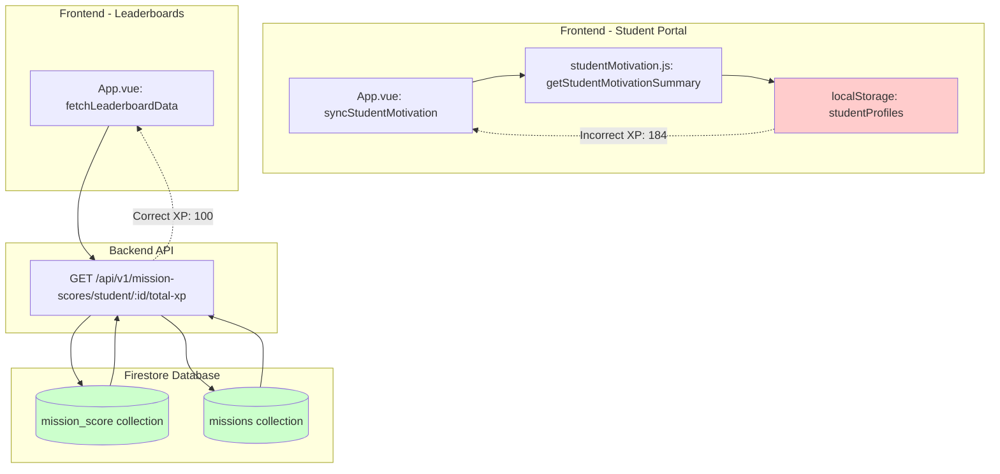
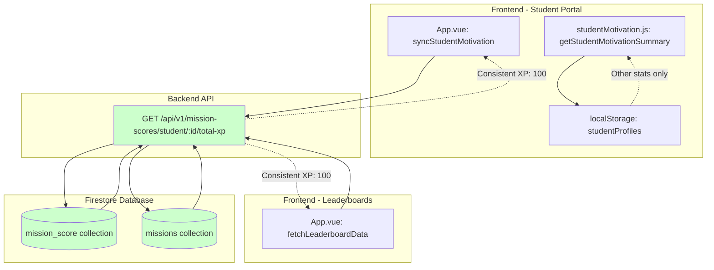
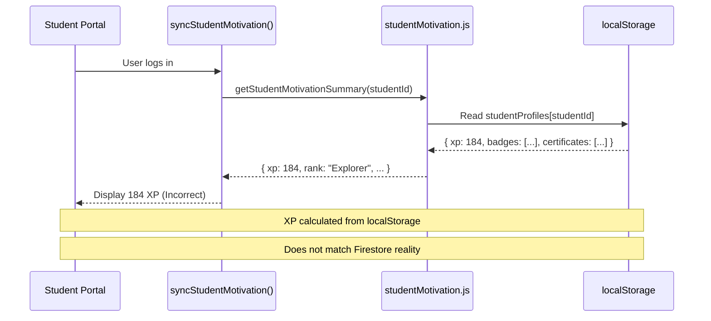
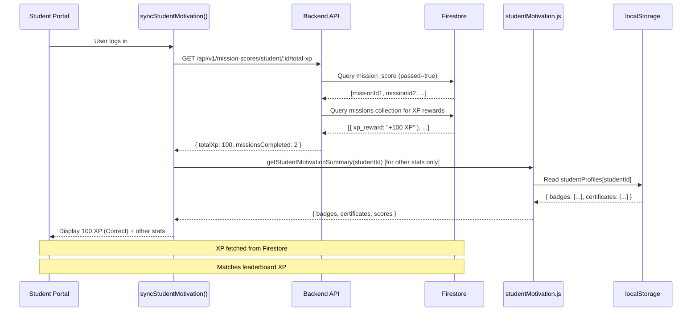

# Design Document: Firestore XP Integration

## Overview

The student portal currently displays inconsistent XP values due to using localStorage-based calculations via `getStudentMotivationSummary()`, while the leaderboards correctly display XP from Firestore via the backend API endpoint `/api/v1/mission-scores/student/:studentId/total-xp`. This design document outlines the integration strategy to migrate the student portal's XP calculation to use the same Firestore-backed API endpoint, establishing a single source of truth for XP values across the entire application.

The integration will modify the `syncStudentMotivation()` function in `App.vue` to fetch XP data from the backend API instead of localStorage, ensuring XP consistency between the student portal and leaderboards while maintaining backward compatibility with other student statistics (badges, certificates, scores).

## Architecture

### Current Architecture (Before Integration)



**Problem**: Two different XP sources lead to inconsistent values:
- Student Portal: localStorage (184 XP) ❌
- Leaderboards: Firestore (100 XP) ✅

### Target Architecture (After Integration)



**Solution**: Single source of truth from Firestore API:
- Student Portal: Firestore API (100 XP) ✅
- Leaderboards: Firestore API (100 XP) ✅
- localStorage: Only used for badges, certificates, other stats

## Data Flow

### Current Data Flow (Incorrect XP)



### Target Data Flow (Correct XP)



## Components and Interfaces

### Component 1: Backend API Endpoint (Already Implemented)

**Purpose**: Calculate total XP from Firestore by fetching passed missions and their XP rewards

**Endpoint**: `GET /api/v1/mission-scores/student/:studentId/total-xp`

**Interface**:
```typescript
interface TotalXpResponse {
  totalXp: number
  missionsCompleted: number
  xpBreakdown: Array<{
    missionId: string
    missionTitle: string
    xpReward: number
  }>
}
```

**Responsibilities**:
- Query `mission_score` collection for student's passed missions
- Deduplicate mission IDs (count each mission once)
- Handle mission ID variations ("CUSTOM-" prefix, case sensitivity)
- Query `missions` collection to fetch `xp_reward` for each mission
- Parse XP reward strings (e.g., "+100 XP" → 100)
- Sum total XP and return breakdown

**Implementation Status**: ✅ Already implemented in `backend/routes/mission_scores.js` (lines 140-220)

### Component 2: App.vue - syncStudentMotivation() (Needs Modification)

**Purpose**: Synchronize student motivation statistics displayed in the student portal

**Current Interface**:
```typescript
function syncStudentMotivation(): void
```

**Current Implementation**:
```javascript
function syncStudentMotivation() {
  const studentId = currentUser.value?.id;
  if (!studentId || userRole.value !== 'student') return;

  const summary = getStudentMotivationSummary(
    studentId,
    progressData.value,
    navigationMissions.length
  );
  
  demoStudent.value.xp = summary.xp;  // ← Gets XP from localStorage (WRONG)
  demoStudent.value.rank = summary.rank;
  demoStudent.value.completed = summary.completedMissions;
  // ... other stats
}
```

**Target Implementation**:
```javascript
async function syncStudentMotivation() {
  const studentId = currentUser.value?.id;
  if (!studentId || userRole.value !== 'student') return;

  // Fetch XP from Firestore API (NEW)
  let xpData = { totalXp: 0, missionsCompleted: 0 };
  try {
    const response = await fetch(`http://localhost:3001/api/v1/mission-scores/student/${studentId}/total-xp`);
    if (response.ok) {
      xpData = await response.json();
    }
  } catch (error) {
    console.warn('Failed to fetch XP from API:', error);
  }
  
  // Get other stats from localStorage (badges, certificates, scores)
  const summary = getStudentMotivationSummary(
    studentId,
    progressData.value,
    navigationMissions.length
  );
  
  demoStudent.value.xp = xpData.totalXp;  // ← Uses Firestore XP (CORRECT)
  demoStudent.value.completed = xpData.missionsCompleted;  // ← Uses Firestore count (CORRECT)
  demoStudent.value.rank = summary.rank;  // ← Calculated from Firestore XP
  // ... other stats from localStorage
}
```

**Responsibilities**:
- Fetch XP from backend API endpoint
- Handle API errors gracefully (fallback to 0 XP)
- Fetch other student stats from localStorage (badges, certificates, scores)
- Calculate rank based on Firestore XP
- Update `demoStudent` reactive state

### Component 3: studentMotivation.js - getStudentMotivationSummary() (Minor Modification)

**Purpose**: Provide student statistics from localStorage (badges, certificates, scores)

**Current Interface**:
```typescript
function getStudentMotivationSummary(
  studentId: string, 
  progress: ProgressData, 
  totalMissionCount: number
): {
  xp: number,              // ← Will be ignored in new implementation
  rank: string,
  xpProgress: number,
  xpNextAt: number,
  badgesEarned: number,
  badgesTotal: number,
  certificates: number,
  completedMissions: number,  // ← Will be ignored in new implementation
  totalMissions: number,
  averageScore: number,
  bestScore: number
}
```

**Modification Strategy**:
- Keep function signature unchanged for backward compatibility
- Function will continue to return all fields including `xp` and `completedMissions`
- Caller (`syncStudentMotivation()`) will ignore `xp` and `completedMissions` fields and use Firestore data instead
- Other fields (badges, certificates, scores, rank calculation) remain valid

**No changes required** to this function - it will continue to work as-is, providing localStorage-based stats that are still needed.

### Component 4: App.vue - fetchLeaderboardData() (No Changes)

**Purpose**: Fetch leaderboard data using Firestore API (already correct)

**Implementation Status**: ✅ Already correct, no changes needed

**Interface**:
```typescript
async function fetchLeaderboardData(): Promise<void>
```

This component already correctly fetches XP from the backend API and will serve as the reference implementation for the student portal integration.

## Data Models

### Firestore Collections

#### 1. mission_score Collection

**Purpose**: Store student mission completion records

**Schema**:
```typescript
interface MissionScore {
  studentId: string        // Reference to student
  missionId: string        // Reference to mission (may have "CUSTOM-" prefix)
  passed: boolean          // Whether student passed the mission
  score: number           // Score achieved (0-100)
  timestamp: Timestamp    // When the attempt was completed
}
```

**Indexes Required**:
- Composite index: `studentId` + `passed` (for querying passed missions by student)

**Example Document**:
```json
{
  "studentId": "abc123",
  "missionId": "CUSTOM-y5gfC9yiOMFPOf0YlGOE",
  "passed": true,
  "score": 85,
  "timestamp": "2024-01-15T10:30:00Z"
}
```

#### 2. missions Collection

**Purpose**: Store mission definitions including XP rewards

**Schema**:
```typescript
interface Mission {
  mission_title: string    // Display name of the mission
  xp_reward: string       // XP reward (format: "+100 XP" or "+100")
  // ... other mission fields
}
```

**Document ID**: Mission ID (without "CUSTOM-" prefix or with lowercase variations)

**XP Reward Format Variations**:
- Standard: `"+100 XP"`
- Without suffix: `"+100"`
- Edge cases handled by backend: extracts numeric value using regex

**Example Document** (ID: `y5gfC9yiOMFPOf0YlGOE`):
```json
{
  "mission_title": "Harbor Navigation Basics",
  "xp_reward": "+100 XP",
  "difficulty": "beginner"
}
```

### Frontend Data Models

#### 1. Student Profile (localStorage)

**Purpose**: Store local student statistics (badges, certificates)

**Location**: `localStorage.progressData.studentProfiles[studentId]`

**Schema**:
```typescript
interface StudentProfile {
  xp: number              // ⚠️ Will be IGNORED after integration
  badges: string[]        // ✅ Still used
  certificates: string[]  // ✅ Still used
}
```

**Migration Note**: The `xp` field will remain in localStorage but will be ignored by the student portal after integration. Future cleanup task can remove this field.

#### 2. Demo Student State (Reactive)

**Purpose**: Store currently displayed student data in App.vue

**Location**: `demoStudent` ref in App.vue

**Schema**:
```typescript
interface DemoStudent {
  name: string
  xp: number              // ← Will be populated from Firestore API
  rank: string
  completed: number       // ← Will be populated from Firestore API
  averageScore: number
  bestScore: number
  badgesEarned: number
  badgesTotal: number
  certificates: number
  xpProgress: number
  xpNextAt: number
}
```

## Correctness Properties

### Property 1: XP Consistency Across UI Components

**Universal Quantification**:
```
∀ student s, ∀ time t:
  XP_displayed_in_student_portal(s, t) = XP_displayed_in_leaderboard(s, t)
  = XP_calculated_from_firestore(s, t)
```

**Verification**: After integration, both student portal and leaderboards will fetch XP from the same backend API endpoint, ensuring identical values.

### Property 2: XP Calculation Correctness

**Universal Quantification**:
```
∀ student s:
  XP_total(s) = ∑ XP_reward(m) for all missions m where mission_score(s, m).passed = true
```

**Verification**: Backend API implementation correctly:
1. Queries all passed missions for student
2. Deduplicates mission IDs
3. Fetches XP reward for each mission
4. Sums XP values

### Property 3: Mission ID Variation Handling

**Universal Quantification**:
```
∀ mission m with ID variations [id1, id2, id3, id4]:
  backend_finds_mission(m) = true if ∃ id ∈ {id1, id2, id3, id4} where firestore_doc(id).exists = true
```

**Verification**: Backend tries 4 variations:
1. Original ID: `"CUSTOM-y5gfC9yiOMFPOf0YlGOE"`
2. Without prefix: `"y5gfC9yiOMFPOf0YlGOE"`
3. Lowercase: `"custom-y5gfc9yiomfpof0ylgoe"`
4. Without prefix + lowercase: `"y5gfc9yiomfpof0ylgoe"`

### Property 4: Backward Compatibility with Other Stats

**Universal Quantification**:
```
∀ student s, ∀ stat_type t ∈ {badges, certificates, scores}:
  stat_source_after_integration(s, t) = stat_source_before_integration(s, t) = localStorage
```

**Verification**: Integration only changes XP and completedMissions sources. All other statistics continue to use localStorage through `getStudentMotivationSummary()`.

### Property 5: Graceful API Failure Handling

**Universal Quantification**:
```
∀ student s:
  IF backend_api_fails(s) THEN XP_displayed(s) = 0 AND portal_remains_functional = true
```

**Verification**: Implementation includes try-catch block around API call, falling back to 0 XP on failure, allowing portal to continue functioning.

## Error Handling

### Error Scenario 1: Backend API Unavailable

**Condition**: Backend server is down or unreachable

**Response**: 
- Catch network error in `syncStudentMotivation()`
- Log warning to console: `"Failed to fetch XP from API: [error]"`
- Use fallback value: `{ totalXp: 0, missionsCompleted: 0 }`

**Recovery**: 
- Student portal remains functional with 0 XP displayed
- Other stats (badges, certificates, scores) continue to work from localStorage
- User can still navigate and use the portal
- XP will update correctly once backend is available again

### Error Scenario 2: Invalid Student ID

**Condition**: Student ID is null, undefined, or invalid

**Response**:
- Backend API returns `{ totalXp: 0, missionsCompleted: 0, xpBreakdown: [] }`
- Frontend displays 0 XP
- Log message in backend: `"No passed missions found for student [id]"`

**Recovery**:
- No action required - this is expected for new students with no completed missions
- Once student completes missions, XP will appear correctly

### Error Scenario 3: Mission Not Found in Firestore

**Condition**: `mission_score` references a mission ID that doesn't exist in `missions` collection

**Response**:
- Backend logs warning: `"Mission [id] not found with any variation"`
- Skip this mission (don't count XP for it)
- Continue processing other missions

**Recovery**:
- Other missions' XP still counted correctly
- Instructor should verify mission exists in Firestore
- Mission can be added to Firestore to fix missing XP

### Error Scenario 4: Malformed XP Reward Format

**Condition**: Mission's `xp_reward` field has unexpected format

**Response**:
- Backend regex extracts numeric value: `xpReward.toString().replace(/[^0-9]/g, '')`
- If extraction fails, defaults to 0: `parseInt(...) || 0`
- Log parsed value: `"XP value parsed: [value] from '[original]'"`

**Recovery**:
- Mission counted with 0 XP (safe fallback)
- Instructor should update mission's `xp_reward` field to standard format ("+100 XP")

## Testing Strategy

### Unit Testing Approach

**Test Suite 1: syncStudentMotivation() Function**

Test cases:
1. ✅ **Successful API call**: Mock API response with `{ totalXp: 100, missionsCompleted: 2 }`, verify `demoStudent.xp = 100`
2. ✅ **API failure**: Mock network error, verify fallback to `{ totalXp: 0, missionsCompleted: 0 }`
3. ✅ **Invalid student ID**: Call with `null` studentId, verify function returns early without API call
4. ✅ **Non-student role**: Set `userRole = 'instructor'`, verify function returns early
5. ✅ **XP rank calculation**: Verify `demoStudent.rank` correctly calculated from Firestore XP (not localStorage XP)

**Test Suite 2: Backend API Endpoint**

Test cases:
1. ✅ **Student with passed missions**: Verify correct XP calculation and mission count
2. ✅ **Student with no passed missions**: Verify returns `{ totalXp: 0, missionsCompleted: 0 }`
3. ✅ **Mission ID variations**: Test all 4 variations (original, without prefix, lowercase, both)
4. ✅ **XP reward parsing**: Test formats "+100 XP", "+100", "100", verify correct numeric extraction
5. ✅ **Duplicate missions**: Verify same mission passed multiple times counted only once
6. ✅ **Missing mission**: Verify graceful skip when mission not found in Firestore

### Integration Testing Approach

**Test Scenario 1: End-to-End XP Display**

Steps:
1. Create test student in Firestore
2. Add passed mission to `mission_score` collection
3. Add corresponding mission with XP reward to `missions` collection
4. Log in as student in frontend
5. Verify student portal displays correct XP
6. Navigate to leaderboards
7. Verify leaderboard displays same XP value

Expected: Student portal XP = Leaderboard XP = Firestore calculated XP

**Test Scenario 2: Consistency After Mission Completion**

Steps:
1. Log in as student with initial XP
2. Note current XP value in student portal
3. Complete a new mission (pass a quiz)
4. Refresh student portal
5. Verify XP increased by mission's XP reward
6. Check leaderboard
7. Verify leaderboard shows same updated XP

Expected: Both interfaces reflect new XP value immediately after mission completion

**Test Scenario 3: Backward Compatibility**

Steps:
1. Log in as student
2. Verify badges display correctly (from localStorage)
3. Verify certificates display correctly (from localStorage)
4. Verify average score displays correctly (from localStorage)
5. Verify best score displays correctly (from localStorage)

Expected: All non-XP statistics continue to work correctly from localStorage

## Performance Considerations

### API Call Overhead

**Current Behavior**: 
- `syncStudentMotivation()` called on every page load/navigation
- No additional API calls (uses localStorage)

**After Integration**:
- `syncStudentMotivation()` will make 1 API call: `GET /api/v1/mission-scores/student/:id/total-xp`
- API call happens on:
  - Initial login
  - Page refresh
  - Navigation within student portal

**Performance Impact**:
- Additional ~50-200ms latency per API call (typical Firestore query time)
- Backend already optimized with efficient queries
- XP data relatively static (only changes when missions completed)

**Optimization Strategies**:
1. **Caching**: Consider caching XP response in frontend for 5-10 minutes
2. **Async Loading**: Function already async, XP loads without blocking UI
3. **Loading State**: Show loading indicator while fetching XP (optional enhancement)

### Backend Query Optimization

**Current Implementation** (already optimized):
- ✅ Single query for passed missions: `where('studentId', '==', id).where('passed', '==', true)`
- ✅ Deduplication using `Set` to avoid counting same mission multiple times
- ✅ Batch mission queries (could be further optimized with `getAll()` if needed)

**Firestore Reads**:
- 1 query for `mission_score` collection (returns N documents)
- N queries for `missions` collection (where N = unique passed missions)
- Typical student: 5-10 missions = 6-11 total reads

**Cost**: Firestore charges per document read. For typical usage:
- 10 students × 10 logins/day × 10 reads/login = 1,000 reads/day
- Well within Firestore free tier (50,000 reads/day)

## Security Considerations

### Authentication

**Requirement**: Only authenticated students should access their own XP data

**Current Implementation**:
- Backend API does NOT currently verify JWT token
- Frontend passes `studentId` in URL parameter
- ⚠️ **Security Risk**: Any user could query any student's XP by changing URL

**Recommended Enhancement** (future task):
```javascript
router.get('/student/:studentId/total-xp', authenticateToken, async (req, res) => {
  const { studentId } = req.params;
  
  // Verify requesting user has permission to view this student's XP
  if (req.user.role === 'student' && req.user.id !== studentId) {
    return res.status(403).json({ error: 'Forbidden: Cannot access other students\' XP' });
  }
  
  // ... existing implementation
});
```

### Data Validation

**Requirement**: Validate student ID format to prevent injection attacks

**Current Implementation**:
- Student ID used directly in Firestore query
- Firestore SDK handles SQL injection prevention
- ✅ Safe: Firestore queries are parameterized by default

**Additional Validation** (best practice):
```javascript
// Validate studentId format (alphanumeric + hyphens)
if (!/^[a-zA-Z0-9-_]+$/.test(studentId)) {
  return res.status(400).json({ error: 'Invalid student ID format' });
}
```

### CORS Configuration

**Requirement**: Backend API should only accept requests from trusted origins

**Current Implementation**:
```javascript
// backend/server.js
app.use(cors({
  origin: 'http://localhost:8080',  // ← Frontend origin
  credentials: true
}));
```

**Production Consideration**: Update origin to production domain before deployment

## Dependencies

### Existing Dependencies (No Changes)

**Backend**:
- `express` - Web framework
- `firebase-admin` - Firestore SDK
- `cors` - CORS middleware

**Frontend**:
- `vue` - Frontend framework
- `fetch` API - HTTP requests (native browser API)

### Configuration Requirements

**Environment Variables** (already configured):
- `FIREBASE_PROJECT_ID` - Firestore project ID
- `FIREBASE_CREDENTIALS` - Service account credentials path

**API Endpoint URL**:
- Development: `http://localhost:3001`
- Production: Update to production backend URL

### Browser Compatibility

**Fetch API Support**:
- Chrome 42+
- Firefox 39+
- Safari 10.1+
- Edge 14+

**Fallback**: Use `axios` or `XMLHttpRequest` if targeting older browsers (not required for modern browsers)

## Implementation Checklist

### Phase 1: Modify syncStudentMotivation() Function

- [ ] Change function signature to `async function syncStudentMotivation()`
- [ ] Add API call to fetch XP from backend
- [ ] Add try-catch error handling with fallback to 0 XP
- [ ] Update `demoStudent.xp` to use API response
- [ ] Update `demoStudent.completed` to use API response
- [ ] Keep other stats from `getStudentMotivationSummary()`
- [ ] Update rank calculation to use Firestore XP

### Phase 2: Update Function Calls

- [ ] Find all calls to `syncStudentMotivation()` in App.vue
- [ ] Add `await` keyword to all calls (make callers async if needed)
- [ ] Verify no synchronous code depends on immediate execution

### Phase 3: Testing

- [ ] Unit test: API success case
- [ ] Unit test: API failure case
- [ ] Unit test: Invalid student ID
- [ ] Integration test: Student portal displays correct XP
- [ ] Integration test: XP matches leaderboard
- [ ] Integration test: Other stats still work (badges, certificates)

### Phase 4: Cleanup (Optional Future Task)

- [ ] Remove unused `xp` field from localStorage schema
- [ ] Add authentication to backend API endpoint
- [ ] Add request validation (student ID format)
- [ ] Implement XP caching in frontend (5-10 min TTL)
- [ ] Add loading state UI for XP fetch
