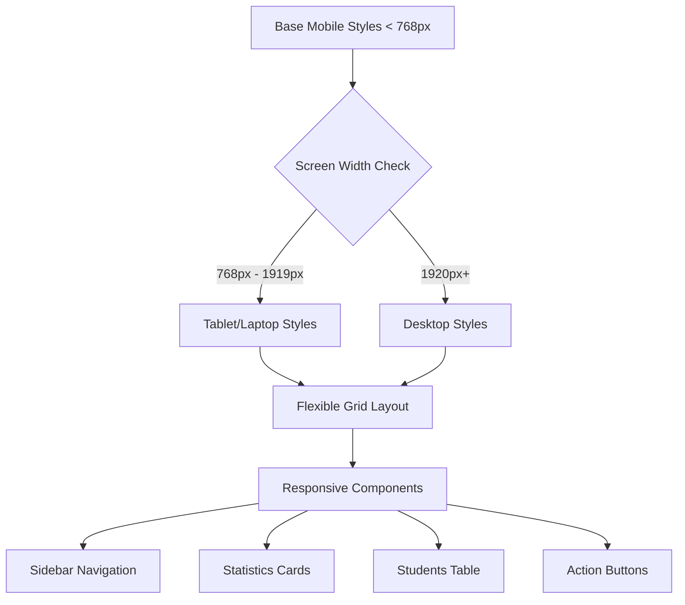
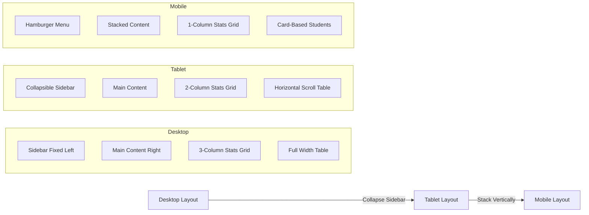

# Design Document: Instructor Dashboard Responsive Design

## Overview

This feature implements a responsive design system for the HelmQuest instructor dashboard to provide an optimal viewing and interaction experience across all device sizes. The dashboard currently uses fixed-width layouts that don't adapt to different screen sizes, making it difficult to use on mobile devices and tablets. This redesign will transform the layout using CSS media queries, flexible grids, and responsive patterns to ensure usability on large desktop monitors (1920px+), medium screens like laptops and tablets (768px-1919px), and small screens including mobile phones (< 768px).

The responsive implementation will maintain full functionality across all screen sizes while optimizing the user interface for touch interactions on mobile devices, ensuring text remains readable at all sizes, and reorganizing layout elements to stack vertically on smaller screens where horizontal space is limited.

## Architecture

The responsive design follows a mobile-first approach with progressive enhancement for larger screens. The architecture is based on CSS media queries that apply different layout rules at specific breakpoints.



### Layout Strategy



## Components and Interfaces

### Component 1: Responsive Container

**Purpose**: Main wrapper that adapts the dashboard layout based on screen size

**Interface**:
```css
.missions-hub {
  display: grid;
  grid-template-columns: [sidebar] 280px [content] 1fr;
  transition: grid-template-columns 0.3s ease;
}

/* Tablet: Collapsible sidebar */
@media (max-width: 1919px) {
  .missions-hub {
    grid-template-columns: [sidebar] 240px [content] 1fr;
  }
  
  .missions-hub--sidebar-collapsed {
    grid-template-columns: [sidebar] 0px [content] 1fr;
  }
}

/* Mobile: Stack vertically */
@media (max-width: 767px) {
  .missions-hub {
    grid-template-columns: 1fr;
    grid-template-rows: auto 1fr;
  }
}
```

**Responsibilities**:
- Control overall dashboard layout structure
- Manage sidebar visibility transitions
- Handle breakpoint-specific layout changes

### Component 2: Responsive Sidebar Navigation

**Purpose**: Collapsible navigation sidebar that transforms into a mobile menu on small screens

**Interface**:
```css
.hub-sidebar {
  position: sticky;
  top: 0;
  height: 100vh;
  overflow-y: auto;
  transition: transform 0.3s ease, width 0.3s ease;
}

/* Tablet: Narrower sidebar */
@media (max-width: 1919px) {
  .hub-sidebar {
    width: 240px;
  }
}

/* Mobile: Off-canvas sidebar */
@media (max-width: 767px) {
  .hub-sidebar {
    position: fixed;
    left: 0;
    top: 0;
    width: 280px;
    height: 100vh;
    transform: translateX(-100%);
    z-index: 1000;
    background: rgba(15, 23, 42, 0.98);
    backdrop-filter: blur(20px);
  }
  
  .hub-sidebar--open {
    transform: translateX(0);
  }
}
```

**Responsibilities**:
- Display navigation items (Overview, Missions, Students, Leaderboards)
- Collapse/expand based on screen size
- Transform to mobile hamburger menu
- Maintain user profile section visibility

### Component 3: Statistics Cards Grid

**Purpose**: Display key metrics in a responsive grid layout

**Interface**:
```css
.instructor-stats-grid {
  display: grid;
  grid-template-columns: repeat(3, minmax(0, 1fr));
  gap: 14px;
}

/* Tablet: 2 columns */
@media (max-width: 1199px) {
  .instructor-stats-grid {
    grid-template-columns: repeat(2, minmax(0, 1fr));
  }
}

/* Mobile: Single column */
@media (max-width: 767px) {
  .instructor-stats-grid {
    grid-template-columns: 1fr;
    gap: 12px;
  }
}
```

**Responsibilities**:
- Display Total Students, Enrolled Students, Average Score
- Adapt column count based on screen width
- Maintain card readability and touch targets

### Component 4: Level Completion Cards

**Purpose**: Show completion progress for each training level

**Interface**:
```css
.instructor-level-completion {
  display: grid;
  grid-template-columns: repeat(auto-fit, minmax(220px, 1fr));
  gap: 14px;
}

/* Mobile: Larger minimum width for better touch targets */
@media (max-width: 767px) {
  .instructor-level-completion {
    grid-template-columns: 1fr;
    gap: 12px;
  }
}
```

**Responsibilities**:
- Display Level 1, Level 2, Level 3 completion data
- Show progress bars and student counts
- Adapt to available screen width

### Component 5: Students Table

**Purpose**: Display student records in a responsive table/card layout

**Interface**:
```css
.instructor-table-wrap {
  overflow-x: auto;
  -webkit-overflow-scrolling: touch;
}

.instructor-table {
  min-width: 800px;
  width: 100%;
}

/* Mobile: Transform table to cards */
@media (max-width: 767px) {
  .instructor-table-wrap {
    overflow-x: visible;
  }
  
  .instructor-table {
    display: none; /* Hide table */
  }
  
  .instructor-students-cards {
    display: flex;
    flex-direction: column;
    gap: 12px;
  }
  
  .instructor-student-card {
    background: rgba(15, 23, 42, 0.55);
    border: 1px solid rgba(51, 65, 85, 0.65);
    border-radius: 12px;
    padding: 16px;
  }
}
```

**Responsibilities**:
- Display student records with ID, Name, Mission Score, Quiz Score, Latest Activity
- Enable horizontal scrolling on tablets
- Transform to card layout on mobile devices
- Maintain action buttons accessibility (Review, Reset, Remove)

### Component 6: Action Buttons

**Purpose**: Responsive button layout for primary actions

**Interface**:
```css
.instructor-panel-actions {
  display: flex;
  gap: 8px;
  flex-wrap: wrap;
}

.instructor-export-btn {
  padding: 8px 16px;
  min-height: 44px; /* Touch target minimum */
  font-size: 0.85rem;
}

/* Mobile: Full width buttons */
@media (max-width: 767px) {
  .instructor-panel-actions {
    flex-direction: column;
  }
  
  .instructor-export-btn,
  .instructor-add-student-btn {
    width: 100%;
    justify-content: center;
  }
}
```

**Responsibilities**:
- Provide Export CSV and other action buttons
- Ensure minimum 44x44px touch targets on mobile
- Stack buttons vertically on small screens

## Data Models

### Breakpoint Configuration

```typescript
interface ResponsiveBreakpoints {
  mobile: {
    max: 767,           // Mobile phones and small tablets (portrait)
    unit: "px"
  },
  tablet: {
    min: 768,           // Tablets (landscape) and small laptops
    max: 1919,
    unit: "px"
  },
  desktop: {
    min: 1920,          // Desktop monitors
    unit: "px"
  }
}
```

**Validation Rules**:
- Breakpoint values must be positive integers
- Max value must be greater than min value
- Unit must be "px" for consistency

### Layout State

```typescript
interface LayoutState {
  screenSize: "mobile" | "tablet" | "desktop";
  sidebarCollapsed: boolean;
  activeTab: "overview" | "missions" | "students" | "leaderboards";
  mobileMenuOpen: boolean;
}
```

**Validation Rules**:
- screenSize must match one of the defined breakpoint categories
- sidebarCollapsed defaults to false on desktop, true on mobile
- activeTab must be one of the valid instructor tabs
- mobileMenuOpen only applicable when screenSize is "mobile"

### Responsive Component Props

```typescript
interface ResponsiveGridConfig {
  desktop: {
    columns: number;      // 3 for stats grid
    gap: string;          // "14px"
  },
  tablet: {
    columns: number;      // 2 for stats grid
    gap: string;          // "14px"
  },
  mobile: {
    columns: number;      // 1 for stats grid
    gap: string;          // "12px"
  }
}
```

**Validation Rules**:
- columns must be positive integers (1-12 range)
- gap must be valid CSS length value
- Desktop columns >= tablet columns >= mobile columns

## Correctness Properties

### Property 1: Layout Integrity
**For all screen sizes S in {mobile, tablet, desktop}, the dashboard layout MUST maintain structural integrity without overlapping elements or broken layouts**

Formal specification:
- ∀ screenSize ∈ {mobile, tablet, desktop}
- ∀ component ∈ {sidebar, statsGrid, levelCards, studentsTable, actionButtons}
- component.isVisible() ⟹ component.boundingBox() ∩ otherComponents.boundingBox() = ∅
- ∧ component.isWithinViewport()

### Property 2: Touch Target Accessibility
**All interactive elements on mobile devices (screenWidth < 768px) MUST have minimum touch target size of 44x44 pixels**

Formal specification:
- ∀ element ∈ interactiveElements
- screenWidth < 768 ⟹ (element.width ≥ 44px ∧ element.height ≥ 44px)
- ∧ element.spacing ≥ 8px

### Property 3: Content Readability
**Text content MUST remain readable at all screen sizes with appropriate font sizes and line heights**

Formal specification:
- ∀ textElement ∈ allTextElements
- ∀ screenSize ∈ breakpoints
- textElement.fontSize ≥ minimumReadableSize(screenSize)
- ∧ textElement.lineHeight ≥ 1.4
- where minimumReadableSize(mobile) = 14px, minimumReadableSize(tablet) = 14px, minimumReadableSize(desktop) = 14px

### Property 4: Sidebar Navigation State
**Sidebar navigation state MUST be consistent with screen size breakpoint**

Formal specification:
- screenWidth ≥ 1920 ⟹ sidebar.isVisible() ∧ sidebar.position = "fixed-left"
- 768 ≤ screenWidth < 1920 ⟹ sidebar.isCollapsible() ∧ sidebar.width ≤ 240px
- screenWidth < 768 ⟹ sidebar.position = "off-canvas" ∧ sidebar.requiresToggle()

### Property 5: Grid Responsiveness
**Statistics grid MUST adapt column count based on available width while maintaining minimum card width**

Formal specification:
- ∀ grid ∈ {statsGrid, levelCompletionGrid}
- screenWidth ≥ 1200 ⟹ grid.columns = 3
- 768 ≤ screenWidth < 1200 ⟹ grid.columns = 2
- screenWidth < 768 ⟹ grid.columns = 1
- ∧ ∀ card ∈ grid.children: card.minWidth ≥ 200px

### Property 6: Table Horizontal Scroll
**Students table MUST enable horizontal scrolling on tablet when table width exceeds viewport**

Formal specification:
- 768 ≤ screenWidth < 1200 ⟹ (
-   table.width > viewport.width ⟹ container.overflowX = "auto"
-   ∧ container.hasScrollbar()
- )

### Property 7: Mobile Card Transformation
**Students table MUST transform to card layout on mobile devices**

Formal specification:
- screenWidth < 768 ⟹ (
-   table.display = "none"
-   ∧ cardLayout.display = "flex"
-   ∧ ∀ student ∈ studentRecords: student.renderedAs = "card"
- )

## Error Handling

### Error Scenario 1: Layout Overflow

**Condition**: Content exceeds viewport width causing horizontal scrolling on mobile
**Response**: Apply `overflow-x: hidden` to body and main containers; ensure all child elements use relative widths or max-width constraints
**Recovery**: Detect layout shift using ResizeObserver and adjust component widths dynamically

### Error Scenario 2: Touch Target Too Small

**Condition**: Interactive element dimensions < 44x44px on mobile devices
**Response**: Apply minimum dimensions via CSS: `min-width: 44px; min-height: 44px; padding: 12px`
**Recovery**: Add visual padding while maintaining semantic spacing using pseudo-elements if needed

### Error Scenario 3: Sidebar State Persistence

**Condition**: User collapses sidebar on tablet, then resizes to mobile, causing state confusion
**Response**: Reset sidebar state on breakpoint transitions; store separate collapse states per breakpoint
**Recovery**: Use matchMedia listeners to detect breakpoint changes and apply appropriate default states

### Error Scenario 4: Image/Content Reflow

**Condition**: Images or fixed-width content breaks mobile layout
**Response**: Apply responsive image rules: `max-width: 100%; height: auto`; use object-fit for aspect ratio maintenance
**Recovery**: Lazy load images with skeleton placeholders to prevent layout shift

### Error Scenario 5: Font Size Too Small

**Condition**: Text becomes unreadable on mobile devices
**Response**: Use responsive typography with `clamp()` function: `font-size: clamp(14px, 2vw, 16px)`
**Recovery**: Provide user-controlled text size adjustment in accessibility settings

## Testing Strategy

### Unit Testing Approach

**CSS Media Query Tests**:
- Test each breakpoint triggers correct styles using window.matchMedia
- Verify computed styles match expected values at each breakpoint
- Test transition animations complete without visual glitches

**Component Visibility Tests**:
- Verify sidebar visibility at each breakpoint
- Test mobile menu toggle functionality
- Confirm card/table transformation on mobile

**Layout Calculation Tests**:
- Test grid column calculations at various widths
- Verify touch target dimensions meet 44x44px minimum
- Test font size calculations with clamp functions

**Test Coverage Goals**:
- 100% coverage of media query breakpoints
- All interactive components tested at mobile size
- Grid layouts tested at boundary widths

### Property-Based Testing Approach

**Property Test Library**: fast-check (for TypeScript/JavaScript)

**Test 1: Layout Integrity Property**
```typescript
fc.assert(
  fc.property(
    fc.integer({min: 320, max: 2560}), // Random screen widths
    (screenWidth) => {
      const layout = calculateLayout(screenWidth);
      return hasNoOverlappingElements(layout) && 
             allElementsWithinViewport(layout);
    }
  )
);
```

**Test 2: Touch Target Property**
```typescript
fc.assert(
  fc.property(
    fc.integer({min: 320, max: 767}), // Mobile widths
    fc.constantFrom(...interactiveElements),
    (screenWidth, element) => {
      const dimensions = getElementDimensions(element, screenWidth);
      return dimensions.width >= 44 && dimensions.height >= 44;
    }
  )
);
```

**Test 3: Grid Responsiveness Property**
```typescript
fc.assert(
  fc.property(
    fc.integer({min: 320, max: 2560}),
    (screenWidth) => {
      const grid = calculateGridLayout(screenWidth);
      const expectedColumns = screenWidth >= 1200 ? 3 : 
                             screenWidth >= 768 ? 2 : 1;
      return grid.columns === expectedColumns &&
             grid.cards.every(card => card.width >= 200);
    }
  )
);
```

### Integration Testing Approach

**Responsive Behavior Tests**:
- Use Playwright/Cypress with viewport emulation
- Test complete user flows at each breakpoint (mobile, tablet, desktop)
- Verify sidebar collapse/expand animations
- Test table horizontal scrolling behavior on tablet
- Confirm mobile card layout displays all information

**Cross-Browser Tests**:
- Test on Chrome, Firefox, Safari, Edge
- Verify CSS Grid and Flexbox support
- Test touch interactions on mobile browsers
- Confirm backdrop-filter effects render correctly

**Accessibility Tests**:
- Run axe-core accessibility scanner at each breakpoint
- Verify keyboard navigation works on all screen sizes
- Test screen reader compatibility with responsive layouts
- Confirm focus indicators visible at all zoom levels

## Performance Considerations

**CSS Performance**:
- Use CSS containment (`contain: layout style`) for independent components
- Minimize repaints by batching DOM changes
- Use `will-change` property sparingly only for animated elements
- Leverage CSS Grid over JavaScript-based layouts for better performance

**Image Optimization**:
- Implement responsive images with srcset for different screen densities
- Use WebP format with fallbacks for better compression
- Lazy load images below the fold
- Apply image aspect ratio boxes to prevent layout shift

**Animation Performance**:
- Use CSS transforms (translate, scale) instead of positional properties
- Limit animations to opacity and transform for GPU acceleration
- Use `prefers-reduced-motion` media query for accessibility
- Keep animation duration under 300ms for snappy feel

**Layout Performance**:
- Minimize layout recalculations by caching dimensions
- Use passive event listeners for scroll events
- Implement virtual scrolling for large student lists (>100 items)
- Debounce window resize events (300ms delay)

## Security Considerations

**Content Security Policy**:
- Restrict inline styles if possible; use CSS classes
- Ensure responsive images loaded from trusted domains only
- Validate any user-controlled viewport meta tags

**XSS Prevention**:
- Sanitize any dynamic content inserted into responsive cards
- Use framework's built-in escaping for student names and data
- Avoid innerHTML usage in responsive transformations

**Data Privacy**:
- Ensure responsive table transformations don't expose hidden data
- Verify mobile card layout doesn't leak sensitive information
- Test that collapsed sidebar doesn't reveal user info

## Dependencies

**Required Browser APIs**:
- CSS Grid Layout (>95% browser support)
- CSS Flexbox (>98% browser support)
- matchMedia API for breakpoint detection
- ResizeObserver for layout monitoring

**CSS Features**:
- CSS Custom Properties (CSS Variables)
- CSS clamp() function for responsive typography
- CSS Grid gap property
- backdrop-filter for glassmorphism effects

**Vue.js Reactivity**:
- Reactive refs for sidebar collapse state
- Computed properties for screen size detection
- Watch hooks for breakpoint transitions

**External Libraries** (if needed):
- None required for core functionality
- Optional: lodash.debounce for resize event optimization
- Optional: intersection-observer polyfill for older browsers

**Build Tools**:
- PostCSS for autoprefixer support
- CSS minification for production builds
- Source maps for debugging responsive layouts
