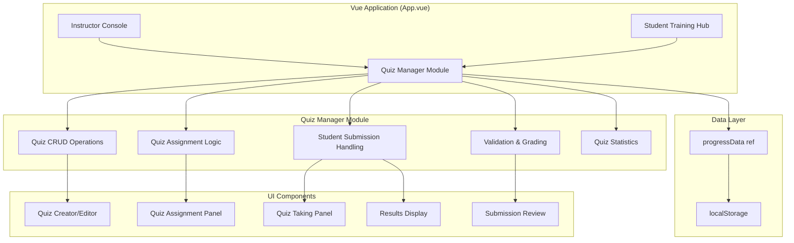

# Design Document: Instructor Quiz Management System

## Overview

The Instructor Quiz Management System extends HelmQuest's existing instructor console and student training hub with comprehensive quiz/assessment capabilities. The system enables instructors to author quizzes with multiple question types (multiple-choice, true-false, fill-in-the-blank), assign them to training modules or missions, and validate student submissions with automated grading support.

The design integrates seamlessly with HelmQuest's existing Vue.js architecture, Three.js simulation, localStorage-based persistence (via `progressData`), and reactive state management patterns using Vue's Composition API (`ref()` and `computed()`).

### Key Design Principles

1. **Non-Disruptive Integration**: Quiz functionality layers onto existing instructor console and student training hub without modifying core simulation or mission logic
2. **Consistent UI Patterns**: Follows established HelmQuest design patterns for panels, cards, forms, and modals
3. **Reuse Existing Infrastructure**: Leverages `progressData` storage, authentication, role-based access, and reactive state management
4. **Instructor-Centric Workflow**: Instructors create, assign, review, and validate; students consume and submit
5. **Extensibility**: Data models support future enhancements (e.g., question banks, randomized quizzes, timed assessments)


## Architecture

### System Components




### Module Organization

The quiz system will be implemented as a cohesive module within `App.vue` following the existing pattern:

1. **State Management**: Reactive refs and computed properties at the top level of the `<script setup>` block
2. **Helper Functions**: Quiz CRUD, assignment, grading, and statistics functions defined in the script section
3. **UI Integration**: Quiz panels rendered conditionally within existing instructor console and student training hub sections
4. **Persistence**: All quiz data stored in `progressData.value.quizzes`, synchronized to localStorage via `saveProgress()`

No new .vue component files are required initially; all UI will be inline in App.vue using the existing glass-card, panel, and modal patterns.

### Data Flow

1. **Quiz Creation Flow**:
   - Instructor clicks "Create Quiz" → New quiz object created in memory → Instructor edits fields → Save triggers `saveProgress(progressData.value)`

2. **Quiz Assignment Flow**:
   - Instructor selects quiz → Selects target module/mission → Assignment record created → Persisted to `progressData.value.quizAssignments`

3. **Student Submission Flow**:
   - Student views module/mission → Sees assigned quizzes → Takes quiz → Answers stored in memory → Submit creates submission record → Persisted to `progressData.value.quizSubmissions`

4. **Validation Flow**:
   - Instructor views pending submissions → Opens submission detail → Reviews answers → Marks correct/incorrect (auto-validation pre-populated) → Adds feedback → Save creates result record → Persisted to `progressData.value.quizResults`


## Components and Interfaces

### UI Component Breakdown

#### 1. Quiz Management Panel (Instructor Console)

**Location**: Rendered within `activeScreen === 'dashboard' && userRole === 'instructor'` after the existing instructor panels

**Structure**:
```html
<section class="instructor-panel quiz-management-panel">
  <h2 class="instructor-panel-title">Quiz Management</h2>
  <div class="quiz-actions">
    <button class="quiz-create-btn" @click="createNewQuiz">+ Create Quiz</button>
  </div>
  <div class="quiz-list">
    <article v-for="quiz in quizzes" :key="quiz.id" class="quiz-card">
      <!-- Quiz title, description, question count -->
      <div class="quiz-actions-row">
        <button @click="editQuiz(quiz)">Edit</button>
        <button @click="deleteQuiz(quiz)">Delete</button>
        <button @click="openQuizAssignments(quiz)">Assign</button>
      </div>
    </article>
  </div>
</section>
```

**Styling**: Follows existing `.instructor-panel`, `.instructor-table`, `.instructor-stat-card` patterns


#### 2. Quiz Editor Modal

**Location**: Overlay modal similar to the existing instructor review modal

**Structure**:
```html
<div v-if="quizEditorModal" class="quiz-editor-overlay">
  <div class="quiz-editor-card glass-card">
    <h2>{{ quizEditorModal.isNew ? 'Create Quiz' : 'Edit Quiz' }}</h2>
    
    <div class="quiz-editor-form">
      <label class="form-field">
        <span>Quiz Title</span>
        <input v-model="quizEditorModal.quiz.title" />
      </label>
      
      <label class="form-field">
        <span>Description</span>
        <textarea v-model="quizEditorModal.quiz.description"></textarea>
      </label>
      
      <div class="quiz-questions-section">
        <h3>Questions</h3>
        <div v-for="(q, idx) in quizEditorModal.quiz.questions" :key="idx" class="question-editor">
          <label class="form-field">
            <span>Question {{ idx + 1 }}</span>
            <textarea v-model="q.prompt"></textarea>
          </label>
          
          <label class="form-field">
            <span>Type</span>
            <select v-model="q.type" @change="resetAnswers(q)">
              <option value="multiple-choice">Multiple Choice</option>
              <option value="true-false">True/False</option>
              <option value="fill-in-the-blank">Fill in the Blank</option>
            </select>
          </label>
          
          <!-- Dynamic answer options based on type -->
          <div v-if="q.type === 'multiple-choice'" class="mc-options">
            <!-- ... multiple choice editor ... -->
          </div>
          
          <button @click="deleteQuestion(idx)">Remove Question</button>
        </div>
        
        <button @click="addQuestion">+ Add Question</button>
      </div>
    </div>
    
    <div class="quiz-editor-actions">
      <button @click="saveQuiz">Save</button>
      <button @click="closeQuizEditor">Cancel</button>
    </div>
  </div>
</div>
```


#### 3. Quiz Assignment Modal

**Location**: Overlay modal for linking quizzes to modules/missions

**Structure**:
```html
<div v-if="quizAssignmentModal" class="quiz-assignment-overlay">
  <div class="quiz-assignment-card glass-card">
    <h2>Assign Quiz: {{ quizAssignmentModal.quiz.title }}</h2>
    
    <div class="assignment-selector">
      <label class="form-field">
        <span>Target Type</span>
        <select v-model="quizAssignmentModal.targetType">
          <option value="module">Training Module</option>
          <option value="mission">Training Mission</option>
        </select>
      </label>
      
      <label class="form-field">
        <span>Select {{ quizAssignmentModal.targetType === 'module' ? 'Module' : 'Mission' }}</span>
        <select v-model="quizAssignmentModal.targetId">
          <option v-for="target in availableTargets" :key="target.id" :value="target.id">
            {{ target.title }}
          </option>
        </select>
      </label>
      
      <button @click="createAssignment">Assign</button>
    </div>
    
    <div class="current-assignments">
      <h3>Current Assignments</h3>
      <ul>
        <li v-for="assignment in currentAssignments" :key="assignment.id">
          {{ assignment.targetTitle }}
          <button @click="removeAssignment(assignment.id)">Remove</button>
        </li>
      </ul>
    </div>
    
    <button @click="closeQuizAssignment">Close</button>
  </div>
</div>
```


#### 4. Student Quiz Display (Training Hub)

**Location**: Within existing training module cards in `activeScreen === 'dashboard' && userRole === 'student'`

**Structure**:
```html
<!-- Inside each training-card -->
<div class="module-quizzes" v-if="getAssignedQuizzes(module.id).length > 0">
  <h4>Assessments</h4>
  <div v-for="quiz in getAssignedQuizzes(module.id)" :key="quiz.id" class="quiz-badge">
    <span class="quiz-title">{{ quiz.title }}</span>
    <span class="quiz-status" :class="getQuizStatusClass(quiz.id)">
      {{ getQuizStatusLabel(quiz.id) }}
    </span>
    <button v-if="canTakeQuiz(quiz.id)" @click="startQuiz(quiz)">Take Quiz</button>
    <button v-if="isQuizGraded(quiz.id)" @click="viewQuizResults(quiz)">View Results</button>
  </div>
</div>
```

**Status Labels**:
- "Not Started" (gray badge)
- "Pending Review" (yellow badge)
- "Graded: X%" (green if passed, red if failed)


#### 5. Quiz Taking Interface (Student)

**Location**: Full-screen overlay similar to the mission briefing screen

**Structure**:
```html
<div v-if="activeQuizSession" class="quiz-taking-overlay">
  <div class="quiz-taking-shell">
    <header class="quiz-header">
      <h1>{{ activeQuizSession.quiz.title }}</h1>
      <p>{{ activeQuizSession.quiz.description }}</p>
    </header>
    
    <div class="quiz-questions">
      <div v-for="(q, idx) in activeQuizSession.quiz.questions" :key="idx" class="quiz-question">
        <h3>{{ idx + 1 }}. {{ q.prompt }}</h3>
        
        <!-- Multiple Choice -->
        <div v-if="q.type === 'multiple-choice'" class="mc-answers">
          <label v-for="(option, optIdx) in q.options" :key="optIdx" class="mc-option">
            <input 
              type="radio" 
              :name="'question-' + idx" 
              :value="option.text"
              v-model="activeQuizSession.answers[idx]"
            />
            <span>{{ option.text }}</span>
          </label>
        </div>
        
        <!-- True/False -->
        <div v-if="q.type === 'true-false'" class="tf-answers">
          <label class="tf-option">
            <input type="radio" :name="'question-' + idx" value="True" v-model="activeQuizSession.answers[idx]" />
            <span>True</span>
          </label>
          <label class="tf-option">
            <input type="radio" :name="'question-' + idx" value="False" v-model="activeQuizSession.answers[idx]" />
            <span>False</span>
          </label>
        </div>
        
        <!-- Fill in the Blank -->
        <div v-if="q.type === 'fill-in-the-blank'" class="fib-answer">
          <input type="text" v-model="activeQuizSession.answers[idx]" placeholder="Your answer..." />
        </div>
      </div>
    </div>
    
    <div class="quiz-footer">
      <button :disabled="!allQuestionsAnswered" @click="submitQuiz">Submit Quiz</button>
      <button @click="cancelQuiz">Cancel</button>
    </div>
  </div>
</div>
```


#### 6. Submission Review Panel (Instructor)

**Location**: New section in instructor console below student table

**Structure**:
```html
<section class="instructor-panel quiz-submissions-panel">
  <h2 class="instructor-panel-title">Quiz Submissions</h2>
  
  <div class="submission-filters">
    <select v-model="submissionFilter.status">
      <option value="all">All Submissions</option>
      <option value="pending">Pending Review</option>
      <option value="graded">Graded</option>
    </select>
    
    <select v-model="submissionFilter.student">
      <option value="all">All Students</option>
      <option v-for="student in instructorStudents" :key="student.id" :value="student.id">
        {{ student.name }}
      </option>
    </select>
    
    <select v-model="submissionFilter.quiz">
      <option value="all">All Quizzes</option>
      <option v-for="quiz in quizzes" :key="quiz.id" :value="quiz.id">
        {{ quiz.title }}
      </option>
    </select>
  </div>
  
  <div class="submission-list">
    <article v-for="sub in filteredSubmissions" :key="sub.id" class="submission-card">
      <div class="submission-header">
        <span class="submission-student">{{ sub.studentName }}</span>
        <span class="submission-quiz">{{ sub.quizTitle }}</span>
        <span class="submission-date">{{ formatDate(sub.submittedAt) }}</span>
        <span class="submission-status" :class="sub.status">{{ sub.status }}</span>
      </div>
      <button @click="reviewSubmission(sub)">Review</button>
    </article>
  </div>
</section>
```


#### 7. Submission Grading Modal (Instructor)

**Location**: Overlay modal for detailed submission review

**Structure**:
```html
<div v-if="gradingModal" class="grading-overlay">
  <div class="grading-card glass-card">
    <h2>Review Submission: {{ gradingModal.studentName }}</h2>
    <h3>{{ gradingModal.quizTitle }}</h3>
    <p>Submitted: {{ formatDate(gradingModal.submittedAt) }}</p>
    
    <div class="grading-questions">
      <div v-for="(q, idx) in gradingModal.questions" :key="idx" class="grading-question">
        <h4>{{ idx + 1 }}. {{ q.prompt }}</h4>
        <p class="student-answer">
          <strong>Student Answer:</strong> {{ gradingModal.answers[idx] }}
        </p>
        <p class="correct-answer">
          <strong>Correct Answer:</strong> {{ q.correctAnswer }}
        </p>
        
        <label class="validation-toggle">
          <input type="checkbox" v-model="gradingModal.validation[idx]" />
          <span>Mark as Correct</span>
        </label>
      </div>
    </div>
    
    <div class="grading-score">
      <strong>Score:</strong> {{ calculateScore() }}%
    </div>
    
    <label class="form-field">
      <span>Instructor Feedback (optional)</span>
      <textarea v-model="gradingModal.feedback"></textarea>
    </label>
    
    <div class="grading-actions">
      <button @click="submitGrading">Save & Grade</button>
      <button @click="closeGrading">Cancel</button>
    </div>
  </div>
</div>
```


#### 8. Quiz Results View (Student)

**Location**: Modal overlay showing graded quiz results

**Structure**:
```html
<div v-if="quizResultsModal" class="quiz-results-overlay">
  <div class="quiz-results-card glass-card">
    <h2>Quiz Results: {{ quizResultsModal.quizTitle }}</h2>
    
    <div class="results-summary">
      <div class="result-score">
        <span class="score-label">Your Score</span>
        <span class="score-value" :class="quizResultsModal.passed ? 'pass' : 'fail'">
          {{ quizResultsModal.score }}%
        </span>
      </div>
      <p class="graded-date">Graded on {{ formatDate(quizResultsModal.gradedAt) }}</p>
      <p v-if="quizResultsModal.feedback" class="instructor-feedback">
        <strong>Instructor Feedback:</strong> {{ quizResultsModal.feedback }}
      </p>
    </div>
    
    <div class="results-breakdown">
      <h3>Question Breakdown</h3>
      <div v-for="(q, idx) in quizResultsModal.questions" :key="idx" class="result-question">
        <h4>{{ idx + 1 }}. {{ q.prompt }}</h4>
        <p class="your-answer" :class="quizResultsModal.validation[idx] ? 'correct' : 'incorrect'">
          <strong>Your Answer:</strong> {{ quizResultsModal.answers[idx] }}
          <span class="result-icon">{{ quizResultsModal.validation[idx] ? '✓' : '✗' }}</span>
        </p>
        <p v-if="!quizResultsModal.validation[idx]" class="correct-answer-reveal">
          <strong>Correct Answer:</strong> {{ q.correctAnswer }}
        </p>
      </div>
    </div>
    
    <div class="results-actions">
      <button @click="closeResults">Close</button>
      <button v-if="canRetakeQuiz" @click="retakeQuiz">Retake Quiz</button>
    </div>
  </div>
</div>
```


#### 9. Quiz Statistics Panel (Instructor)

**Location**: New section in instructor console

**Structure**:
```html
<section class="instructor-panel quiz-stats-panel">
  <h2 class="instructor-panel-title">Quiz Statistics</h2>
  
  <div class="quiz-stats-grid">
    <article v-for="quiz in quizzesWithStats" :key="quiz.id" class="quiz-stat-card">
      <h3>{{ quiz.title }}</h3>
      <div class="stat-row">
        <span class="stat-label">Average Score:</span>
        <span class="stat-value">{{ quiz.averageScore }}%</span>
      </div>
      <div class="stat-row">
        <span class="stat-label">Submissions:</span>
        <span class="stat-value">{{ quiz.submissionCount }}</span>
      </div>
      <div class="stat-row">
        <span class="stat-label">Pending Review:</span>
        <span class="stat-value">{{ quiz.pendingCount }}</span>
      </div>
      
      <button @click="viewQuizDetails(quiz)">View Details</button>
    </article>
  </div>
</section>
```


## Data Models

### Quiz Data Structure

```typescript
interface Quiz {
  id: string;                    // Unique identifier (e.g., "quiz-1234567890")
  title: string;                 // Quiz title
  description: string;           // Quiz description/instructions
  questions: Question[];         // Array of questions
  createdAt: string;            // ISO timestamp
  createdBy: string;            // Instructor ID
  updatedAt: string;            // ISO timestamp
}

interface Question {
  id: string;                    // Unique identifier within quiz
  prompt: string;                // Question text
  type: QuestionType;           // Question format
  options?: MultipleChoiceOption[];  // For multiple-choice only
  correctAnswer: string;        // Correct answer text
  order: number;                // Display order (0-indexed)
}

type QuestionType = 'multiple-choice' | 'true-false' | 'fill-in-the-blank';

interface MultipleChoiceOption {
  text: string;                 // Option text
  isCorrect: boolean;           // Whether this is the correct answer
}
```


### Quiz Assignment Data Structure

```typescript
interface QuizAssignment {
  id: string;                    // Unique identifier (e.g., "assignment-1234567890")
  quizId: string;               // Reference to Quiz
  targetType: 'module' | 'mission';  // What the quiz is assigned to
  targetId: string;             // Module ID (e.g., "m1-mission1") or Mission ID (e.g., "M1-1")
  createdAt: string;            // ISO timestamp
  createdBy: string;            // Instructor ID
}
```

### Student Submission Data Structure

```typescript
interface QuizSubmission {
  id: string;                    // Unique identifier (e.g., "submission-1234567890")
  quizId: string;               // Reference to Quiz
  studentId: string;            // Student ID
  studentName: string;          // Student display name
  answers: string[];            // Student answers (index matches question order)
  submittedAt: string;          // ISO timestamp
  status: 'pending' | 'graded'; // Validation status
}
```


### Quiz Result Data Structure

```typescript
interface QuizResult {
  id: string;                    // Unique identifier (e.g., "result-1234567890")
  submissionId: string;         // Reference to QuizSubmission
  quizId: string;               // Reference to Quiz
  studentId: string;            // Student ID
  score: number;                // Percentage (0-100)
  validation: boolean[];        // Array of correct/incorrect flags (index matches question order)
  feedback?: string;            // Optional instructor feedback
  gradedAt: string;             // ISO timestamp
  gradedBy: string;             // Instructor ID
}
```

### progressData Schema Extension

The existing `progressData` object will be extended with quiz-related fields:

```typescript
interface ProgressData {
  // Existing fields...
  students: Student[];
  sessions: MissionSession[];
  completedModules: Record<string, string[]>;
  studentProfiles: Record<string, StudentProfile>;
  courseSettings: CourseSettings;
  
  // New quiz fields
  quizzes?: Quiz[];
  quizAssignments?: QuizAssignment[];
  quizSubmissions?: QuizSubmission[];
  quizResults?: QuizResult[];
}
```


### Data Initialization

On application load, if `progressData.value` lacks quiz fields, they will be initialized:

```javascript
function ensureQuizData(progress) {
  if (!progress.quizzes) progress.quizzes = [];
  if (!progress.quizAssignments) progress.quizAssignments = [];
  if (!progress.quizSubmissions) progress.quizSubmissions = [];
  if (!progress.quizResults) progress.quizResults = [];
}

// Called during loadProgress()
progressData.value = loadProgress();
ensureQuizData(progressData.value);
```


## Core Functions and Logic

### Quiz CRUD Operations

#### Create Quiz

```javascript
function createNewQuiz() {
  const quiz = {
    id: `quiz-${Date.now()}-${Math.random().toString(36).slice(2, 7)}`,
    title: '',
    description: '',
    questions: [],
    createdAt: new Date().toISOString(),
    createdBy: currentUser.value.id,
    updatedAt: new Date().toISOString()
  };
  
  quizEditorModal.value = {
    isNew: true,
    quiz: JSON.parse(JSON.stringify(quiz))
  };
}
```

#### Save Quiz

```javascript
function saveQuiz() {
  ensureQuizData(progressData.value);
  
  const quiz = quizEditorModal.value.quiz;
  quiz.updatedAt = new Date().toISOString();
  
  if (quizEditorModal.value.isNew) {
    progressData.value.quizzes.push(quiz);
  } else {
    const idx = progressData.value.quizzes.findIndex(q => q.id === quiz.id);
    if (idx !== -1) {
      progressData.value.quizzes[idx] = quiz;
    }
  }
  
  saveProgress(progressData.value);
  quizEditorModal.value = null;
}
```

#### Edit Quiz

```javascript
function editQuiz(quiz) {
  quizEditorModal.value = {
    isNew: false,
    quiz: JSON.parse(JSON.stringify(quiz))
  };
}
```

#### Delete Quiz

```javascript
function deleteQuiz(quiz) {
  if (!confirm(`Delete quiz "${quiz.title}"? This will remove all assignments but preserve student submissions.`)) {
    return;
  }
  
  ensureQuizData(progressData.value);
  
  // Remove quiz
  progressData.value.quizzes = progressData.value.quizzes.filter(q => q.id !== quiz.id);
  
  // Remove all assignments for this quiz
  progressData.value.quizAssignments = progressData.value.quizAssignments.filter(
    a => a.quizId !== quiz.id
  );
  
  saveProgress(progressData.value);
}
```

#### Add Question to Quiz

```javascript
function addQuestion() {
  const question = {
    id: `question-${Date.now()}-${Math.random().toString(36).slice(2, 7)}`,
    prompt: '',
    type: 'multiple-choice',
    options: [
      { text: '', isCorrect: false },
      { text: '', isCorrect: false }
    ],
    correctAnswer: '',
    order: quizEditorModal.value.quiz.questions.length
  };
  
  quizEditorModal.value.quiz.questions.push(question);
}
```

#### Delete Question from Quiz

```javascript
function deleteQuestion(index) {
  quizEditorModal.value.quiz.questions.splice(index, 1);
  
  // Re-index remaining questions
  quizEditorModal.value.quiz.questions.forEach((q, idx) => {
    q.order = idx;
  });
}
```

#### Reset Answer Options on Type Change

```javascript
function resetAnswers(question) {
  if (question.type === 'multiple-choice') {
    question.options = [
      { text: '', isCorrect: false },
      { text: '', isCorrect: false }
    ];
    question.correctAnswer = '';
  } else if (question.type === 'true-false') {
    question.options = [];
    question.correctAnswer = 'True';
  } else if (question.type === 'fill-in-the-blank') {
    question.options = [];
    question.correctAnswer = '';
  }
}
```


### Quiz Assignment Operations

#### Get Assigned Quizzes for Module/Mission

```javascript
function getAssignedQuizzes(targetId) {
  ensureQuizData(progressData.value);
  
  const assignments = progressData.value.quizAssignments.filter(
    a => a.targetId === targetId
  );
  
  return assignments.map(assignment => {
    return progressData.value.quizzes.find(q => q.id === assignment.quizId);
  }).filter(Boolean);
}
```

#### Create Quiz Assignment

```javascript
function createAssignment() {
  ensureQuizData(progressData.value);
  
  const assignment = {
    id: `assignment-${Date.now()}-${Math.random().toString(36).slice(2, 7)}`,
    quizId: quizAssignmentModal.value.quiz.id,
    targetType: quizAssignmentModal.value.targetType,
    targetId: quizAssignmentModal.value.targetId,
    createdAt: new Date().toISOString(),
    createdBy: currentUser.value.id
  };
  
  // Check for duplicate assignment
  const exists = progressData.value.quizAssignments.some(
    a => a.quizId === assignment.quizId && 
         a.targetId === assignment.targetId &&
         a.targetType === assignment.targetType
  );
  
  if (exists) {
    alert('This quiz is already assigned to this module/mission.');
    return;
  }
  
  progressData.value.quizAssignments.push(assignment);
  saveProgress(progressData.value);
  
  // Refresh assignment list
  loadCurrentAssignments();
}
```

#### Remove Quiz Assignment

```javascript
function removeAssignment(assignmentId) {
  ensureQuizData(progressData.value);
  
  progressData.value.quizAssignments = progressData.value.quizAssignments.filter(
    a => a.id !== assignmentId
  );
  
  saveProgress(progressData.value);
  loadCurrentAssignments();
}
```

#### Get Current Assignments for Quiz

```javascript
function loadCurrentAssignments() {
  ensureQuizData(progressData.value);
  
  const assignments = progressData.value.quizAssignments.filter(
    a => a.quizId === quizAssignmentModal.value.quiz.id
  );
  
  quizAssignmentModal.value.currentAssignments = assignments.map(a => {
    let targetTitle = 'Unknown';
    
    if (a.targetType === 'module') {
      const module = trainingModules.value.find(m => m.id === a.targetId);
      if (module) targetTitle = module.title;
    } else if (a.targetType === 'mission') {
      const mission = navigationMissions.find(m => m.id === a.targetId);
      if (mission) targetTitle = mission.title;
    }
    
    return {
      id: a.id,
      targetTitle: targetTitle,
      targetType: a.targetType
    };
  });
}
```


### Student Submission Operations

#### Get Quiz Status for Student

```javascript
function getQuizStatusLabel(quizId) {
  const studentId = currentUser.value?.id;
  if (!studentId) return 'Not Started';
  
  ensureQuizData(progressData.value);
  
  const submission = progressData.value.quizSubmissions.find(
    s => s.quizId === quizId && s.studentId === studentId
  );
  
  if (!submission) return 'Not Started';
  
  if (submission.status === 'pending') return 'Pending Review';
  
  const result = progressData.value.quizResults.find(
    r => r.submissionId === submission.id
  );
  
  if (result) return `Graded: ${result.score}%`;
  
  return 'Not Started';
}
```

#### Check if Student Can Take Quiz

```javascript
function canTakeQuiz(quizId) {
  const studentId = currentUser.value?.id;
  if (!studentId) return false;
  
  ensureQuizData(progressData.value);
  
  const submission = progressData.value.quizSubmissions.find(
    s => s.quizId === quizId && s.studentId === studentId
  );
  
  // Can take if no submission exists, or if submission is graded (retake allowed)
  return !submission || submission.status === 'graded';
}
```

#### Start Quiz

```javascript
function startQuiz(quiz) {
  activeQuizSession.value = {
    quiz: JSON.parse(JSON.stringify(quiz)),
    answers: new Array(quiz.questions.length).fill(''),
    startedAt: new Date().toISOString()
  };
}
```

#### Check if All Questions Answered

```javascript
const allQuestionsAnswered = computed(() => {
  if (!activeQuizSession.value) return false;
  return activeQuizSession.value.answers.every(answer => answer !== '');
});
```

#### Submit Quiz

```javascript
function submitQuiz() {
  if (!allQuestionsAnswered.value) return;
  
  ensureQuizData(progressData.value);
  
  const studentId = currentUser.value.id;
  const quizId = activeQuizSession.value.quiz.id;
  
  // Check if submission already exists (retake scenario)
  let submission = progressData.value.quizSubmissions.find(
    s => s.quizId === quizId && s.studentId === studentId
  );
  
  if (submission) {
    // Update existing submission (retake)
    submission.answers = [...activeQuizSession.value.answers];
    submission.submittedAt = new Date().toISOString();
    submission.status = 'pending';
    
    // Remove old result if exists
    progressData.value.quizResults = progressData.value.quizResults.filter(
      r => r.submissionId !== submission.id
    );
  } else {
    // Create new submission
    submission = {
      id: `submission-${Date.now()}-${Math.random().toString(36).slice(2, 7)}`,
      quizId: quizId,
      studentId: studentId,
      studentName: currentUser.value.name,
      answers: [...activeQuizSession.value.answers],
      submittedAt: new Date().toISOString(),
      status: 'pending'
    };
    
    progressData.value.quizSubmissions.push(submission);
  }
  
  saveProgress(progressData.value);
  
  activeQuizSession.value = null;
  
  alert('Quiz submitted successfully! Your instructor will review your answers.');
}
```

#### Cancel Quiz

```javascript
function cancelQuiz() {
  if (confirm('Are you sure you want to cancel? Your answers will not be saved.')) {
    activeQuizSession.value = null;
  }
}
```


### Instructor Validation and Grading Operations

#### Get Filtered Submissions

```javascript
const filteredSubmissions = computed(() => {
  ensureQuizData(progressData.value);
  
  let submissions = progressData.value.quizSubmissions;
  
  // Filter by status
  if (submissionFilter.value.status !== 'all') {
    submissions = submissions.filter(s => s.status === submissionFilter.value.status);
  }
  
  // Filter by student
  if (submissionFilter.value.student !== 'all') {
    submissions = submissions.filter(s => s.studentId === submissionFilter.value.student);
  }
  
  // Filter by quiz
  if (submissionFilter.value.quiz !== 'all') {
    submissions = submissions.filter(s => s.quizId === submissionFilter.value.quiz);
  }
  
  // Enrich with quiz title
  return submissions.map(s => {
    const quiz = progressData.value.quizzes.find(q => q.id === s.quizId);
    return {
      ...s,
      quizTitle: quiz?.title || 'Unknown Quiz'
    };
  });
});
```

#### Review Submission (Open Grading Modal)

```javascript
function reviewSubmission(submission) {
  ensureQuizData(progressData.value);
  
  const quiz = progressData.value.quizzes.find(q => q.id === submission.quizId);
  if (!quiz) return;
  
  // Perform automatic validation
  const validation = quiz.questions.map((q, idx) => {
    return validateAnswer(q, submission.answers[idx]);
  });
  
  gradingModal.value = {
    submissionId: submission.id,
    quizId: submission.quizId,
    studentId: submission.studentId,
    studentName: submission.studentName,
    quizTitle: quiz.title,
    questions: quiz.questions,
    answers: submission.answers,
    validation: validation,
    feedback: '',
    submittedAt: submission.submittedAt
  };
}
```

#### Automatic Answer Validation

```javascript
function validateAnswer(question, studentAnswer) {
  if (question.type === 'multiple-choice') {
    const correctOption = question.options.find(opt => opt.isCorrect);
    return correctOption?.text === studentAnswer;
  } else if (question.type === 'true-false') {
    return question.correctAnswer === studentAnswer;
  } else if (question.type === 'fill-in-the-blank') {
    // Case-insensitive text matching
    return question.correctAnswer.trim().toLowerCase() === studentAnswer.trim().toLowerCase();
  }
  return false;
}
```

#### Calculate Score

```javascript
function calculateScore() {
  if (!gradingModal.value) return 0;
  
  const correctCount = gradingModal.value.validation.filter(v => v).length;
  const totalQuestions = gradingModal.value.validation.length;
  
  if (totalQuestions === 0) return 0;
  
  return Math.round((correctCount / totalQuestions) * 100);
}
```

#### Submit Grading

```javascript
function submitGrading() {
  ensureQuizData(progressData.value);
  
  const result = {
    id: `result-${Date.now()}-${Math.random().toString(36).slice(2, 7)}`,
    submissionId: gradingModal.value.submissionId,
    quizId: gradingModal.value.quizId,
    studentId: gradingModal.value.studentId,
    score: calculateScore(),
    validation: [...gradingModal.value.validation],
    feedback: gradingModal.value.feedback,
    gradedAt: new Date().toISOString(),
    gradedBy: currentUser.value.id
  };
  
  progressData.value.quizResults.push(result);
  
  // Update submission status
  const submission = progressData.value.quizSubmissions.find(
    s => s.id === gradingModal.value.submissionId
  );
  if (submission) {
    submission.status = 'graded';
  }
  
  saveProgress(progressData.value);
  gradingModal.value = null;
  
  alert('Quiz graded successfully!');
}
```


### Student Results Access Operations

#### View Quiz Results

```javascript
function viewQuizResults(quiz) {
  ensureQuizData(progressData.value);
  
  const studentId = currentUser.value.id;
  
  const submission = progressData.value.quizSubmissions.find(
    s => s.quizId === quiz.id && s.studentId === studentId
  );
  
  if (!submission) return;
  
  const result = progressData.value.quizResults.find(
    r => r.submissionId === submission.id
  );
  
  if (!result) return;
  
  quizResultsModal.value = {
    quizTitle: quiz.title,
    questions: quiz.questions,
    answers: submission.answers,
    validation: result.validation,
    score: result.score,
    passed: result.score >= 70, // Assuming 70% pass threshold
    feedback: result.feedback,
    gradedAt: result.gradedAt
  };
}
```

#### Check if Student Can Retake Quiz

```javascript
const canRetakeQuiz = computed(() => {
  if (!quizResultsModal.value) return false;
  // Allow retakes for all graded quizzes
  return true;
});
```

#### Retake Quiz

```javascript
function retakeQuiz() {
  const quizId = quizResultsModal.value.quizId;
  const quiz = progressData.value.quizzes.find(q => q.id === quizId);
  
  quizResultsModal.value = null;
  
  if (quiz) {
    startQuiz(quiz);
  }
}
```


### Quiz Statistics Operations

#### Calculate Quiz Statistics

```javascript
const quizzesWithStats = computed(() => {
  ensureQuizData(progressData.value);
  
  return progressData.value.quizzes.map(quiz => {
    const submissions = progressData.value.quizSubmissions.filter(s => s.quizId === quiz.id);
    const results = progressData.value.quizResults.filter(r => r.quizId === quiz.id);
    
    const averageScore = results.length > 0
      ? results.reduce((sum, r) => sum + r.score, 0) / results.length
      : 0;
    
    const pendingCount = submissions.filter(s => s.status === 'pending').length;
    
    return {
      ...quiz,
      averageScore: averageScore.toFixed(1),
      submissionCount: submissions.length,
      pendingCount: pendingCount
    };
  });
});
```

#### Calculate Per-Question Statistics

```javascript
function calculateQuestionStats(quiz) {
  ensureQuizData(progressData.value);
  
  const results = progressData.value.quizResults.filter(r => r.quizId === quiz.id);
  
  if (results.length === 0) return [];
  
  return quiz.questions.map((question, idx) => {
    const correctCount = results.filter(r => r.validation[idx]).length;
    const percentage = (correctCount / results.length) * 100;
    
    return {
      questionNumber: idx + 1,
      prompt: question.prompt,
      correctPercentage: percentage.toFixed(1),
      correctCount: correctCount,
      totalAttempts: results.length
    };
  });
}
```

#### Calculate Average Score Per Student

```javascript
function calculateStudentQuizAverages() {
  ensureQuizData(progressData.value);
  
  const studentAverages = {};
  
  progressData.value.students.forEach(student => {
    const studentResults = progressData.value.quizResults.filter(
      r => r.studentId === student.id
    );
    
    if (studentResults.length > 0) {
      const avgScore = studentResults.reduce((sum, r) => sum + r.score, 0) / studentResults.length;
      studentAverages[student.id] = {
        name: student.name,
        averageScore: avgScore.toFixed(1),
        completedQuizzes: studentResults.length
      };
    } else {
      studentAverages[student.id] = {
        name: student.name,
        averageScore: 0,
        completedQuizzes: 0
      };
    }
  });
  
  return studentAverages;
}
```


## LocalStorage Persistence Strategy

### Storage Key

Quiz data is stored within the existing `helmquest-progress-v3` localStorage key as part of the `progressData` object.

### Data Structure in localStorage

```json
{
  "students": [...],
  "sessions": [...],
  "completedModules": {...},
  "studentProfiles": {...},
  "courseSettings": {...},
  "quizzes": [
    {
      "id": "quiz-1234567890",
      "title": "Maritime Navigation Basics",
      "description": "Test your knowledge of basic navigation concepts",
      "questions": [
        {
          "id": "question-0987654321",
          "prompt": "What is the international distress signal?",
          "type": "multiple-choice",
          "options": [
            { "text": "SOS", "isCorrect": true },
            { "text": "HELP", "isCorrect": false },
            { "text": "MAYDAY", "isCorrect": false }
          ],
          "correctAnswer": "SOS",
          "order": 0
        }
      ],
      "createdAt": "2025-01-15T10:30:00.000Z",
      "createdBy": "instructor-helen",
      "updatedAt": "2025-01-15T10:30:00.000Z"
    }
  ],
  "quizAssignments": [
    {
      "id": "assignment-1234567890",
      "quizId": "quiz-1234567890",
      "targetType": "module",
      "targetId": "m1-mission1",
      "createdAt": "2025-01-15T10:35:00.000Z",
      "createdBy": "instructor-helen"
    }
  ],
  "quizSubmissions": [
    {
      "id": "submission-1234567890",
      "quizId": "quiz-1234567890",
      "studentId": "student-alex",
      "studentName": "Alex Rivera",
      "answers": ["SOS", "True", "90 degrees"],
      "submittedAt": "2025-01-15T14:20:00.000Z",
      "status": "pending"
    }
  ],
  "quizResults": [
    {
      "id": "result-1234567890",
      "submissionId": "submission-1234567890",
      "quizId": "quiz-1234567890",
      "studentId": "student-alex",
      "score": 85,
      "validation": [true, true, false],
      "feedback": "Good work! Review compass headings.",
      "gradedAt": "2025-01-15T15:00:00.000Z",
      "gradedBy": "instructor-helen"
    }
  ]
}
```

### Persistence Operations

All quiz operations follow the existing pattern:

1. **Read**: `progressData.value = loadProgress();`
2. **Modify**: Update `progressData.value.quizzes`, `progressData.value.quizAssignments`, etc.
3. **Write**: `saveProgress(progressData.value);`

### Data Migration

When loading `progressData`, the system will check for quiz fields and initialize them if missing:

```javascript
function ensureQuizData(progress) {
  if (!progress.quizzes) progress.quizzes = [];
  if (!progress.quizAssignments) progress.quizAssignments = [];
  if (!progress.quizSubmissions) progress.quizSubmissions = [];
  if (!progress.quizResults) progress.quizResults = [];
}

// Called in loadProgress normalization
export function loadProgress() {
  try {
    const raw = localStorage.getItem(STORAGE_KEY);
    if (raw) {
      const data = JSON.parse(raw);
      const normalized = normalizeProgress(data);
      ensureQuizData(normalized);
      return normalized;
    }
  } catch {
    // Ignore storage read errors and fall back to demo seed data.
  }

  const initial = normalizeProgress(defaultProgress());
  ensureQuizData(initial);
  saveProgress(initial);
  return initial;
}
```


## Error Handling

### Quiz Creation Errors

- **Empty Title**: Display inline error message, prevent save
- **No Questions**: Display warning, allow save (draft state)
- **Invalid Question Configuration**: 
  - Multiple-choice with no correct answer marked → Display error, prevent save
  - Fill-in-the-blank with empty correct answer → Display error, prevent save

### Quiz Assignment Errors

- **Duplicate Assignment**: Check before creating, display alert if quiz already assigned to target
- **Invalid Target**: Validate target ID exists in `trainingModules` or `navigationMissions`

### Student Submission Errors

- **Incomplete Answers**: Disable submit button until all questions answered
- **Network/Storage Failure**: Display error message, preserve answers in memory for retry

### Validation Errors

- **Missing Submission**: Handle gracefully if submission record not found
- **Missing Quiz**: Handle gracefully if quiz has been deleted after submission

### Result Access Errors

- **No Result Available**: Display "Not yet graded" message instead of error
- **Corrupted Data**: Validate data structure before rendering, fallback to safe display


## Testing Strategy

### Testing Approach

The quiz system will be tested using **unit tests**, **integration tests**, and **manual testing**. Property-based testing (PBT) is **NOT applicable** to this feature because:

1. **UI-Centric Feature**: Most functionality involves Vue component rendering, modal state management, and user interactions (not pure functions)
2. **CRUD Operations**: Simple create/read/update/delete operations on localStorage (not complex algorithmic transformations)
3. **State Validation**: Testing form validation, required fields, and UI state transitions (specific scenarios, not universal properties)
4. **No Universal Properties**: Behaviors are context-specific (e.g., "clicking create button opens modal") rather than universal across all inputs

**Appropriate testing strategies** for this feature:
- **Unit tests** for CRUD functions, validation logic, score calculation
- **Integration tests** for localStorage persistence, end-to-end quiz lifecycle
- **Component tests** for Vue UI state management and reactivity
- **Manual testing** for user workflows and edge cases

### Unit Tests (Vitest)

Unit tests will focus on isolated function behavior:

1. **Quiz CRUD Operations**:
   - ✅ Creating quiz with valid data creates correct structure with ID, timestamps
   - ✅ Editing quiz preserves ID and updates `updatedAt` timestamp
   - ✅ Deleting quiz removes quiz and assignments, preserves submissions
   - ✅ Adding question increments order correctly
   - ✅ Removing question re-indexes remaining questions

2. **Quiz Assignment Logic**:
   - ✅ Creating assignment links quiz to module/mission with correct IDs
   - ✅ Duplicate assignment detection prevents duplicate records
   - ✅ Removing assignment cleans up without affecting other assignments
   - ✅ Getting assigned quizzes filters by targetId correctly

3. **Submission Logic**:
   - ✅ Submitting quiz creates submission record with all required fields
   - ✅ Incomplete quiz detection works (empty answers array)
   - ✅ Retake scenario updates existing submission and removes old result
   - ✅ Quiz status calculation returns correct labels (Not Started, Pending, Graded)

4. **Validation and Grading Logic**:
   - ✅ Multiple-choice validation: compares student answer to `isCorrect` option
   - ✅ True-false validation: compares to `correctAnswer` field
   - ✅ Fill-in-the-blank validation: case-insensitive string comparison
   - ✅ Score calculation: `(correct / total) * 100` rounds correctly
   - ✅ Instructor override: manual validation flag overrides automatic result

5. **Statistics Calculations**:
   - ✅ Quiz average score calculation across all results
   - ✅ Per-question statistics: percentage of students answering correctly
   - ✅ Student average score across all quizzes
   - ✅ Submission counts (total, pending, graded) are accurate

6. **Helper Functions**:
   - ✅ `ensureQuizData()` initializes missing fields without overwriting existing data
   - ✅ `resetAnswers()` clears options correctly based on question type
   - ✅ `formatDate()` displays timestamps in readable format


### Integration Testing

Integration tests will verify end-to-end workflows and data persistence:

1. **End-to-End Quiz Lifecycle**:
   - ✅ Instructor creates quiz → Assigns to module → Student sees in training hub
   - ✅ Student takes quiz → Submits answers → Submission appears in instructor console
   - ✅ Instructor grades submission → Student sees results with correct score
   - ✅ Student retakes quiz → New submission created, old result removed

2. **localStorage Persistence**:
   - ✅ Quiz data survives page reload (save/load roundtrip)
   - ✅ Multiple students can submit same quiz independently
   - ✅ Deleting quiz preserves submissions but removes from quiz list
   - ✅ `ensureQuizData()` migration handles missing fields on old data

3. **UI State Management**:
   - ✅ Opening quiz editor modal loads quiz data correctly
   - ✅ Closing modal without saving discards changes
   - ✅ Submission filters update list reactively
   - ✅ Quiz status badges update after grading
   - ✅ Statistics panel recalculates when new results added

4. **Role-Based Access**:
   - ✅ Instructor sees quiz management panel, student does not
   - ✅ Student sees assigned quizzes, instructor does not see "Take Quiz" button
   - ✅ Quiz editor only accessible to instructors
   - ✅ Grading modal only accessible to instructors


### Component Testing (Optional)

If quiz UI is extracted into separate `.vue` components:

1. **QuizEditorModal.vue**:
   - ✅ Emits save event with correct quiz data
   - ✅ Question type change resets answer options
   - ✅ Add/remove question buttons work correctly

2. **QuizTakingInterface.vue**:
   - ✅ All questions render based on type
   - ✅ Submit button disabled until all answered
   - ✅ Cancel button prompts confirmation

3. **SubmissionReviewModal.vue**:
   - ✅ Displays auto-validation results correctly
   - ✅ Manual override checkboxes update score
   - ✅ Feedback textarea captures instructor comments


### Manual Testing Checklist

**Instructor Workflow:**

- [ ] Create quiz with multiple-choice questions (2-6 options)
- [ ] Create quiz with true-false questions
- [ ] Create quiz with fill-in-the-blank questions
- [ ] Create quiz with mix of all three question types
- [ ] Edit existing quiz and modify question text
- [ ] Edit existing quiz and change question type
- [ ] Add question to existing quiz
- [ ] Remove question from quiz with 5+ questions
- [ ] Reorder questions using drag-and-drop (if implemented)
- [ ] Delete quiz and confirm assignments removed
- [ ] Assign quiz to training module
- [ ] Assign quiz to training mission
- [ ] Assign same quiz to multiple modules
- [ ] Remove quiz assignment
- [ ] View pending submissions list
- [ ] Filter submissions by status (pending/graded)
- [ ] Filter submissions by student
- [ ] Filter submissions by quiz
- [ ] Open submission for grading
- [ ] Review auto-validation results
- [ ] Override auto-validation (mark incorrect as correct)
- [ ] Add instructor feedback
- [ ] Submit grading and verify submission status updates
- [ ] View quiz statistics panel
- [ ] View per-question statistics for a quiz
- [ ] View student average scores

**Student Workflow:**

- [ ] View training module with assigned quiz
- [ ] View training mission with assigned quiz
- [ ] See "Not Started" status badge
- [ ] Click "Take Quiz" button
- [ ] Answer multiple-choice question (select radio button)
- [ ] Answer true-false question
- [ ] Answer fill-in-the-blank question (text input)
- [ ] Try to submit quiz with incomplete answers (should be blocked)
- [ ] Complete all questions and submit
- [ ] See "Pending Review" status after submission
- [ ] See "Graded: X%" status after instructor grades
- [ ] Click "View Results" button
- [ ] Review score and feedback
- [ ] See correct/incorrect indicators for each question
- [ ] See correct answer revealed for incorrect questions
- [ ] Retake quiz after grading
- [ ] Submit retake and verify new submission created

**Edge Cases and Error Handling:**

- [ ] Create quiz with 20+ questions (performance test)
- [ ] Create multiple-choice question with 6 options (maximum)
- [ ] Fill-in-the-blank with special characters (!, @, #)
- [ ] Fill-in-the-blank with leading/trailing whitespace
- [ ] Case-insensitive matching for fill-in-the-blank (test "Answer" vs "answer")
- [ ] Multiple students submit same quiz simultaneously
- [ ] Delete quiz that has pending submissions
- [ ] Delete quiz that has graded results
- [ ] Assign quiz to locked module (student cannot access)
- [ ] Take quiz, close browser, reload (answers should be lost)
- [ ] Grade submission, close modal, verify save persisted
- [ ] Reach localStorage quota limit (test graceful degradation)
- [ ] Create quiz with empty title (should show validation error)
- [ ] Create quiz with no questions (should allow save as draft)
- [ ] Create multiple-choice with no correct answer marked (should show error)
- [ ] Submit grading with no feedback (should allow empty feedback)

**Cross-Browser Testing:**

- [ ] Test in Chrome
- [ ] Test in Firefox
- [ ] Test in Edge
- [ ] Test in Safari (if available)

**Responsive Design Testing:**

- [ ] Test on desktop (1920x1080)
- [ ] Test on laptop (1366x768)
- [ ] Test on tablet (768x1024)
- [ ] Test on mobile (375x667)


### Test Data Seeding

For testing, seed `progressData` with sample quizzes:

```javascript
const seedQuizData = {
  quizzes: [
    {
      id: 'quiz-seed-001',
      title: 'Maritime Navigation Basics',
      description: 'Test your knowledge of fundamental navigation concepts',
      questions: [
        {
          id: 'q1',
          prompt: 'What is the international distress signal?',
          type: 'multiple-choice',
          options: [
            { text: 'SOS', isCorrect: true },
            { text: 'HELP', isCorrect: false },
            { text: 'MAYDAY', isCorrect: false },
            { text: 'PAN-PAN', isCorrect: false }
          ],
          correctAnswer: 'SOS',
          order: 0
        },
        {
          id: 'q2',
          prompt: 'A nautical mile is longer than a statute mile.',
          type: 'true-false',
          options: [],
          correctAnswer: 'True',
          order: 1
        },
        {
          id: 'q3',
          prompt: 'How many degrees are in a right angle?',
          type: 'fill-in-the-blank',
          options: [],
          correctAnswer: '90',
          order: 2
        }
      ],
      createdAt: '2025-01-10T08:00:00.000Z',
      createdBy: 'instructor-helen',
      updatedAt: '2025-01-10T08:00:00.000Z'
    }
  ],
  quizAssignments: [
    {
      id: 'assignment-seed-001',
      quizId: 'quiz-seed-001',
      targetType: 'module',
      targetId: 'm1-mission1',
      createdAt: '2025-01-10T08:05:00.000Z',
      createdBy: 'instructor-helen'
    }
  ],
  quizSubmissions: [],
  quizResults: []
};
```


### Automated Test Examples

**Unit Test Example (Vitest):**

```javascript
import { describe, it, expect } from 'vitest';
import { validateAnswer } from './quizHelpers';

describe('Quiz Validation', () => {
  it('should validate multiple-choice answers correctly', () => {
    const question = {
      type: 'multiple-choice',
      options: [
        { text: 'Option A', isCorrect: true },
        { text: 'Option B', isCorrect: false }
      ]
    };
    
    expect(validateAnswer(question, 'Option A')).toBe(true);
    expect(validateAnswer(question, 'Option B')).toBe(false);
  });
  
  it('should validate fill-in-the-blank case-insensitively', () => {
    const question = {
      type: 'fill-in-the-blank',
      correctAnswer: 'SOS'
    };
    
    expect(validateAnswer(question, 'SOS')).toBe(true);
    expect(validateAnswer(question, 'sos')).toBe(true);
    expect(validateAnswer(question, 'SoS')).toBe(true);
    expect(validateAnswer(question, ' SOS ')).toBe(true); // with whitespace
  });
  
  it('should calculate score correctly', () => {
    const validation = [true, true, false, true];
    const score = (validation.filter(v => v).length / validation.length) * 100;
    
    expect(score).toBe(75);
  });
});
```

**Integration Test Example (Vitest):**

```javascript
import { describe, it, expect, beforeEach } from 'vitest';
import { loadProgress, saveProgress } from './progressStore';

describe('Quiz Persistence', () => {
  beforeEach(() => {
    localStorage.clear();
  });
  
  it('should persist quiz data to localStorage', () => {
    const progress = loadProgress();
    
    progress.quizzes = [{
      id: 'test-quiz-1',
      title: 'Test Quiz',
      questions: []
    }];
    
    saveProgress(progress);
    
    const reloaded = loadProgress();
    expect(reloaded.quizzes).toHaveLength(1);
    expect(reloaded.quizzes[0].title).toBe('Test Quiz');
  });
  
  it('should initialize quiz fields if missing', () => {
    const progress = {
      students: [],
      sessions: []
    };
    
    saveProgress(progress);
    const reloaded = loadProgress();
    
    expect(reloaded.quizzes).toEqual([]);
    expect(reloaded.quizAssignments).toEqual([]);
    expect(reloaded.quizSubmissions).toEqual([]);
    expect(reloaded.quizResults).toEqual([]);
  });
});
```


## Implementation Phases

### Phase 1: Data Models and Storage (Foundation)
- Implement `ensureQuizData()` initialization
- Add quiz interfaces to progressData schema
- Test localStorage persistence

### Phase 2: Instructor Quiz Management (CRUD)
- Implement quiz creation/editing modal
- Add quiz list display in instructor console
- Implement delete functionality
- Test quiz CRUD operations

### Phase 3: Quiz Assignment System
- Implement assignment modal
- Add assignment creation/removal
- Display assigned quizzes in student hub
- Test assignment relationships

### Phase 4: Student Quiz Taking
- Implement quiz-taking interface
- Add answer input for all question types
- Implement submission logic
- Test submission flow

### Phase 5: Instructor Grading System
- Implement submission review panel
- Add grading modal with automatic validation
- Implement score calculation
- Test grading workflow

### Phase 6: Results Display
- Implement student results view
- Add detailed question breakdown
- Test results access

### Phase 7: Statistics and Reporting
- Implement quiz statistics panel
- Add per-question statistics
- Calculate student averages
- Test statistics calculations

### Phase 8: Polish and Testing
- Add loading states and error handling
- Implement confirmation dialogs
- Add success/error notifications
- Comprehensive manual testing
- Property-based test suite


## Future Enhancements

### Question Bank System
- Centralized repository of questions
- Tag-based categorization
- Reuse questions across quizzes

### Randomized Quizzes
- Generate quiz from question bank with random selection
- Randomize question order per student
- Randomize multiple-choice option order

### Timed Assessments
- Add time limit to quizzes
- Display countdown timer
- Auto-submit when time expires

### Question Types Expansion
- Multiple-select (choose multiple correct answers)
- Matching questions
- Ordering/sequencing questions
- Image-based questions

### Advanced Grading
- Partial credit for multiple-select questions
- Weighted questions (different point values)
- Grade curves and normalization

### Analytics Dashboard
- Visual charts for quiz performance
- Trend analysis over time
- Comparative student performance

### Export and Reporting
- Export quiz results to CSV/PDF
- Generate student progress reports
- Certification generation based on quiz scores


## References

- **Existing Codebase**: `c:\Users\kevin\Capstone\capstone\src\App.vue` (Vue.js patterns, reactive state management)
- **Persistence Layer**: `c:\Users\kevin\Capstone\capstone\src\helpers\progressStore.js` (localStorage operations)
- **Requirements**: `c:\Users\kevin\Capstone\capstone\.kiro\specs\instructor-quiz-management\requirements.md`
- **Vue.js Composition API**: https://vuejs.org/api/composition-api-setup.html
- **Vitest Testing Framework**: https://vitest.dev/
- **localStorage API**: https://developer.mozilla.org/en-US/docs/Web/API/Window/localStorage

