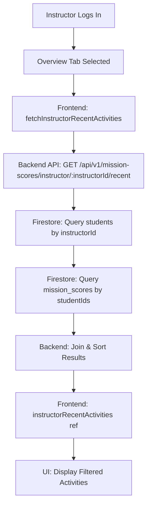
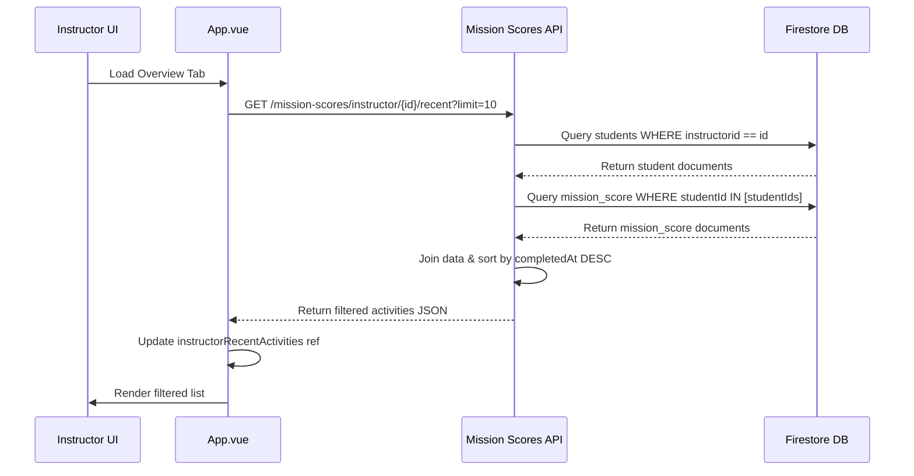

# Design Document: Instructor Recent Activities Filter

## Overview

The Recent Activities section in the instructor Overview tab currently displays ALL student mission completions from localStorage, regardless of which instructor they belong to. This design introduces a filtering mechanism to show only mission completions from students assigned to the logged-in instructor. The solution involves creating a new backend API endpoint that joins the students and mission_score collections in Firestore, filtered by instructor ID, and updating the frontend to consume this endpoint instead of localStorage data.

## Architecture



## Main Algorithm/Workflow



## Components and Interfaces

### Component 1: Backend API Endpoint

**Purpose**: Fetch recent mission completions for students assigned to a specific instructor

**Interface**:
```typescript
// GET /api/v1/mission-scores/instructor/:instructorId/recent
interface RecentActivitiesEndpoint {
  request: {
    params: {
      instructorId: string
    }
    query: {
      limit?: number  // default: 10
    }
  }
  response: {
    activities: RecentActivity[]
    count: number
  }
}
```

**Responsibilities**:
- Validate instructorId parameter
- Query students collection filtered by instructorId
- Extract student IDs from results
- Query mission_score collection filtered by student IDs
- Join student names with mission score data
- Sort by completedAt timestamp (descending)
- Limit results to requested number
- Return formatted JSON response

### Component 2: Frontend Data Fetcher

**Purpose**: Fetch filtered recent activities from backend and update reactive state

**Interface**:
```typescript
async function fetchInstructorRecentActivities(): Promise<void>
```

**Responsibilities**:
- Check if current user is an instructor
- Extract instructorId from currentUser
- Make HTTP GET request to backend endpoint
- Update instructorRecentActivities ref with response data
- Handle errors and edge cases
- Log success/failure for debugging

### Component 3: UI Display Component

**Purpose**: Render the filtered recent activities list in the instructor overview panel

**Interface**: Uses existing Vue template structure in App.vue (lines 1315-1340)

**Responsibilities**:
- Display "No student activity yet" when list is empty
- Render each activity with student name, mission title, score, and pass/fail status
- Apply appropriate CSS classes for pass/fail styling
- Use instructorRecentActivities ref instead of instructorRecentSessions computed property

## Data Models

### Model 1: RecentActivity (Frontend & Backend)

```typescript
interface RecentActivity {
  id: string              // mission_score document ID
  studentId: string       // student document ID
  studentName: string     // from students.name
  missionId: string       // e.g., "M1-1"
  missionTitle: string    // e.g., "Follow the Buoys"
  score: number           // 0-100
  passed: boolean         // true if score >= passing threshold
  completedAt: Date       // timestamp of completion
}
```

**Validation Rules**:
- id must be non-empty string
- studentId must be non-empty string
- studentName must be non-empty string
- missionId must match pattern /^M\d+-\d+$/
- missionTitle must be non-empty string
- score must be number between 0 and 100 (inclusive)
- passed must be boolean
- completedAt must be valid Date object

### Model 2: Firestore mission_score Document

```typescript
interface MissionScoreDocument {
  studentId: string
  missionId: string
  missionTitle: string
  score: number
  passed: boolean
  completedAt: Timestamp
  createdAt: Timestamp
}
```

**Validation Rules**:
- All fields are required
- studentId must exist in students collection
- score must be 0-100
- completedAt and createdAt must be valid Firestore Timestamps

### Model 3: Firestore students Document

```typescript
interface StudentDocument {
  studentId: string
  name: string
  email: string
  instructorid: string
  status: 'pending' | 'approved' | 'rejected'
  xp: number
  rank: string
  completed: number
  averageScore: number
  bestScore: number
  badgesEarned: number
  badgesTotal: number
  certificates: number
  xpProgress: number
  xpNextAt: number
  boatUsed: string
  createdAt: Timestamp
}
```

**Validation Rules**:
- instructorid must be non-empty string
- name must be non-empty string
- Only students with status 'approved' should be included in results

## Algorithmic Pseudocode

### Backend: Fetch Instructor Recent Activities

```pascal
ALGORITHM fetchInstructorRecentActivities(instructorId, limit)
INPUT: instructorId (string), limit (number, default 10)
OUTPUT: activities (array of RecentActivity objects)

PRECONDITION: instructorId is non-empty string
PRECONDITION: limit is positive integer
POSTCONDITION: activities array contains at most 'limit' items
POSTCONDITION: all activities belong to students with instructorid === instructorId
POSTCONDITION: activities are sorted by completedAt in descending order

BEGIN
  // Step 1: Query students assigned to this instructor
  studentsSnapshot ← db.collection('students')
    .where('instructorid', '==', instructorId)
    .where('status', '==', 'approved')
    .get()
  
  IF studentsSnapshot.empty THEN
    RETURN []
  END IF
  
  // Step 2: Extract student IDs and create name lookup map
  studentIds ← []
  studentNamesMap ← new Map()
  
  FOR EACH doc IN studentsSnapshot.docs DO
    studentData ← doc.data()
    studentIds.add(doc.id)
    studentNamesMap.set(doc.id, studentData.name)
  END FOR
  
  // Step 3: Query mission scores for these students
  // Note: Firestore 'in' queries support max 10 items
  // For > 10 students, batch the queries
  allActivities ← []
  
  FOR EACH batch IN batchArray(studentIds, 10) DO
    scoresSnapshot ← db.collection('mission_score')
      .where('studentId', 'in', batch)
      .orderBy('completedAt', 'desc')
      .limit(limit * 2)  // Fetch extra for post-filtering
      .get()
    
    FOR EACH doc IN scoresSnapshot.docs DO
      scoreData ← doc.data()
      activity ← {
        id: doc.id,
        studentId: scoreData.studentId,
        studentName: studentNamesMap.get(scoreData.studentId),
        missionId: scoreData.missionId,
        missionTitle: scoreData.missionTitle,
        score: scoreData.score,
        passed: scoreData.passed,
        completedAt: scoreData.completedAt
      }
      allActivities.add(activity)
    END FOR
  END FOR
  
  // Step 4: Sort all activities by completedAt descending
  allActivities.sort((a, b) => b.completedAt - a.completedAt)
  
  // Step 5: Limit to requested number
  activities ← allActivities.slice(0, limit)
  
  RETURN activities
END
```

**Loop Invariants**:
- studentIds contains only IDs from students with matching instructorId
- studentNamesMap keys correspond to entries in studentIds
- allActivities contains only mission scores from students in studentIds

### Frontend: Fetch and Update Recent Activities

```pascal
ALGORITHM fetchInstructorRecentActivities()
INPUT: None (uses currentUser.value global)
OUTPUT: None (updates instructorRecentActivities ref)

PRECONDITION: currentUser.value is defined
PRECONDITION: currentUser.value.role === 'instructor'
PRECONDITION: currentUser.value.instructorid is non-empty string
POSTCONDITION: instructorRecentActivities.value contains filtered activities
POSTCONDITION: instructorRecentActivities.value has at most 10 items

BEGIN
  // Step 1: Validate current user
  IF currentUser.value IS NULL THEN
    console.error("No current user")
    RETURN
  END IF
  
  IF currentUser.value.role !== 'instructor' THEN
    console.error("User is not an instructor")
    RETURN
  END IF
  
  instructorId ← currentUser.value.instructorid
  
  IF instructorId IS NULL OR instructorId === '' THEN
    console.error("Instructor ID not found")
    instructorRecentActivities.value ← []
    RETURN
  END IF
  
  // Step 2: Fetch from backend
  TRY
    url ← `http://localhost:3001/api/v1/mission-scores/instructor/${instructorId}/recent?limit=10`
    response ← await fetch(url)
    
    IF NOT response.ok THEN
      THROW Error(`HTTP ${response.status}: ${response.statusText}`)
    END IF
    
    data ← await response.json()
    
    // Step 3: Update reactive ref
    instructorRecentActivities.value ← data.activities
    
    console.log(`✅ Fetched ${data.count} recent activities for instructor ${instructorId}`)
    
  CATCH error
    console.error('Error fetching instructor recent activities:', error)
    instructorRecentActivities.value ← []
  END TRY
END
```

**Error Handling**:
- Network failures: Log error, set instructorRecentActivities to empty array
- Invalid instructor ID: Log error, set instructorRecentActivities to empty array
- Backend errors: Log error, set instructorRecentActivities to empty array

## Key Functions with Formal Specifications

### Function 1: batchArray (Backend Utility)

```javascript
function batchArray(array, batchSize)
```

**Preconditions:**
- array is a non-null array
- batchSize is a positive integer

**Postconditions:**
- Returns array of arrays (batches)
- Each batch (except possibly last) has exactly batchSize elements
- Last batch may have fewer than batchSize elements
- Concatenating all batches recreates original array in order
- No elements are lost or duplicated

**Loop Invariants:**
- All previously created batches have exactly batchSize elements
- Result contains all elements from array[0] to array[i-1]

### Function 2: formatRecentActivity (Backend)

```javascript
function formatRecentActivity(missionScoreDoc, studentNamesMap)
```

**Preconditions:**
- missionScoreDoc is a valid Firestore document from mission_score collection
- studentNamesMap is a Map with studentId keys and name string values
- missionScoreDoc.data().studentId exists in studentNamesMap

**Postconditions:**
- Returns RecentActivity object with all required fields
- completedAt is converted from Firestore Timestamp to JavaScript Date
- studentName is successfully looked up from studentNamesMap
- All numeric fields are valid numbers

## Example Usage

```javascript
// Backend Route Handler (backend/routes/mission_scores.js)
router.get('/instructor/:instructorId/recent', async (req, res) => {
  try {
    const { instructorId } = req.params;
    const limit = parseInt(req.query.limit) || 10;
    
    const activities = await fetchInstructorRecentActivities(instructorId, limit);
    
    res.json({ 
      activities, 
      count: activities.length 
    });
  } catch (error) {
    console.error('Error fetching instructor recent activities:', error);
    res.status(500).json({ error: 'Server Error', message: error.message });
  }
});

// Frontend Call (src/App.vue)
async function fetchInstructorRecentActivities() {
  if (!currentUser.value || currentUser.value.role !== 'instructor') {
    return;
  }
  
  const instructorId = currentUser.value.instructorid;
  if (!instructorId) {
    instructorRecentActivities.value = [];
    return;
  }
  
  try {
    const response = await fetch(
      `http://localhost:3001/api/v1/mission-scores/instructor/${instructorId}/recent?limit=10`
    );
    
    if (!response.ok) {
      throw new Error(`HTTP ${response.status}: ${response.statusText}`);
    }
    
    const data = await response.json();
    instructorRecentActivities.value = data.activities;
    
    console.log(`✅ Fetched ${data.count} recent activities`);
  } catch (error) {
    console.error('Error fetching instructor recent activities:', error);
    instructorRecentActivities.value = [];
  }
}

// Vue Template Usage (src/App.vue)
<section v-show="instructorTab === 'overview'" class="instructor-panel">
  <h2 class="instructor-panel-title">Recent Activities</h2>
  <p v-if="!instructorRecentActivities.length" class="instructor-review-empty">
    No student activity yet.
  </p>
  <ul v-else class="instructor-recent-list">
    <li
      v-for="activity in instructorRecentActivities"
      :key="activity.id"
      class="instructor-recent-item"
    >
      <span class="instructor-recent-label">
        {{ activity.studentName }} · {{ activity.missionTitle }}
      </span>
      <span
        class="instructor-recent-score"
        :class="activity.passed ? 'instructor-recent-score--pass' : 'instructor-recent-score--fail'"
      >
        {{ activity.score }}% {{ activity.passed ? 'PASS' : 'FAIL' }}
      </span>
    </li>
  </ul>
</section>
```

## Correctness Properties

### Property 1: Instructor Isolation
**∀ instructorId, activities = fetchInstructorRecentActivities(instructorId) ⟹ ∀ activity ∈ activities, activity.studentId ∈ studentsOf(instructorId)**

*All activities returned for an instructor belong only to students assigned to that instructor.*

### Property 2: Chronological Ordering
**∀ i, j where 0 ≤ i < j < activities.length ⟹ activities[i].completedAt ≥ activities[j].completedAt**

*Activities are sorted by completion timestamp in descending order (most recent first).*

### Property 3: Limit Constraint
**activities.length ≤ limit**

*The number of returned activities never exceeds the requested limit.*

### Property 4: Data Completeness
**∀ activity ∈ activities ⟹ activity.studentName ≠ null ∧ activity.studentName ≠ ''**

*All activities have valid student names successfully joined from the students collection.*

### Property 5: Approved Students Only
**∀ activity ∈ activities ⟹ statusOf(activity.studentId) === 'approved'**

*Only activities from approved students are included in the results.*

## Error Handling

### Error Scenario 1: No Students Assigned to Instructor

**Condition**: Instructor has no approved students in their class
**Response**: Return empty array from backend, display "No student activity yet" message in UI
**Recovery**: Automatically resolves when students are approved and assigned

### Error Scenario 2: Firestore Query Failure

**Condition**: Firestore connection fails or query times out
**Response**: Catch error, log to console, return 500 status from backend
**Recovery**: Frontend displays empty list and logs error; user can refresh page to retry

### Error Scenario 3: Invalid Instructor ID

**Condition**: instructorId parameter is missing, null, or empty string
**Response**: Backend returns 400 Bad Request; frontend logs error and sets empty array
**Recovery**: Should not occur in normal operation; indicates authentication issue

### Error Scenario 4: Batch Query Limitation (>10 Students)

**Condition**: Instructor has more than 10 students (Firestore 'in' query limit)
**Response**: Split studentIds into batches of 10, execute multiple queries, merge results
**Recovery**: Automatic; user experiences no error

### Error Scenario 5: Missing Student Name in Lookup

**Condition**: mission_score references studentId that doesn't exist in students collection
**Response**: Skip that activity or use placeholder name "Unknown Student"
**Recovery**: Data integrity issue; should be prevented by proper referential constraints

## Testing Strategy

### Unit Testing Approach

**Backend Unit Tests**:
- Test `fetchInstructorRecentActivities` with mock Firestore data
- Test `batchArray` utility with arrays of various sizes (0, 5, 10, 15, 25 elements)
- Test student name lookup with missing student IDs
- Test sorting by completedAt with various timestamp combinations
- Test limit constraint with different limit values (0, 1, 5, 10, 100)
- Test empty results when instructor has no students

**Frontend Unit Tests**:
- Test `fetchInstructorRecentActivities` with mocked fetch responses
- Test error handling for network failures
- Test handling of empty response data
- Test validation of currentUser role and instructorId

**Test Coverage Goals**: 
- 90%+ line coverage for new functions
- All error paths tested
- All edge cases covered (empty arrays, single element, limit boundary)

### Property-Based Testing Approach

**Property Test Library**: fast-check (JavaScript)

**Property 1: Instructor Isolation**
```javascript
test('all returned activities belong to instructor students', async () => {
  fc.assert(fc.asyncProperty(
    fc.record({
      instructorId: fc.string(),
      studentIds: fc.array(fc.string(), { minLength: 1, maxLength: 20 }),
      otherStudentIds: fc.array(fc.string(), { minLength: 1, maxLength: 10 })
    }),
    async ({ instructorId, studentIds, otherStudentIds }) => {
      // Setup: Create students for instructor and other students
      // Setup: Create mission scores for both groups
      
      const activities = await fetchInstructorRecentActivities(instructorId, 10);
      
      // Assert: Every activity's studentId is in instructor's student list
      return activities.every(activity => 
        studentIds.includes(activity.studentId)
      );
    }
  ));
});
```

**Property 2: Chronological Ordering**
```javascript
test('activities are sorted by completedAt descending', async () => {
  fc.assert(fc.asyncProperty(
    fc.record({
      instructorId: fc.string(),
      activities: fc.array(fc.record({
        completedAt: fc.date()
      }), { minLength: 2, maxLength: 20 })
    }),
    async ({ instructorId, activities }) => {
      // Setup: Create mission scores with given timestamps
      
      const result = await fetchInstructorRecentActivities(instructorId, 20);
      
      // Assert: Each item's completedAt >= next item's completedAt
      for (let i = 0; i < result.length - 1; i++) {
        if (result[i].completedAt < result[i + 1].completedAt) {
          return false;
        }
      }
      return true;
    }
  ));
});
```

**Property 3: Limit Constraint**
```javascript
test('result never exceeds requested limit', async () => {
  fc.assert(fc.asyncProperty(
    fc.record({
      instructorId: fc.string(),
      limit: fc.integer({ min: 0, max: 50 }),
      activityCount: fc.integer({ min: 0, max: 100 })
    }),
    async ({ instructorId, limit, activityCount }) => {
      // Setup: Create activityCount mission scores
      
      const result = await fetchInstructorRecentActivities(instructorId, limit);
      
      return result.length <= limit;
    }
  ));
});
```

### Integration Testing Approach

**Integration Test 1: End-to-End Flow**
- Create test instructor in Firestore
- Create 5 approved students assigned to test instructor
- Create 5 students assigned to different instructor
- Create mission scores for both groups
- Call API endpoint
- Assert: Only activities from test instructor's students are returned
- Assert: Activities are sorted correctly
- Cleanup: Delete test data

**Integration Test 2: Real Firestore Query Performance**
- Create test instructor with 50 students
- Create 200 mission scores across those students
- Measure query execution time
- Assert: Query completes in < 2 seconds
- Assert: Correct number of results returned

## Performance Considerations

### Database Query Optimization
- **Index Creation**: Create composite index on mission_score collection: `(studentId ASC, completedAt DESC)`
- **Batch Queries**: For instructors with >10 students, use batched 'in' queries to avoid Firestore limitation
- **Limit Early**: Apply `limit()` in Firestore query before fetching data to reduce network transfer

### Caching Strategy
- **Frontend Cache**: Store fetched activities in ref for tab switching (avoid re-fetching)
- **Cache Invalidation**: Refresh when:
  - Instructor logs in
  - Overview tab is re-selected after leaving
  - After 5 minutes of inactivity (optional)
  - Manual refresh button clicked (future enhancement)

### Expected Performance
- **Query Time**: < 500ms for instructors with < 50 students
- **Query Time**: < 2s for instructors with > 50 students
- **Network Payload**: ~1-5 KB for 10 activities
- **UI Render Time**: < 50ms for 10 activities

## Security Considerations

### Authorization
- **Endpoint Protection**: Verify JWT token in request headers (future enhancement)
- **Instructor Verification**: Only allow instructors to access this endpoint
- **Data Isolation**: Ensure instructorId from JWT matches requested instructorId parameter

### Data Privacy
- **No Sensitive Data**: Response does not include student email, password, or personal details
- **Role-Based Access**: Only users with role='instructor' can call frontend fetch function
- **Student Status Filter**: Only include approved students (exclude pending/rejected)

### Input Validation
- **instructorId**: Must be non-empty string, alphanumeric + hyphens only
- **limit**: Must be positive integer between 1 and 100
- **SQL Injection**: Not applicable (using Firestore, not SQL)
- **NoSQL Injection**: Firestore SDK handles query sanitization

## Dependencies

### Backend Dependencies
- **express**: Web framework for API routing (already installed)
- **firebase-admin**: Firestore database access (already installed)
- **No new packages required**

### Frontend Dependencies
- **Vue 3**: Reactive framework (already installed)
- **fetch API**: Native browser API for HTTP requests
- **No new packages required**

### External Services
- **Google Firestore**: Database for students and mission_score collections
- **Backend API Server**: http://localhost:3001 (development)

### Configuration
- **Firestore Collection Names**:
  - `students`
  - `mission_score`
- **API Base URL**: `http://localhost:3001/api/v1` (configurable via environment variable in future)

### Firestore Security Rules (Recommendation)
```javascript
// Allow instructors to read their own students' mission scores
match /mission_score/{scoreId} {
  allow read: if request.auth != null && 
                 exists(/databases/$(database)/documents/students/$(resource.data.studentId)) &&
                 get(/databases/$(database)/documents/students/$(resource.data.studentId)).data.instructorid == request.auth.uid;
}
```
