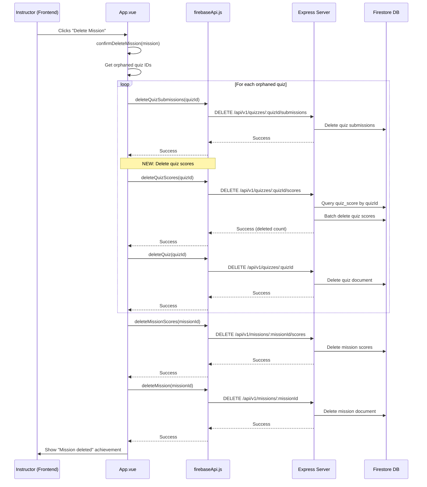

# Design Document: Mission Deletion Quiz Score Cleanup

## Overview

When an instructor deletes a mission, the system currently removes the mission document, associated quiz document, quiz submissions, and mission completion scores from Firestore. However, quiz scores stored in the `quiz_score` collection are not deleted, leaving orphaned records that reference deleted quizzes. This bugfix adds a new backend endpoint to delete quiz scores by quizId and integrates it into the frontend mission deletion flow.

## Main Algorithm/Workflow



## Core Interfaces/Types

### Backend API Endpoint

```javascript
// DELETE /api/v1/quizzes/:quizId/scores
// Request: quizId in URL params
// Response: { message: string, deletedCount: number }
```

### Frontend API Function

```javascript
// firebaseApi.js
export async function deleteQuizScores(quizId: string): Promise<{
  message: string;
  deletedCount: number;
}>
```

### Firestore Document Structure

```javascript
// quiz_score collection document
interface QuizScore {
  studentId: string;
  quizId: string;        // Foreign key to quiz document
  quizTitle: string;
  score: number;
  passed: boolean;
  totalQuestions: number;
  correctAnswers: number;
  completedAt: Date;
  createdAt: Date;
}
```

## Key Functions with Formal Specifications

### Function 1: deleteQuizScores (Backend Route Handler)

```javascript
// backend/routes/quiz_scores.js
router.delete('/:quizId/scores', async (req, res) => {
  // Implementation details in algorithmic pseudocode section
});
```

**Preconditions:**
- `req.params.quizId` is a non-empty string
- Database connection is established
- `quiz_score` collection exists in Firestore

**Postconditions:**
- All documents in `quiz_score` collection where `quizId` matches are deleted
- Returns JSON response with success message and count of deleted documents
- If error occurs, returns 500 status with error message
- No side effects on other collections

**Loop Invariants:** N/A (uses Firestore batch operation, not explicit loop)

### Function 2: deleteQuizScores (Frontend API Function)

```javascript
// src/api/firebaseApi.js
export async function deleteQuizScores(quizId)
```

**Preconditions:**
- `quizId` is a non-empty string
- Backend server is running and accessible
- Valid API_BASE_URL is configured

**Postconditions:**
- HTTP DELETE request is sent to backend endpoint
- Returns parsed JSON response from backend
- Throws error if HTTP request fails or returns non-200 status
- No modifications to local state

**Loop Invariants:** N/A

### Function 3: confirmDeleteMission (Updated Frontend Function)

```javascript
// src/App.vue
async function confirmDeleteMission(module)
```

**Preconditions:**
- `module` is a valid mission object with `id` property
- `module.id` exists in `trainingModules.value` array
- User has confirmed deletion via window.confirm()

**Postconditions:**
- Mission is removed from `trainingModules.value`
- All orphaned quizzes have their submissions, scores, and documents deleted
- Mission scores are deleted from Firestore
- Mission document is deleted from Firestore
- Local storage is updated via `saveProgress()`
- Success achievement is shown to user
- **NEW:** Quiz scores in `quiz_score` collection are deleted for all orphaned quizzes

**Loop Invariants (for orphaned quiz processing):**
- For each iteration: all previously processed quizzes have had submissions, scores, and documents deleted
- Processing state remains consistent throughout iteration

## Algorithmic Pseudocode

### Backend Endpoint: Delete Quiz Scores by Quiz ID

```javascript
ALGORITHM deleteQuizScoresByQuizId(quizId)
INPUT: quizId (string) from URL parameter
OUTPUT: JSON response with deletion count

BEGIN
  LOG "Deleting quiz scores for quizId: " + quizId
  
  // Initialize batch operation for atomic deletion
  batch ← db.batch()
  totalDeleted ← 0
  
  TRY
    // Query all quiz scores for this quiz
    scoresSnapshot ← AWAIT db.collection('quiz_score')
                          .where('quizId', '==', quizId)
                          .get()
    
    // Add each document to batch deletion
    FOR EACH doc IN scoresSnapshot.docs DO
      batch.delete(doc.ref)
      totalDeleted ← totalDeleted + 1
    END FOR
    
    LOG "Found " + scoresSnapshot.size + " quiz score documents"
    
    // Commit batch deletion atomically
    AWAIT batch.commit()
    LOG "Deleted " + totalDeleted + " quiz score documents"
    
    // Return success response
    RETURN JSON {
      message: "Quiz scores deleted successfully",
      deletedCount: totalDeleted
    } WITH status 200
    
  CATCH error
    LOG_ERROR "Error deleting quiz scores: " + error
    RETURN JSON {
      error: "Server Error",
      message: error.message
    } WITH status 500
  END TRY
END
```

**Preconditions:**
- quizId is non-null and valid string
- Database connection is active
- quiz_score collection exists

**Postconditions:**
- All quiz_score documents with matching quizId are deleted
- Returns count of deleted documents
- Operation is atomic (all or nothing via batch)

**Loop Invariants:**
- Each document added to batch is from quiz_score collection
- All documents in batch have quizId matching input parameter

### Frontend API Function: Call Delete Quiz Scores Endpoint

```javascript
ALGORITHM callDeleteQuizScores(quizId)
INPUT: quizId (string)
OUTPUT: Promise<{ message: string, deletedCount: number }>

BEGIN
  endpoint ← "/quizzes/" + quizId + "/scores"
  
  options ← {
    method: "DELETE"
  }
  
  // Use existing apiFetch wrapper with error handling
  response ← AWAIT apiFetch(endpoint, options)
  
  RETURN response
END
```

**Preconditions:**
- quizId is non-empty string
- API_BASE_URL is configured
- Backend server is reachable

**Postconditions:**
- HTTP DELETE request sent to correct endpoint
- Returns parsed JSON response on success
- Throws error on HTTP failure or network issue

### Updated Mission Deletion Workflow

```javascript
ALGORITHM confirmDeleteMission_UPDATED(module)
INPUT: module (mission object)
OUTPUT: void (side effects: deletions in Firestore and localStorage)

BEGIN
  IF module IS NULL THEN RETURN
  
  // Existing confirmation logic...
  ok ← window.confirm(promptMsg)
  IF NOT ok THEN RETURN
  
  // Remove from local state...
  trainingModules.value ← filter(trainingModules.value, m => m.id ≠ module.id)
  
  // Find orphaned quizzes...
  orphaned ← filter(quizAssignments, a => a.targetId = module.id AND a.targetType = 'module')
  orphanedQuizIds ← map(orphaned, a => a.quizId)
  
  // Clean up quiz assignments and quizzes from localStorage...
  quizAssignments ← filter(quizAssignments, a => NOT (a.targetId = module.id AND a.targetType = 'module'))
  
  IF orphanedQuizIds.length > 0 THEN
    quizzes ← filter(quizzes, q => NOT orphanedQuizIds.includes(q.id))
    quizSubmissions ← filter(quizSubmissions, sub => NOT orphanedQuizIds.includes(sub.quizId))
    
    // Delete from Firestore for each orphaned quiz
    IF window.firebaseApi EXISTS THEN
      FOR EACH quizId IN orphanedQuizIds DO
        TRY
          // Step 1: Delete quiz submissions
          AWAIT window.firebaseApi.deleteQuizSubmissions(quizId)
          LOG "Quiz submissions deleted: " + quizId
          
          // Step 2: *** NEW *** Delete quiz scores
          AWAIT window.firebaseApi.deleteQuizScores(quizId)
          LOG "Quiz scores deleted: " + quizId
          
          // Step 3: Delete quiz document
          AWAIT window.firebaseApi.deleteQuiz(quizId)
          LOG "Quiz deleted: " + quizId
        CATCH error
          LOG_WARN "Failed to delete quiz data: " + error
        END TRY
      END FOR
    END IF
  END IF
  
  // Save localStorage changes
  saveProgress(progressData.value)
  
  // Delete mission scores and mission from Firestore
  TRY
    IF window.firebaseApi EXISTS THEN
      AWAIT window.firebaseApi.deleteMissionScores(module.id)
      LOG "Mission scores deleted: " + module.id
      
      AWAIT window.firebaseApi.deleteMission(module.id)
      LOG "Mission deleted: " + module.id
    END IF
  CATCH error
    LOG_WARN "Failed to delete mission from Firestore: " + error
  END TRY
  
  showAchievement("Mission deleted")
END
```

**Preconditions:**
- module is valid mission object
- module.id exists
- User has confirmed deletion
- Firestore connection is available

**Postconditions:**
- Mission removed from local state
- All orphaned quizzes have submissions, **scores**, and documents deleted from Firestore
- Mission scores deleted from Firestore
- Mission document deleted from Firestore
- localStorage updated
- User sees confirmation message

**Loop Invariants (orphaned quiz deletion loop):**
- For each quiz processed: submissions deleted → scores deleted → quiz document deleted (in order)
- Error in one quiz doesn't prevent processing of remaining quizzes
- All previously processed quizzes are fully cleaned up

## Example Usage

### Backend Endpoint Usage

```javascript
// DELETE http://localhost:3001/api/v1/quizzes/quiz-123/scores

// Response (success):
{
  "message": "Quiz scores deleted successfully",
  "deletedCount": 5
}

// Response (error):
{
  "error": "Server Error",
  "message": "Connection timeout"
}
```

### Frontend API Function Usage

```javascript
// In App.vue confirmDeleteMission function
try {
  // Delete quiz scores for orphaned quiz
  const result = await window.firebaseApi.deleteQuizScores('quiz-123');
  console.log(`✅ Quiz scores deleted: ${result.deletedCount} records`);
} catch (error) {
  console.warn('⚠️ Failed to delete quiz scores:', error);
}
```

### Complete Deletion Flow

```javascript
// User deletes a mission
const mission = {
  id: 'CUSTOM-abc123',
  title: 'Navigation Basics',
  // ... other properties
};

// Associated quiz will be deleted
const quiz = {
  id: 'quiz-xyz789',
  title: 'Navigation Quiz'
};

// Deletion sequence:
// 1. Delete quiz submissions (existing)
await deleteQuizSubmissions('quiz-xyz789'); // ✅ Already works

// 2. Delete quiz scores (NEW - this is the fix)
await deleteQuizScores('quiz-xyz789'); // ✅ NEW ENDPOINT

// 3. Delete quiz document (existing)
await deleteQuiz('quiz-xyz789'); // ✅ Already works

// 4. Delete mission scores (existing)
await deleteMissionScores('CUSTOM-abc123'); // ✅ Already works

// 5. Delete mission document (existing)
await deleteMission('CUSTOM-abc123'); // ✅ Already works
```

## Correctness Properties

*A property is a characteristic or behavior that should hold true across all valid executions of a system—essentially, a formal statement about what the system should do. Properties serve as the bridge between human-readable specifications and machine-verifiable correctness guarantees.*

### Property 1: Quiz Score Deletion Completeness

*For any* valid quizId, when `deleteQuizScores(quizId)` is called, all documents in the `quiz_score` collection where `quizId` matches the input parameter shall be deleted from Firestore.

**Validates: Requirements 1.1, 1.2**

### Property 2: Quiz Score Deletion Response Format

*For any* successful quiz score deletion operation, the Backend_API shall return a JSON response with status 200 containing both a success message and the count of deleted documents.

**Validates: Requirements 1.3**

### Property 3: Orphaned Quiz Identification

*For any* mission being deleted, the Frontend_API shall correctly identify all quizzes that were assigned to that mission and are now orphaned.

**Validates: Requirements 2.1**

### Property 4: Deletion Order Preservation

*For any* orphaned quiz being cleaned up during mission deletion, the deletion API calls shall always be made in this order: `deleteQuizSubmissions` first, then `deleteQuizScores`, then `deleteQuiz` (to maintain referential integrity during the deletion process).

**Validates: Requirements 2.2, 5.1, 5.2, 5.3**

### Property 5: API Endpoint Format Correctness

*For any* quizId passed to the `deleteQuizScores` frontend API function, the DELETE request shall be sent to the correctly formatted endpoint `/api/v1/quizzes/:quizId/scores`.

**Validates: Requirements 2.3, 4.2**

### Property 6: Error Isolation in Batch Operations

*For any* set of orphaned quizzes being deleted, if deletion fails for one quiz, the remaining quizzes in the set shall still be processed (errors are caught and logged but don't halt the entire operation).

**Validates: Requirements 2.5, 3.1, 3.5**

### Property 7: Promise Resolution on Success

*For any* successful DELETE request made by `deleteQuizScores`, the returned Promise shall resolve to the parsed JSON response containing the deletion result.

**Validates: Requirements 4.3**

### Property 8: Error Propagation on Failure

*For any* failed DELETE request made by `deleteQuizScores`, the function shall throw an error with the failure message from the backend.

**Validates: Requirements 4.4**

### Property 9: Mission Deletion Sequence Completeness

*For any* mission deletion operation, after all orphaned quizzes are processed (submissions → scores → quiz documents), the system shall then delete mission scores followed by the mission document.

**Validates: Requirements 5.4, 5.5**
