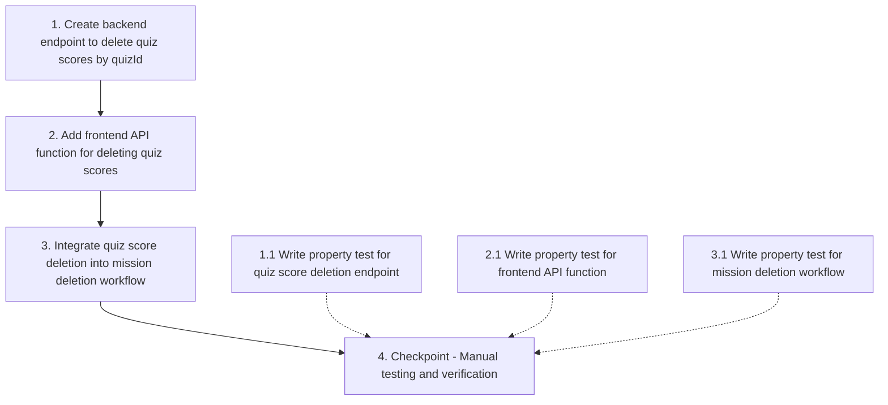

# Implementation Plan: Mission Deletion Quiz Score Cleanup

## Overview

This bugfix adds quiz score deletion to the mission deletion workflow. The implementation involves creating a new backend endpoint to delete quiz scores by quizId, adding a frontend API function to call this endpoint, and integrating the quiz score deletion into the existing mission deletion flow in App.vue.

## Tasks

- [x] 1. Create backend endpoint to delete quiz scores by quizId
  - Add DELETE route handler in `backend/routes/quiz_scores.js`
  - Implement Firestore query to find all quiz scores for a given quizId
  - Use Firestore batch operation to delete all matching documents atomically
  - Return JSON response with success message and count of deleted documents
  - Include comprehensive error handling and logging
  - _Requirements: 1.1, 1.2, 1.3, 1.4, 1.5_

- [ ]* 1.1 Write property test for quiz score deletion endpoint
  - **Property 1: Quiz Score Deletion Completeness**
  - **Property 2: Quiz Score Deletion Response Format**
  - **Validates: Requirements 1.1, 1.2, 1.3**

- [x] 2. Add frontend API function for deleting quiz scores
  - Create `deleteQuizScores(quizId)` function in `src/api/firebaseApi.js`
  - Use existing `apiFetch` wrapper to send DELETE request
  - Format endpoint as `/quizzes/:quizId/scores`
  - Return Promise that resolves to parsed JSON response
  - Add function to module exports
  - _Requirements: 4.1, 4.2, 4.3, 4.4, 4.5_

- [ ]* 2.1 Write property test for frontend API function
  - **Property 5: API Endpoint Format Correctness**
  - **Property 7: Promise Resolution on Success**
  - **Property 8: Error Propagation on Failure**
  - **Validates: Requirements 2.3, 4.2, 4.3, 4.4**

- [x] 3. Integrate quiz score deletion into mission deletion workflow
  - Locate `confirmDeleteMission` function in `src/App.vue` (around line 9391)
  - Add call to `window.firebaseApi.deleteQuizScores(quizId)` for each orphaned quiz
  - Insert between `deleteQuizSubmissions` and `deleteQuiz` calls
  - Add try-catch error handling with warning logs
  - Add success logging with emoji indicators
  - Ensure error in one quiz doesn't stop processing of remaining quizzes
  - _Requirements: 2.1, 2.2, 2.3, 2.4, 2.5, 3.1, 3.5, 5.1, 5.2, 5.3_

- [ ]* 3.1 Write property test for mission deletion workflow
  - **Property 3: Orphaned Quiz Identification**
  - **Property 4: Deletion Order Preservation**
  - **Property 6: Error Isolation in Batch Operations**
  - **Property 9: Mission Deletion Sequence Completeness**
  - **Validates: Requirements 2.1, 2.2, 2.5, 3.1, 5.1, 5.2, 5.3, 5.4, 5.5**

- [x] 4. Checkpoint - Manual testing and verification
  - Start backend server (port 3001)
  - Start frontend dev server (port 5174)
  - Create test mission with quiz
  - Add quiz scores to Firestore via student quiz completion
  - Delete mission as instructor
  - Verify quiz scores are deleted from Firestore `quiz_score` collection
  - Verify console logs show quiz score deletion messages
  - Ensure all tests pass, ask the user if questions arise

## Task Dependency Graph

## Notes

- Tasks marked with `*` are optional property-based tests
- The fix follows the same pattern as existing `deleteMissionScores` implementation
- Backend endpoint uses Firestore batch operations for atomic deletion
- Frontend integration preserves error isolation (one failure doesn't halt entire deletion)
- Deletion order is critical: submissions → scores → quiz document → mission scores → mission document
- All console logging uses emoji indicators for easy debugging (🗑️, ✅, ⚠️, ❌)
