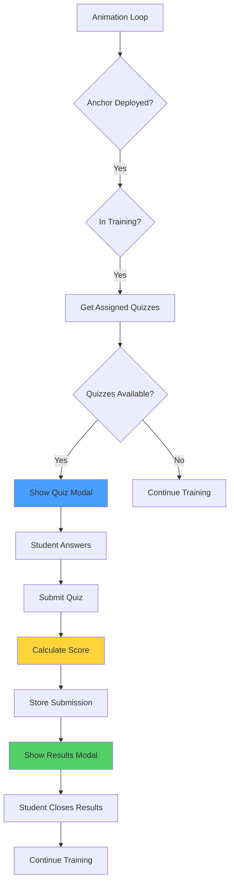
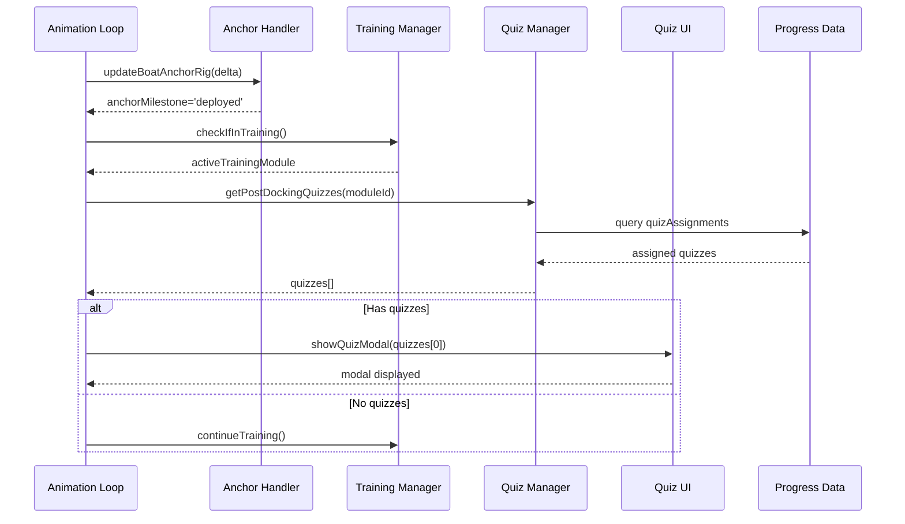

# Design Document: Post-Docking Quiz System

## Overview

The Post-Docking Quiz System automatically presents students with training-related quiz questions after successfully anchoring the boat during training missions. When a student deploys the anchor (via H key) and completes the docking milestone, a modal overlay appears with quiz questions specific to the training module they just completed. The system supports multiple question types (Multiple Choice, True/False, Fill in the Blank), provides immediate feedback with score and correct/incorrect breakdown, and stores results in the existing progressData structure. This feature integrates seamlessly with the existing instructor quiz management system where instructors can create and assign quizzes to specific training modules.

The system leverages the existing anchor deployment milestone detection in the animation loop (line 7348 in App.vue where `anchorMilestone === 'deployed'` is checked during training), and extends the current quiz infrastructure (progressData.quizzes, progressData.quizAssignments, progressData.quizSubmissions, progressData.quizResults) to support post-docking triggers.

## Architecture



## Sequence Diagrams

### Main Flow: Anchor Deployment to Quiz Display



### Quiz Submission and Results Flow

```mermaid
sequenceDiagram
    participant ST as Student
    participant UI as Quiz UI
    participant QE as Quiz Evaluator
    participant PD as Progress Data
    participant RM as Results Modal

    ST->>UI: answerQuestion(questionId, answer)
    UI->>UI: storeAnswer(questionId, answer)
    ST->>UI: submitQuiz()
    UI->>QE: evaluateQuiz(answers, quiz)
    QE->>QE: checkAnswers()
