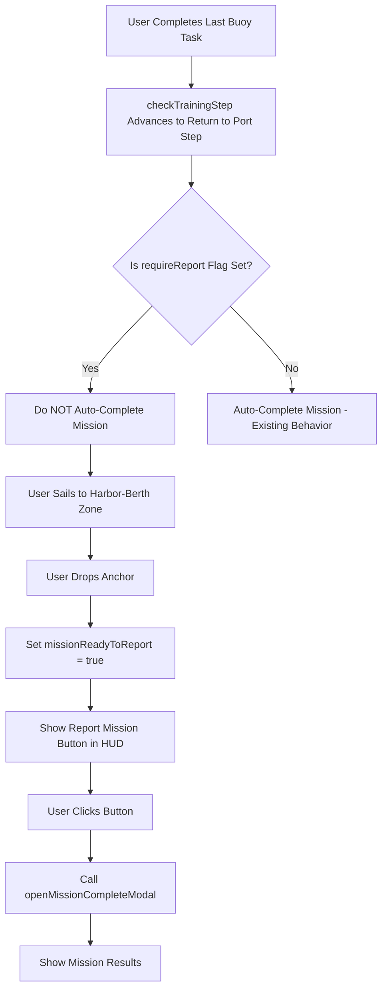
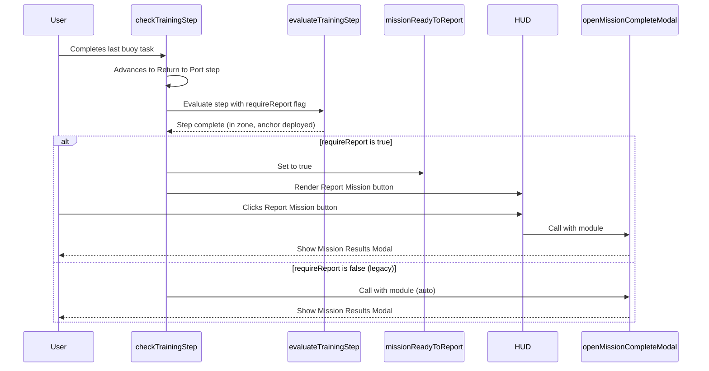
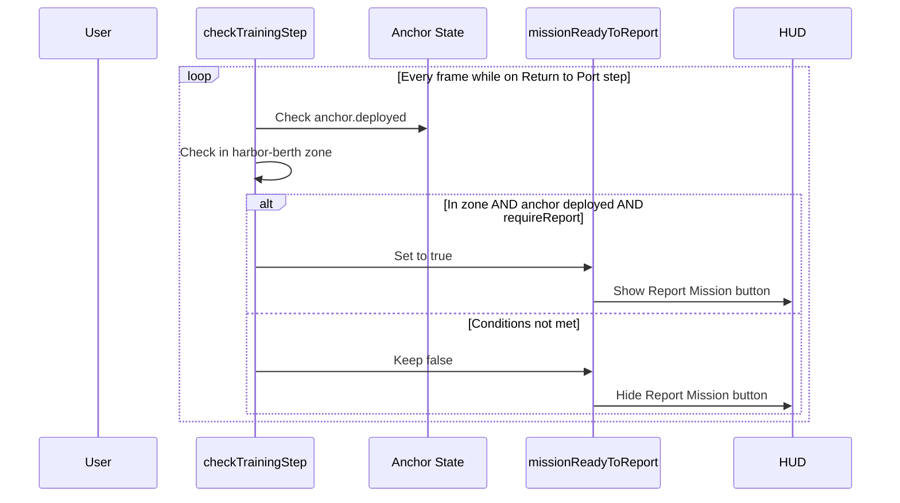

# Design Document: Return to Port and Report Mission

## Overview

This feature changes the mission completion flow to require explicit user action after completing all buoy tasks. Instead of automatically showing the mission results modal, the user must: (1) sail back to port (harbor-berth zone), (2) drop anchor, and (3) click a "Report Mission" button that appears in the HUD. This adds a sense of completion ritual and ensures users properly return to port before finishing their mission.

The implementation builds on existing infrastructure: the `missionReadyToReport` ref already exists, the `ensureMissionBuoySteps()` function already adds a "Return to Port" step with `requireReport: true` flag, and the `openMissionCompleteModal()` function already handles showing mission results. We need to connect these pieces by: preventing automatic completion in `checkTrainingStep()`, setting the ready state when conditions are met, and adding the UI button.

## Architecture

The feature integrates into the existing training/mission system in App.vue. The flow involves coordination between step evaluation, anchor state tracking, and UI rendering.



## Sequence Diagrams

### Main Mission Completion Flow



### Anchor State Monitoring



## Components and Interfaces

### Component 1: Mission State Management (App.vue)

**Purpose**: Track whether mission is ready to be reported based on location and anchor state

**Interface**:
```typescript
interface MissionState {
  missionReadyToReport: Ref<boolean>;  // Existing ref
  trainingRunFinished: Ref<boolean>;   // Existing ref
  activeTrainingModule: Ref<TrainingModule | null>; // Existing ref
}

interface TrainingStep {
  instruction: string;
  waypointZone?: string;
  type?: string;
  anchorAction?: 'deploy' | 'retract';
  requireReport?: boolean;  // New flag - indicates manual reporting required
  requireInteraction?: string;
  // ... other existing fields
}
```

**Responsibilities**:
- Monitor boat position relative to harbor-berth zone
- Monitor anchor deployment state
- Set `missionReadyToReport` to true when conditions met on a `requireReport` step
- Reset `missionReadyToReport` when mission starts or is reset

### Component 2: Step Evaluation Logic (checkTrainingStep function)

**Purpose**: Evaluate training step completion and handle mission reporting requirements

**Interface**:
```typescript
function checkTrainingStep(): void {
  // Existing function signature
  // Modified behavior: check requireReport flag before auto-completing
}

interface StepEvaluationContext {
  step: TrainingStep;
  inHarborBerth: boolean;
  anchorDeployed: boolean;
  stepPassed: boolean;
}
```

**Responsibilities**:
- Check if current step has `requireReport: true` flag
- If flag is set and step conditions met, set `missionReadyToReport = true` instead of calling `openMissionCompleteModal()`
- Continue to auto-complete missions for steps without the flag (backward compatibility)
- Reset `missionReadyToReport` when advancing to new steps

### Component 3: HUD Report Button (Template)

**Purpose**: Render button in HUD when mission is ready to be reported

**Interface**:
```typescript
interface ReportButtonProps {
  visible: boolean;  // Computed from missionReadyToReport
  onClick: () => void;  // Handler to call openMissionCompleteModal
}
```

**Responsibilities**:
- Render "Report Mission" button only when `missionReadyToReport === true`
- Position button prominently in HUD near training feedback area
- Call `handleReportMission()` when clicked
- Style consistently with existing HUD buttons

### Component 4: Report Handler Function

**Purpose**: Handle Report Mission button click and trigger mission completion

**Interface**:
```typescript
function handleReportMission(): void {
  // Call openMissionCompleteModal with active module
  // Reset missionReadyToReport state
}
```

**Responsibilities**:
- Retrieve `activeTrainingModule.value`
- Call `openMissionCompleteModal(module)`
- Reset `missionReadyToReport.value = false`
- Ensure button disappears after click

## Data Models

### TrainingStep Model (Extended)

```typescript
interface TrainingStep {
  instruction: string;
  waypointZone?: string;
  type?: 'dock' | 'compass' | string;
  anchorAction?: 'deploy' | 'retract';
  requireReport?: boolean;  // NEW: If true, prevents auto-completion
  requireInteraction?: string;
  requireHeadingDeg?: number;
  headingTolerance?: number;
  maxSpeedKnots?: number;
  holdHeadingMs?: number;
  requiresTurn?: boolean;
  minTurn?: number;
  check?: (stats: any) => boolean;
  allowIdle?: boolean;
  placeholder?: boolean;
  requireReturn?: boolean;
}
```

**Validation Rules**:
- If `requireReport` is true, `waypointZone` should typically be 'harbor-berth'
- If `requireReport` is true, `anchorAction` should typically be 'deploy'
- `requireReport` is optional and defaults to false (preserving existing behavior)

### Mission Reporting State

```typescript
interface MissionReportingState {
  ready: boolean;           // missionReadyToReport ref value
  step: TrainingStep | null;  // Current step requiring report
  inZone: boolean;          // Is boat in harbor-berth zone?
  anchorDeployed: boolean;  // Is anchor currently deployed?
}
```

**Validation Rules**:
- `ready` should only be true when `inZone && anchorDeployed && step.requireReport === true`
- `ready` should reset to false when mission completes or new mission starts
- `ready` should reset to false if anchor is raised or boat leaves zone

## Key Functions with Formal Specifications

### Function 1: checkTrainingStep()

```typescript
function checkTrainingStep(): void {
  // Existing function with modifications
}
```

**Preconditions:**
- `activeTrainingModule.value` exists or function returns early
- `trainingStepSuccess.value` is false (not already completed)
- `trainingRunFinished.value` is false (training still active)

**Postconditions:**
- If step passes evaluation:
  - If `requireReport === true` and step is complete: sets `missionReadyToReport = true`, does NOT call `openMissionCompleteModal()`
  - If `requireReport !== true` and is last step: calls `openMissionCompleteModal()` after timeout (existing behavior)
  - If not last step: advances to next step
- If step fails evaluation: provides feedback via `trainingFeedback.value`

**Loop Invariants:** N/A (called per frame, not a loop-based function)

### Function 2: handleReportMission()

```typescript
function handleReportMission(): void {
  if (!activeTrainingModule.value || !missionReadyToReport.value) {
    return;
  }
  
  const module = activeTrainingModule.value;
  missionReadyToReport.value = false;
  openMissionCompleteModal(module);
}
```

**Preconditions:**
- `activeTrainingModule.value` is not null
- `missionReadyToReport.value` is true
- User has clicked the Report Mission button

**Postconditions:**
- `missionReadyToReport.value` is reset to false
- `openMissionCompleteModal()` is called with the active module
- Mission completion modal is displayed to user

**Loop Invariants:** N/A (event handler, single execution)

### Function 3: resetMissionReportingState()

```typescript
function resetMissionReportingState(): void {
  missionReadyToReport.value = false;
}
```

**Preconditions:**
- Called when starting new training module or resetting training state

**Postconditions:**
- `missionReadyToReport.value` is false
- Report Mission button is hidden

**Loop Invariants:** N/A (initialization/cleanup function)

## Algorithmic Pseudocode

### Modified checkTrainingStep Algorithm

```pascal
ALGORITHM checkTrainingStep()
INPUT: None (uses reactive refs)
OUTPUT: Side effects on state and UI

BEGIN
  // Early exit conditions (existing)
  IF NOT activeTrainingModule.value OR trainingStepSuccess.value OR trainingRunFinished.value THEN
    RETURN
  END IF
  
  refreshTrainingWaypointZones()
  
  module ← activeTrainingModule.value
  step ← module.steps[currentTrainingStep.value]
  
  IF NOT step THEN
    RETURN
  END IF
  
  // Existing step evaluation logic
  context ← buildEvaluationContext(step, stats.value, anchor.value, ...)
  passed ← evaluateTrainingStep(step, context)
  
  IF NOT passed THEN
    // Provide coaching feedback (existing)
    coach ← formatHeadingStepHint(step, stats.value, trainingHeadingHold.value)
    IF coach AND NOT trainingStepSuccess.value THEN
      trainingFeedback.value ← coach
      trainingStepError.value ← false
    END IF
    RETURN
  END IF
  
  // Step passed
  trainingStepSuccess.value ← true
  trainingStepError.value ← false
  trainingFeedback.value ← '✓ Step completed!'
  
  // Delay before advancing (existing pattern)
  WAIT 1500ms THEN
    trainingStepSuccess.value ← false
    trainingFeedback.value ← ''
    
    completedStep ← module.steps[currentTrainingStep.value]
    
    // Update metrics (existing)
    IF completedStep.waypointZone THEN
      trainingRunMetrics.value.waypointsReached += 1
    END IF
    
    // Check if this is the last step
    IF currentTrainingStep.value < module.steps.length - 1 THEN
      // Not last step - advance normally
      trainingRunMetrics.value.stepsCompleted += 1
      currentTrainingStep.value += 1
      interactionReadyStep.value ← null
      syncTrainingWaypointMarkers()
      captureTrainingStepBaseline()
      RETURN
    END IF
    
    // Last step completed
    trainingRunFinished.value ← true
    trainingRunMetrics.value.endedAt ← performance.now()
    trainingRunMetrics.value.stepsCompleted ← module.steps.length
    
    // NEW: Check if this step requires manual reporting
    IF completedStep.requireReport = true THEN
      // Set ready state and wait for user to click button
      missionReadyToReport.value ← true
      trainingFeedback.value ← '✓ Mission complete! Click Report Mission to submit results.'
      RETURN  // Do NOT call openMissionCompleteModal automatically
    END IF
    
    // Existing special case handling
    IF module.id = 'm1-mission1' THEN
      startGearQuiz(module)
      RETURN
    END IF
    
    IF isTrainingReviewMode.value THEN
      completeTrainingReview(module)
      RETURN
    END IF
    
    // Default completion behavior (existing)
    trainingFeedback.value ← '🎉 Training module completed!'
    showTrainingNotification(...)
    openMissionCompleteModal(module)
    syncUiCursor()
  END WAIT
END
```

**Preconditions:**
- Training system is active with valid module and step
- Reactive refs are properly initialized

**Postconditions:**
- If `requireReport` is true: `missionReadyToReport` is set, modal is NOT opened
- If `requireReport` is false or undefined: modal is opened automatically (existing behavior)
- Step advancement and metrics tracking occur correctly

**Loop Invariants:**
- Function is called per frame; step evaluation remains consistent within a single frame
- State transitions are atomic (success → advance → capture baseline)

### Report Mission Button Handler Algorithm

```pascal
ALGORITHM handleReportMission()
INPUT: None (triggered by button click)
OUTPUT: Mission completion modal displayed

BEGIN
  // Guard: Ensure preconditions
  IF NOT activeTrainingModule.value OR NOT missionReadyToReport.value THEN
    RETURN
  END IF
  
  module ← activeTrainingModule.value
  
  // Reset ready state
  missionReadyToReport.value ← false
  
  // Open mission complete modal
  openMissionCompleteModal(module)
END
```

**Preconditions:**
- `missionReadyToReport.value === true`
- `activeTrainingModule.value` is not null
- Button is visible and clickable

**Postconditions:**
- `missionReadyToReport.value` is false
- Mission completion modal is displayed
- Button disappears (reactively based on state)

**Loop Invariants:** N/A (single execution event handler)

### State Reset Algorithm

```pascal
ALGORITHM resetMissionReportingState()
INPUT: None
OUTPUT: missionReadyToReport reset to false

BEGIN
  missionReadyToReport.value ← false
END
```

**Preconditions:**
- Called during training module initialization or reset

**Postconditions:**
- `missionReadyToReport.value` is false
- No report button is shown

**Loop Invariants:** N/A (initialization function)

## Example Usage

### Example 1: Mission with requireReport Flag

```typescript
// In ensureMissionBuoySteps() - already implemented
const returnToPortStep: TrainingStep = {
  instruction: 'Return to port, drop anchor, and report mission completion',
  waypointZone: 'harbor-berth',
  type: 'dock',
  anchorAction: 'deploy',
  requireReport: true  // NEW: Requires manual reporting
};

// User completes all buoy tasks
// checkTrainingStep() evaluates the last step
// Step passes: in harbor-berth zone AND anchor deployed
// Instead of auto-opening modal:
missionReadyToReport.value = true;
trainingFeedback.value = '✓ Mission complete! Click Report Mission to submit results.';

// User sees button in HUD and clicks it
handleReportMission();
// -> openMissionCompleteModal(module) is called
// -> Mission results modal appears
```

### Example 2: Legacy Mission (No requireReport Flag)

```typescript
// Existing mission without requireReport flag
const regularStep: TrainingStep = {
  instruction: 'Return to port',
  waypointZone: 'harbor-berth',
  type: 'dock',
  anchorAction: 'deploy'
  // requireReport: undefined (or false)
};

// User completes step
// checkTrainingStep() evaluates the last step
// Step passes
// requireReport is falsy:
openMissionCompleteModal(module);  // Existing behavior preserved
```

### Example 3: HUD Button Rendering

```vue
<template>
  <!-- Existing HUD elements -->
  <div class="training-feedback-mini" :class="{ success: trainingStepSuccess, error: trainingStepError }">
    <p>{{ trainingFeedback }}</p>
  </div>
  
  <!-- NEW: Report Mission Button -->
  <div v-if="missionReadyToReport" class="report-mission-container">
    <button 
      class="btn btn-primary btn-report-mission"
      @click="handleReportMission"
      aria-label="Report mission completion">
      📋 Report Mission
    </button>
  </div>
</template>

<script setup>
// Add handler function
function handleReportMission() {
  if (!activeTrainingModule.value || !missionReadyToReport.value) {
    return;
  }
  
  const module = activeTrainingModule.value;
  missionReadyToReport.value = false;
  openMissionCompleteModal(module);
}
</script>

<style scoped>
.report-mission-container {
  margin-top: 1rem;
  text-align: center;
}

.btn-report-mission {
  font-size: 1.1rem;
  padding: 0.75rem 1.5rem;
  font-weight: 600;
  animation: pulse-glow 2s ease-in-out infinite;
}

@keyframes pulse-glow {
  0%, 100% {
    box-shadow: 0 0 10px rgba(66, 153, 225, 0.5);
  }
  50% {
    box-shadow: 0 0 20px rgba(66, 153, 225, 0.8);
  }
}
</style>
```

## Correctness Properties

*A property is a characteristic or behavior that should hold true across all valid executions of a system-essentially, a formal statement about what the system should do. Properties serve as the bridge between human-readable specifications and machine-verifiable correctness guarantees.*

### Property 1: Manual reporting prevents auto-completion

For any mission step with `requireReport === true`, when the step is completed, the system SHALL NOT automatically call `openMissionCompleteModal()`.

**Validates: Requirements TBD**

### Property 2: Report button visibility

For any mission state, the Report Mission button SHALL be visible if and only if `missionReadyToReport === true`.

**Validates: Requirements TBD**

### Property 3: Report button triggers completion

For any active training module, when the Report Mission button is clicked while `missionReadyToReport === true`, the system SHALL call `openMissionCompleteModal()` with that module.

**Validates: Requirements TBD**

### Property 4: State reset on report

For any mission reporting action, after `handleReportMission()` is called, `missionReadyToReport` SHALL be false.

**Validates: Requirements TBD**

### Property 5: Backward compatibility

For any mission step with `requireReport !== true` (undefined or false), the system SHALL call `openMissionCompleteModal()` automatically when the step is completed (existing behavior).

**Validates: Requirements TBD**

### Property 6: Ready state conditions

For any mission with `requireReport === true`, `missionReadyToReport` SHALL be true if and only if: the boat is in the harbor-berth zone AND the anchor is deployed AND the step is completed.

**Validates: Requirements TBD**

### Property 7: State reset on new mission

For any training module start or reset, `missionReadyToReport` SHALL be false.

**Validates: Requirements TBD**

## Error Handling

### Error Scenario 1: Missing activeTrainingModule

**Condition**: `handleReportMission()` is called but `activeTrainingModule.value` is null
**Response**: Function returns early without error
**Recovery**: Button should not be clickable in this state (guard in template)

### Error Scenario 2: missionReadyToReport False When Button Clicked

**Condition**: Race condition where button is clicked but state changes to false
**Response**: `handleReportMission()` returns early without calling modal
**Recovery**: User will need to complete conditions again

### Error Scenario 3: Multiple Clicks on Report Button

**Condition**: User rapidly clicks Report Mission button
**Response**: First click sets `missionReadyToReport = false`, subsequent clicks are ignored
**Recovery**: No action needed, modal only opens once

### Error Scenario 4: requireReport Flag on Non-Final Step

**Condition**: `requireReport: true` is set on a step that is not the last step
**Response**: Logic currently only checks flag on final step completion
**Recovery**: Design guidance: `requireReport` should only be set on final steps

## Testing Strategy

### Unit Testing Approach

Focus on testing individual functions and state transitions:

**Test Cases**:
1. `handleReportMission()` with valid state → calls `openMissionCompleteModal()`
2. `handleReportMission()` with null module → returns early
3. `handleReportMission()` with `missionReadyToReport = false` → returns early
4. State reset: verify `missionReadyToReport` is false after `resetMissionReportingState()`
5. State reset: verify `missionReadyToReport` is false after `handleReportMission()`

**Mocking Strategy**:
- Mock `activeTrainingModule` ref
- Mock `missionReadyToReport` ref
- Mock `openMissionCompleteModal` function
- Verify function calls and state changes

### Property-Based Testing Approach

**Property Test Library**: fast-check (for TypeScript/JavaScript)

**Property Tests** (if applicable):
- For any step configuration with `requireReport: true`, completion should set `missionReadyToReport = true`
- For any step configuration with `requireReport !== true`, completion should call `openMissionCompleteModal()`

**Note**: Many properties are more suited to integration testing due to Vue reactivity and DOM interaction

### Integration Testing Approach

**Integration Test Scenarios**:
1. Complete mission with `requireReport: true`:
   - Verify button appears when in zone + anchor deployed
   - Verify clicking button opens modal
   - Verify modal contains correct mission data
2. Complete mission without `requireReport` flag:
   - Verify modal opens automatically (existing behavior)
3. Button visibility reactivity:
   - Verify button appears when conditions met
   - Verify button disappears when anchor raised or boat leaves zone
   - Verify button disappears after clicking
4. Multiple missions:
   - Complete mission, verify state reset for next mission

**Testing Tools**:
- Vue Test Utils for component testing
- Vitest or Jest for test runner
- Testing Library for user interaction simulation

## Performance Considerations

- **Frame-rate impact**: `checkTrainingStep()` is called every frame. The additional conditional check (`if (completedStep.requireReport === true)`) is negligible (single boolean comparison).
- **Button rendering**: The `v-if="missionReadyToReport"` directive efficiently shows/hides the button with minimal overhead.
- **State updates**: Reactive refs trigger minimal re-renders since button is conditionally rendered only when state changes.

**Optimization Notes**:
- No additional watchers or computed properties needed
- Existing evaluation logic is reused
- No performance degradation expected

## Security Considerations

**No significant security concerns** for this feature. The feature controls UI flow and does not:
- Expose sensitive data
- Handle authentication or authorization
- Process user input that could be exploited
- Communicate with external services

**Minor consideration**:
- Ensure mission completion rewards/XP are only granted once per mission (existing system already handles this in `openMissionCompleteModal()`)

## Dependencies

### Internal Dependencies
- `activeTrainingModule` ref (existing)
- `missionReadyToReport` ref (existing)
- `trainingRunFinished` ref (existing)
- `openMissionCompleteModal()` function (existing)
- `checkTrainingStep()` function (modified)
- `ensureMissionBuoySteps()` function (existing, already sets `requireReport` flag)
- Vue 3 reactivity system (refs, computed)

### External Dependencies
- None (feature is self-contained within App.vue)

### Modified Files
- `src/App.vue`:
  - Template: Add Report Mission button
  - Script: Modify `checkTrainingStep()`, add `handleReportMission()`
  - Style: Add button styles

### No Changes Required
- `src/helpers/trainingValidation.js`: No changes needed
- `src/helpers/missionWaypoints.js`: No changes needed
- Other helper files: No changes needed
