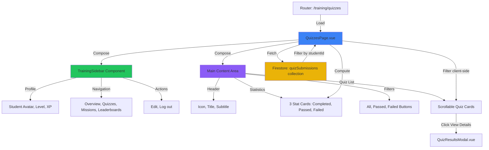
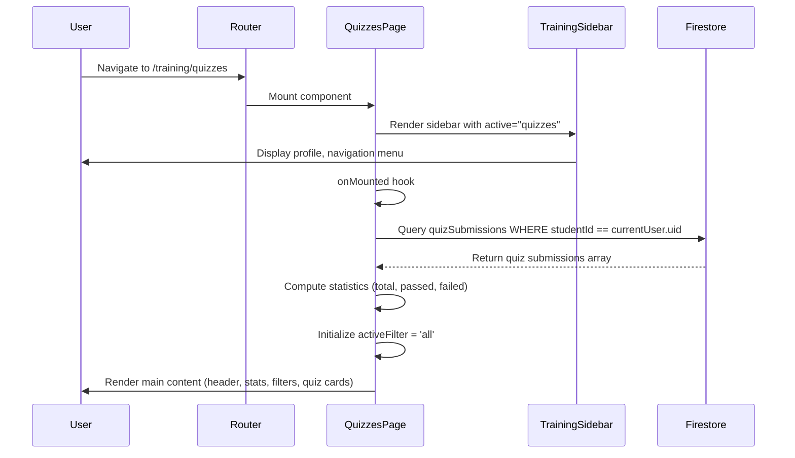
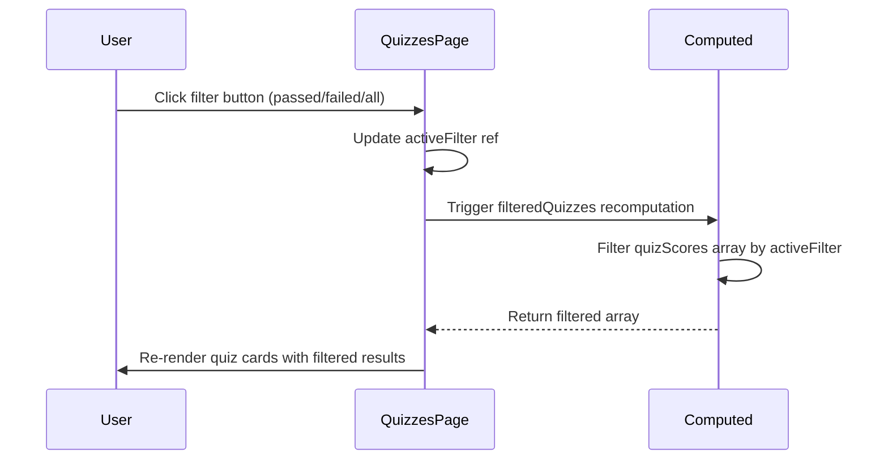
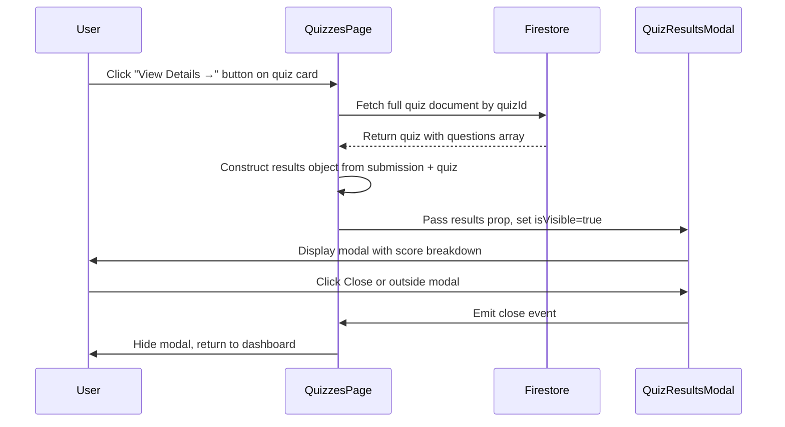
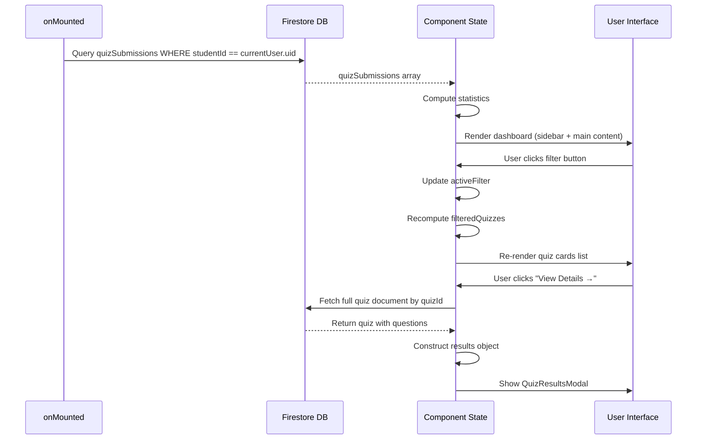

# Design Document: Student Quiz Dashboard

## Overview

The Student Quiz Dashboard is a **full-page view** within the HelmQuest Training system, accessible via the `/training/quizzes` route. It provides students with a comprehensive interface to track their quiz performance history. The page features a **fixed left sidebar navigation** (reused from other training pages) and a **main content area** displaying quiz statistics, filters, and a scrollable list of completed quiz cards. Students can view aggregate statistics (quizzes completed, passed, failed), filter results by pass/fail status, and access detailed quiz breakdowns. The design integrates with Firebase Firestore to fetch quiz submission data from the `quizSubmissions` collection and uses Vue 3's Composition API for reactive state management and client-side filtering.

## Architecture

The Student Quiz Dashboard is a **full-page route** (`/training/quizzes`) with two main layout sections: a **reusable left sidebar** and a **main content area**. The page follows Vue 3's Composition API architecture and communicates directly with Firebase Firestore to fetch quiz submission data.



## Sequence Diagrams

### Main Quiz Dashboard Load Flow



### Filter Application Flow



### View Quiz Details Flow



## Components and Interfaces

### Component 1: QuizzesPage.vue

**Purpose**: Main container component for the full-page student quiz dashboard. Orchestrates the layout with sidebar and main content, fetches quiz submissions, computes statistics, handles filtering, and manages quiz detail modal.

**Route**: `/training/quizzes`

**Interface**:
```typescript
// Component does not receive props (standalone page)

interface QuizSubmission {
  id: string;
  studentId: string;
  quizId: string;
  quizTitle: string;
  missionTitle: string;
  moduleIcon: string; // 'compass' | 'anchor' | etc.
  score: number; // 0-100 percentage
  correctCount: number;
  totalQuestions: number;
  passed: boolean;
  submittedAt: Timestamp | Date;
}

interface QuizStatistics {
  totalCompleted: number;
  totalPassed: number;
  totalFailed: number;
}

// Component state (reactive refs)
const quizSubmissions = ref<QuizSubmission[]>([]);
const loading = ref<boolean>(true);
const error = ref<string | null>(null);
const activeFilter = ref<'all' | 'passed' | 'failed'>('all');
const selectedQuizDetails = ref<any | null>(null);
const showQuizResultsModal = ref<boolean>(false);

// Computed properties
const statistics = computed<QuizStatistics>(() => ({
  totalCompleted: quizSubmissions.value.length,
  totalPassed: quizSubmissions.value.filter(q => q.passed).length,
  totalFailed: quizSubmissions.value.filter(q => !q.passed).length
}));

const filteredQuizzes = computed<QuizSubmission[]>(() => {
  if (activeFilter.value === 'all') return quizSubmissions.value;
  if (activeFilter.value === 'passed') return quizSubmissions.value.filter(q => q.passed);
  if (activeFilter.value === 'failed') return quizSubmissions.value.filter(q => !q.passed);
  return [];
});
```

**Responsibilities**:
- Render full-page layout with sidebar and main content area
- Fetch quiz submissions from Firestore `quizSubmissions` collection on mount
- Compute aggregate statistics (total, passed, failed)
- Manage filter state and apply client-side filtering
- Handle "View Details" button clicks and fetch full quiz data
- Render header, statistics cards, filter buttons, and quiz cards
- Manage QuizResultsModal visibility and data

### Component 2: TrainingSidebar.vue (Existing, Reused)

**Purpose**: Reusable sidebar component for training pages. Displays HelmQuest logo, student profile card, navigation menu, and logout button.

**Interface**:
```typescript
interface TrainingSidebarProps {
  activePage: 'overview' | 'quizzes' | 'missions' | 'leaderboards';
}

// Emits
const emit = defineEmits<{
  navigate: [page: string];
  logout: [];
}>();
```

**Sidebar Structure**:
- **Logo**: "HelmQuest Training" at top
- **Profile Card**:
  - Avatar with level indicator (e.g., "scarlet")
  - Display name (e.g., "0x024DE-3456")
  - Role badge (e.g., "946 Seafarer")
  - XP progress bar (e.g., "10 XP")
- **Navigation Menu**:
  - Overview (📊 icon)
  - **Quizzes (📝 icon) - Active/highlighted when activePage="quizzes"**
  - Missions (🧭 icon)
  - Leaderboards (🏆 icon)
- **Actions**:
  - Edit button
  - Log out button (⎋ icon)

**Responsibilities**:
- Display student profile information (avatar, level, XP)
- Render navigation menu with active state highlighting
- Emit navigation events when menu items are clicked
- Emit logout event when logout button is clicked

### Component 3: StatisticsCard (Inline or Extracted)

**Purpose**: Displays a single statistic with icon, count, and label.

**Interface**:
```typescript
interface StatisticsCardProps {
  icon: string; // '📄', '✓', '✗'
  label: string; // 'Quizzes Completed', 'Passed', 'Failed'
  count: number;
  variant?: 'default' | 'success' | 'danger';
}
```

**Responsibilities**:
- Display icon and count prominently
- Display label below count
- Apply color variant styling (green for success, red for danger)

### Component 4: QuizCard (Inline within QuizzesPage)

**Purpose**: Displays individual quiz submission information in a card format with module icon, title, score, status badge, and action button.

**Interface**:
```typescript
interface QuizCardProps {
  submission: QuizSubmission;
}

// Emits
const emit = defineEmits<{
  viewDetails: [submission: QuizSubmission];
}>();
```

**Card Structure**:
- **Left**: Module icon (🧭 compass or ⚓ anchor)
- **Center**:
  - Module title (e.g., "Module 1 — Basic Navigation")
  - Subtitle (e.g., "Navigation Fundamentals")
  - Completion timestamp with 📅 icon (e.g., "Completed on September 15, 2026 • 10:24 AM")
- **Right**:
  - "SCORE" label
  - Score display (e.g., "8 / 10")
  - Percentage progress bar with percentage (e.g., 80%)
  - Status badge (green "PASSED" or red "FAILED")
  - Blue "View Details →" button

**Responsibilities**:
- Display quiz title, module name, completion timestamp
- Show score as fraction (e.g., "8 / 10") with percentage bar visualization
- Display status badge with color coding
- Emit viewDetails event when button is clicked

### Component 5: QuizResultsModal.vue (Existing, Reused)

**Purpose**: Existing modal component to display detailed quiz results with question-by-question breakdown.

**Interface**:
```typescript
interface QuizResultsModalProps {
  results: {
    score: number;
    answers: Array<{
      questionId: string;
      studentAnswer: string;
      isCorrect: boolean;
      skipped?: boolean;
    }>;
    quiz: {
      questions: Array<{
        id: string;
        prompt: string;
        correctAnswer: string;
      }>;
    };
  };
  isVisible: boolean;
}

// Emits
const emit = defineEmits<{
  close: [];
}>();
```

**Responsibilities**:
- Display overall score percentage with color coding
- Show detailed breakdown of each question
- Display student answers vs correct answers
- Handle modal close action (X button or click outside)

## Data Models

### Model 1: QuizSubmission (Firestore Collection)

```typescript
interface QuizSubmission {
  id: string;                    // Firestore document ID
  studentId: string;             // Student's Firebase Auth UID
  quizId: string;                // Reference to quiz document ID
  quizTitle: string;             // Quiz title for display
  missionTitle: string;          // Parent mission/module title (e.g., "Module 1 — Basic Navigation")
  moduleIcon: string;            // Icon identifier ('compass', 'anchor', etc.)
  score: number;                 // Score percentage (0-100)
  correctCount: number;          // Number of correct answers
  totalQuestions: number;        // Total number of questions
  passed: boolean;               // Pass/fail status (typically score >= 70)
  submittedAt: Timestamp | Date; // When quiz was submitted/completed
  answers: Array<{               // Student's answers to questions
    questionId: string;
    studentAnswer: string;
    isCorrect: boolean;
    skipped?: boolean;
  }>;
}
```

**Validation Rules**:
- `id` must be non-empty string (Firestore doc ID)
- `studentId` must match authenticated user ID
- `quizId` must reference existing quiz document
- `score` must be number between 0-100
- `correctCount` must be ≤ `totalQuestions`
- `totalQuestions` must be positive integer
- `passed` is boolean (auto-computed as score >= 70 if not provided)
- `submittedAt` must be valid Firestore Timestamp or Date
- `answers` array length should equal `totalQuestions`

### Model 2: QuizStatistics (Computed)

```typescript
interface QuizStatistics {
  totalCompleted: number;  // Total number of quizzes completed
  totalPassed: number;     // Number of quizzes with passed = true
  totalFailed: number;     // Number of quizzes with passed = false
}
```

**Validation Rules**:
- All values must be non-negative integers
- `totalCompleted` must equal `totalPassed + totalFailed`

### Model 3: FilterOption (Type)

```typescript
type FilterOption = 'all' | 'passed' | 'failed';
```

**Validation Rules**:
- Must be one of three literal values: 'all', 'passed', 'failed'

## Main Algorithm/Workflow



## Key Functions with Formal Specifications

### Function 1: fetchQuizSubmissions()

```typescript
async function fetchQuizSubmissions(studentId: string): Promise<void>
```

**Preconditions:**
- `studentId` is non-empty string representing authenticated user
- Firestore `quizSubmissions` collection exists and is accessible
- Component is mounted and Firebase auth is initialized

**Postconditions:**
- If successful: `quizSubmissions.value` contains array of QuizSubmission objects
- If successful: `loading.value` is set to false
- If error occurs: `error.value` contains error message
- `loading.value` is always set to false after completion

**Loop Invariants:** N/A (async function with single Firestore query)

### Function 2: applyFilter()

```typescript
function applyFilter(filter: FilterOption): void
```

**Preconditions:**
- `filter` is one of 'all', 'passed', 'failed'
- `quizScores.value` has been populated

**Postconditions:**
- `activeFilter.value` is set to the provided filter value
- `filteredQuizzes` computed property automatically recomputes
- UI re-renders to show filtered quiz cards
- No mutations to `quizScores.value` array

**Loop Invariants:** N/A (simple assignment)

### Function 3: viewQuizDetails()

```typescript
async function viewQuizDetails(submission: QuizSubmission): Promise<void>
```

**Preconditions:**
- `submission` is valid QuizSubmission object with non-empty `quizId`
- Firestore `quizzes` collection exists and contains the referenced quiz
- `submission.answers` array contains student's answer data

**Postconditions:**
- If successful: `selectedQuizDetails.value` contains full quiz data with questions
- If successful: `showQuizResultsModal.value` is set to true
- If error occurs: Error is logged to console or displayed to user
- QuizResultsModal is rendered with proper props

**Loop Invariants:** N/A (async function with single Firestore query)

### Function 4: computeStatistics()

```typescript
function computeStatistics(submissions: QuizSubmission[]): QuizStatistics
```

**Preconditions:**
- `submissions` is array of QuizSubmission objects (may be empty)

**Postconditions:**
- Returns QuizStatistics object with non-negative integers
- `totalCompleted` equals `submissions.length`
- `totalPassed` equals count of submissions where `passed === true`
- `totalFailed` equals count of submissions where `passed === false`
- `totalCompleted === totalPassed + totalFailed`
- No mutations to input `submissions` array

**Loop Invariants:**
- During filtering operations: All previously counted submissions remain valid
- Running counts never exceed total array length

## Algorithmic Pseudocode

### Main Dashboard Initialization Algorithm

```typescript
/**
 * Algorithm: Initialize Quiz Dashboard
 * INPUT: studentId (string)
 * OUTPUT: Populated dashboard with statistics and quiz list
 */
async function initializeQuizDashboard(studentId: string): Promise<void> {
  // ASSERT: studentId is valid and non-empty
  
  // Step 1: Set loading state
  loading.value = true;
  error.value = null;
  
  try {
    // Step 2: Fetch quiz submissions from Firestore
    const db = getFirestore();
    const submissionsRef = collection(db, 'quizSubmissions');
    const q = query(submissionsRef, where('studentId', '==', studentId));
    const querySnapshot = await getDocs(q);
    
    // Step 3: Parse Firestore documents into submissions array
    const submissions: QuizSubmission[] = [];
    querySnapshot.forEach((doc) => {
      submissions.push({
        id: doc.id,
        ...doc.data()
      } as QuizSubmission);
    });
    
    // ASSERT: submissions is valid array
    
    // Step 4: Sort by submission date (most recent first)
    submissions.sort((a, b) => {
      const dateA = a.submittedAt instanceof Timestamp ? a.submittedAt.toDate() : new Date(a.submittedAt);
      const dateB = b.submittedAt instanceof Timestamp ? b.submittedAt.toDate() : new Date(b.submittedAt);
      return dateB.getTime() - dateA.getTime();
    });
    
    // Step 5: Store quiz submissions
    quizSubmissions.value = submissions;
    
    // Step 6: Compute statistics (handled by computed property)
    // statistics.value automatically updates due to reactivity
    
    // ASSERT: quizSubmissions.value.length === statistics.value.totalCompleted
    
  } catch (err) {
    // Step 7: Handle errors
    console.error('Failed to load quiz submissions:', err);
    error.value = 'Failed to load quiz data. Please try again.';
  } finally {
    // Step 8: Clear loading state
    loading.value = false;
  }
  
  // POSTCONDITION: loading.value === false
  // POSTCONDITION: quizSubmissions.value is populated OR error.value is set
}
```

**Preconditions:**
- studentId is non-null and non-empty string
- Firestore is initialized and accessible
- `quizSubmissions` collection exists (may be empty)

**Postconditions:**
- loading.value is false
- Either quizSubmissions.value contains array of submissions OR error.value contains error message
- statistics computed property reflects loaded data
- Submissions are sorted by submittedAt in descending order

**Loop Invariants:** 
- During document iteration: All previously processed documents are valid
- During sorting: Array length remains constant

### Filter Application Algorithm

```typescript
/**
 * Algorithm: Apply Quiz Filter
 * INPUT: filterOption ('all' | 'passed' | 'failed')
 * OUTPUT: Updated filteredQuizzes computed property
 */
function applyQuizFilter(filterOption: FilterOption): void {
  // ASSERT: filterOption is one of 'all', 'passed', 'failed'
  
  // Step 1: Update active filter
  activeFilter.value = filterOption;
  
  // Step 2: Filtered quizzes recomputed automatically by Vue reactivity
  // The computed property filteredQuizzes will trigger re-evaluation:
  //
  // if (filterOption === 'all') {
  //   return quizSubmissions.value;
  // } else if (filterOption === 'passed') {
  //   return quizSubmissions.value.filter(q => q.passed === true);
  // } else if (filterOption === 'failed') {
  //   return quizSubmissions.value.filter(q => q.passed === false);
  // }
  
  // POSTCONDITION: activeFilter.value === filterOption
  // POSTCONDITION: filteredQuizzes contains only matching quiz submissions
  // POSTCONDITION: Original quizSubmissions.value array is unchanged
}
```

**Preconditions:**
- filterOption is valid FilterOption type
- quizSubmissions.value has been initialized (may be empty array)

**Postconditions:**
- activeFilter.value equals provided filterOption
- filteredQuizzes computed property returns filtered subset of quizSubmissions
- Original quizSubmissions array remains unchanged (immutable filter operation)

**Loop Invariants:**
- For filter operations: All submissions in filtered result satisfy filter predicate

### View Quiz Details Algorithm

```typescript
/**
 * Algorithm: View Quiz Details
 * INPUT: submission (QuizSubmission object)
 * OUTPUT: Display QuizResultsModal with detailed quiz information
 */
async function viewQuizDetails(submission: QuizSubmission): Promise<void> {
  // ASSERT: submission is valid QuizSubmission object
  // ASSERT: submission.quizId is non-empty string
  // ASSERT: submission.answers array contains student's answer data
  
  try {
    // Step 1: Fetch full quiz data from Firestore (including questions and correct answers)
    const db = getFirestore();
    const quizDocRef = doc(db, 'quizzes', submission.quizId);
    const quizDocSnap = await getDoc(quizDocRef);
    
    // ASSERT: Quiz document exists
    if (!quizDocSnap.exists()) {
      throw new Error('Quiz not found');
    }
    
    const quizData = quizDocSnap.data();
    
    // ASSERT: quizData contains questions array
    if (!quizData.questions || !Array.isArray(quizData.questions)) {
      throw new Error('Quiz data missing questions');
    }
    
    // Step 2: Construct results object for QuizResultsModal
    // Student's answers are already in the submission object
    const resultsObject = {
      score: submission.score,
      answers: submission.answers || [],
      quiz: {
        questions: quizData.questions
      }
    };
    
    // ASSERT: resultsObject matches QuizResultsModal props interface
    
    // Step 3: Update modal state
    selectedQuizDetails.value = resultsObject;
    showQuizResultsModal.value = true;
    
    // POSTCONDITION: Modal is visible with correct data
    
  } catch (err) {
    console.error('Failed to load quiz details:', err);
    alert('Failed to load quiz details. Please try again.');
  }
}
```

**Preconditions:**
- submission is valid QuizSubmission object with non-empty quizId
- Firestore `quizzes` collection exists and is accessible
- submission.answers contains student's answer data

**Postconditions:**
- If successful: selectedQuizDetails.value contains complete quiz results
- If successful: showQuizResultsModal.value is true
- If error: Error is logged and user is notified via alert
- QuizResultsModal component receives valid props matching its interface

**Loop Invariants:** N/A (sequential async operations)

## Example Usage

```typescript
// Example 1: Component initialization in QuizzesPage.vue
import { ref, computed, onMounted } from 'vue';
import { getFirestore, collection, query, where, getDocs } from 'firebase/firestore';
import { useAuth } from '@/composables/useAuth';

const { currentUser } = useAuth();
const quizSubmissions = ref<QuizSubmission[]>([]);
const loading = ref(true);
const activeFilter = ref<FilterOption>('all');

onMounted(async () => {
  if (currentUser.value?.uid) {
    await initializeQuizDashboard(currentUser.value.uid);
  }
});

// Example 2: Filtering quizzes
const filteredQuizzes = computed(() => {
  if (activeFilter.value === 'all') return quizSubmissions.value;
  if (activeFilter.value === 'passed') {
    return quizSubmissions.value.filter(q => q.passed);
  }
  if (activeFilter.value === 'failed') {
    return quizSubmissions.value.filter(q => !q.passed);
  }
  return [];
});

function handleFilterClick(filter: FilterOption): void {
  applyQuizFilter(filter);
}

// Example 3: Computing statistics
const statistics = computed<QuizStatistics>(() => ({
  totalCompleted: quizSubmissions.value.length,
  totalPassed: quizSubmissions.value.filter(q => q.passed).length,
  totalFailed: quizSubmissions.value.filter(q => !q.passed).length
}));

// Example 4: Viewing quiz details
async function handleViewDetails(submission: QuizSubmission): Promise<void> {
  await viewQuizDetails(submission);
}

// Example 5: Rendering full-page layout in template
/*
<div class="quizzes-page">
  <!-- Left Sidebar (Fixed) -->
  <TrainingSidebar activePage="quizzes" @navigate="handleNavigate" @logout="handleLogout" />
  
  <!-- Main Content Area -->
  <div class="quizzes-main-content">
    <!-- Header Section -->
    <header class="quizzes-header">
      <span class="header-icon">📄</span>
      <h1>Quizzes</h1>
      <p>View your completed quizzes and check your performance.</p>
    </header>
    
    <!-- Statistics Panel (3 cards in a row) -->
    <div class="statistics-panel">
      <StatisticsCard icon="📄" label="Quizzes Completed" :count="statistics.totalCompleted" />
      <StatisticsCard icon="✓" label="Passed" :count="statistics.totalPassed" variant="success" />
      <StatisticsCard icon="✗" label="Failed" :count="statistics.totalFailed" variant="danger" />
    </div>
    
    <!-- Filter Buttons Row -->
    <div class="filter-buttons">
      <button :class="{ active: activeFilter === 'all' }" @click="handleFilterClick('all')">
        All
      </button>
      <button :class="{ active: activeFilter === 'passed' }" @click="handleFilterClick('passed')">
        <span>✓</span> Passed
      </button>
      <button :class="{ active: activeFilter === 'failed' }" @click="handleFilterClick('failed')">
        <span>✗</span> Failed
      </button>
    </div>
    
    <!-- Quiz Cards List (scrollable) -->
    <div class="quiz-cards-list">
      <QuizCard 
        v-for="submission in filteredQuizzes" 
        :key="submission.id"
        :submission="submission"
        @viewDetails="handleViewDetails"
      />
    </div>
    
    <!-- Footer -->
    <footer class="quizzes-footer">
      <span>{{ statistics.totalCompleted }} quizzes completed</span>
      <span class="wave-decoration">〰️</span>
    </footer>
  </div>
</div>
*/

// Example 6: Rendering quiz card
/*
<div class="quiz-card">
  <div class="quiz-card-left">
    <span class="module-icon">{{ submission.moduleIcon === 'compass' ? '🧭' : '⚓' }}</span>
  </div>
  
  <div class="quiz-card-center">
    <h3>{{ submission.missionTitle }}</h3>
    <p>{{ submission.quizTitle }}</p>
    <p class="completion-time">
      <span>📅</span>
      Completed on {{ formatDate(submission.submittedAt) }}
    </p>
  </div>
  
  <div class="quiz-card-right">
    <span class="score-label">SCORE</span>
    <span class="score-fraction">{{ submission.correctCount }} / {{ submission.totalQuestions }}</span>
    <div class="score-bar">
      <div class="score-fill" :style="{ width: submission.score + '%' }"></div>
    </div>
    <span class="score-percentage">{{ submission.score }}%</span>
    <span :class="['status-badge', submission.passed ? 'passed' : 'failed']">
      {{ submission.passed ? 'PASSED' : 'FAILED' }}
    </span>
    <button class="view-details-btn" @click="$emit('viewDetails', submission)">
      View Details →
    </button>
  </div>
</div>
*/
```

## Correctness Properties

### Property 1: Statistics Consistency
**For all states of the component:**
```typescript
statistics.totalCompleted === statistics.totalPassed + statistics.totalFailed
```
The sum of passed and failed quizzes always equals the total completed count.

### Property 2: Filter Correctness
**For all quiz submissions in filteredQuizzes:**
```typescript
// When activeFilter === 'passed'
∀ submission ∈ filteredQuizzes: submission.passed === true

// When activeFilter === 'failed'
∀ submission ∈ filteredQuizzes: submission.passed === false

// When activeFilter === 'all'
filteredQuizzes === quizSubmissions
```
Filtered results always match the active filter predicate.

### Property 3: Score Validation
**For all quiz submissions loaded from Firestore:**
```typescript
∀ submission ∈ quizSubmissions: (
  0 <= submission.score <= 100 &&
  submission.correctCount <= submission.totalQuestions &&
  submission.passed === (submission.score >= 70)
)
```
All quiz scores are valid percentages, correct count doesn't exceed total, and pass status is consistent.

### Property 4: Data Immutability
**For all filter and view operations:**
```typescript
// Original data never mutated
applyFilter(filterOption) => quizSubmissions.value === quizSubmissions.value_before

// Filtered view is derived, not mutated
filteredQuizzes.value !== quizSubmissions.value (when filter !== 'all')
```
Filter operations create derived views without mutating source data.

### Property 5: Modal State Consistency
**When quiz details are viewed:**
```typescript
showQuizResultsModal === true => selectedQuizDetails !== null
showQuizResultsModal === false => (modal not rendered)
```
Modal visibility and data selection are always consistent.

### Property 6: Route Isolation
**The quiz dashboard is a separate page:**
```typescript
// Route is /training/quizzes (not a tab in another page)
route.path === '/training/quizzes' => QuizzesPage is mounted

// Sidebar navigation state
activePage === 'quizzes' => Quizzes nav item is highlighted
```
The dashboard is a full-page view with dedicated route, not a tab component.

## Error Handling

### Error Scenario 1: Firestore Query Failure

**Condition**: Firestore is unreachable or query returns error  
**Response**: 
- Catch error in try-catch block
- Set `error.value` with user-friendly message: "Failed to load quiz data. Please try again."
- Set `loading.value` to false
- Display error message in UI (red banner or toast notification)  
**Recovery**: 
- Provide "Retry" button to re-trigger fetchQuizSubmissions()
- Log error details to console for debugging
- Gracefully handle empty state (show "No quizzes available" message)

### Error Scenario 2: Invalid Firestore Document Data

**Condition**: Firestore returns documents but data is malformed or missing expected fields  
**Response**:
- Validate document structure before adding to submissions array
- Skip invalid documents and log warning
- Continue processing valid documents
- If all documents are invalid, treat as empty state  
**Recovery**:
- Display partial data if some documents are valid
- Show warning message if data quality issues detected
- Allow user to retry or contact support

### Error Scenario 3: Quiz Details Not Found

**Condition**: User clicks "View Details" but quiz document is missing from Firestore  
**Response**:
- Catch error when fetching quiz document
- Display alert or toast: "Quiz details not available"
- Do not show modal  
**Recovery**:
- User can continue browsing other quizzes
- Log warning for missing quiz investigation

### Error Scenario 4: Authentication State Lost

**Condition**: User's authentication token expires or becomes invalid during page load  
**Response**:
- Detect authentication error from Firestore (permission denied)
- Redirect user to login page
- Display message: "Session expired. Please log in again."  
**Recovery**:
- Clear local state
- Trigger authentication flow
- Redirect back to `/training/quizzes` after re-authentication

### Error Scenario 5: Network Timeout

**Condition**: Firestore request takes too long and times out  
**Response**:
- Set timeout on Firestore queries (e.g., 10 seconds)
- If timeout occurs, treat as query failure
- Display error: "Request timed out. Please check your connection."  
**Recovery**:
- Provide "Retry" button
- Check network connection status if available
- Suggest user to refresh page if issue persists

### Error Scenario 6: Empty Submissions Collection

**Condition**: Student has no completed quizzes in Firestore  
**Response**:
- Display empty state message with icon
- Message: "No quizzes completed yet. Complete your first mission quiz to see results here!"
- Show statistics as 0/0/0  
**Recovery**:
- User can navigate to missions page to complete quizzes
- Empty state is expected behavior, not an error

## Testing Strategy

### Unit Testing Approach

**Goal**: Test individual functions and computed properties in isolation

**Key Test Cases**:

1. **fetchQuizScores() tests**:
   - Successfully fetches and stores quiz scores
   - Handles API errors gracefully
   - Sets loading state correctly
   - Parses response data correctly

2. **applyFilter() tests**:
   - Correctly sets activeFilter to provided value
   - Does not mutate quizScores array
   - Triggers filteredQuizzes recomputation

3. **computeStatistics() tests**:
   - Correctly counts total completed quizzes
   - Correctly counts passed quizzes
   - Correctly counts failed quizzes
   - Returns { 0, 0, 0 } for empty array
   - Maintains consistency: totalCompleted = totalPassed + totalFailed

4. **filteredQuizzes computed property tests**:
   - Returns all quizzes when filter is 'all'
   - Returns only passed quizzes when filter is 'passed'
   - Returns only failed quizzes when filter is 'failed'
   - Returns empty array when quizScores is empty

5. **viewQuizDetails() tests**:
   - Fetches quiz and submission data successfully
   - Constructs correct results object
   - Opens modal with correct props
   - Handles missing quiz data gracefully
   - Handles missing submission data gracefully

**Test Framework**: Vitest (Vue 3's recommended test framework)  
**Coverage Goal**: Minimum 80% code coverage for all functions and computed properties

### Property-Based Testing Approach

**Goal**: Verify correctness properties hold for all possible inputs

**Property Test Library**: fast-check (JavaScript/TypeScript property-based testing)

**Properties to Test**:

1. **Statistics Consistency Property**:
   ```typescript
   // For any array of quiz scores
   ∀ quizScores: QuizScore[] =>
     statistics(quizScores).totalCompleted === 
     statistics(quizScores).totalPassed + statistics(quizScores).totalFailed
   ```

2. **Filter Correctness Property**:
   ```typescript
   // For any array of quiz scores and any filter option
   ∀ quizScores: QuizScore[], filter: FilterOption =>
     filter === 'passed' => filteredQuizzes(quizScores, filter).every(q => q.passed)
     filter === 'failed' => filteredQuizzes(quizScores, filter).every(q => !q.passed)
     filter === 'all' => filteredQuizzes(quizScores, filter).length === quizScores.length
   ```

3. **Score Validation Property**:
   ```typescript
   // For any quiz score from API
   ∀ quiz: QuizScore =>
     (0 <= quiz.score <= 100) &&
     (quiz.correctAnswers <= quiz.totalQuestions) &&
     (quiz.passed === (quiz.score >= 70))
   ```

4. **Immutability Property**:
   ```typescript
   // For any filter operation
   ∀ quizScores: QuizScore[], filter: FilterOption =>
     applyFilter(filter) => quizScores_after === quizScores_before
   ```

**Test Execution**: Run property-based tests with 1000+ random inputs per property

### Integration Testing Approach

**Goal**: Test component interactions with API and other components

**Key Integration Tests**:

1. **Full dashboard load flow**:
   - Mock backend API responses
   - Mount QuizzesPage component
   - Verify API is called with correct studentId
   - Verify statistics are computed and rendered
   - Verify quiz cards are rendered

2. **Filter interaction flow**:
   - Load dashboard with mock data
   - Click each filter button
   - Verify filtered results are displayed
   - Verify active filter visual state

3. **View details flow**:
   - Load dashboard with mock data
   - Click "View Details" on a quiz card
   - Verify modal API calls
   - Verify QuizResultsModal is displayed with correct props

4. **Error handling flow**:
   - Mock API error response
   - Verify error message is displayed
   - Verify retry functionality works

**Test Framework**: Vitest + Vue Test Utils  
**Mock Strategy**: Mock fetch API and Firebase auth  
**Coverage Goal**: All user interaction flows tested

### End-to-End Testing Approach

**Goal**: Test complete user journeys in real browser environment

**Key E2E Scenarios**:

1. **Complete quiz dashboard journey**:
   - Navigate to /quizzes page
   - Wait for quiz scores to load
   - Verify statistics panel displays correct counts
   - Verify quiz cards are rendered
   - Apply each filter and verify results
   - Click "View Details" and verify modal opens
   - Close modal and verify return to dashboard

2. **Empty state handling**:
   - Test with student who has no completed quizzes
   - Verify "No quizzes completed" message is displayed

3. **Error recovery**:
   - Simulate network failure
   - Verify error message is displayed
   - Click retry button
   - Verify successful data load after retry

**Test Framework**: Playwright or Cypress  
**Environment**: Real Firebase Firestore test instance  
**Coverage Goal**: All critical user paths tested

## Performance Considerations

**Quiz Score Data Volume**:
- Expected: 10-100 quiz scores per student
- Strategy: No pagination needed for this volume; load all scores at once
- If scale increases (>500 quizzes): Implement virtual scrolling or pagination

**API Response Time**:
- Target: <500ms for quiz scores fetch
- Optimization: Backend implements Firestore query indexing
- Caching: Consider caching quiz scores in local storage with TTL

**Filter Performance**:
- All filters are client-side computed properties
- Vue 3 reactivity handles re-rendering efficiently
- No performance concerns for arrays up to 1000 items

**Modal Loading**:
- Quiz details fetched on-demand (not preloaded)
- Optimization: Show loading spinner in modal while fetching
- Consider: Prefetch quiz data on card hover for instant modal display

**Bundle Size**:
- Component adds minimal bundle size (<10KB)
- No heavy external dependencies
- CSS styles follow existing theme patterns

## Security Considerations

**Authentication**:
- Verify user is authenticated before loading dashboard
- Redirect to login if authentication state is invalid
- Include Firebase Auth token in all API requests

**Authorization**:
- Backend API validates studentId matches authenticated user's UID
- Students can only view their own quiz scores
- Backend prevents cross-student data access via Firestore security rules

**Data Validation**:
- Validate all API response data structures before using
- Sanitize quiz titles and content before rendering (XSS prevention)
- Firestore security rules enforce data integrity

**API Security**:
- All API endpoints use HTTPS
- Firebase Auth tokens validated on backend
- Rate limiting on API endpoints to prevent abuse

**Client-Side Security**:
- No sensitive data stored in browser local storage
- Quiz correct answers not exposed in quiz score records
- Modal fetches full quiz data only when needed (principle of least privilege)

## Dependencies

**External Dependencies**:
- **Vue 3**: Core framework (already installed)
- **Firebase SDK**: Firestore and Auth (already installed)
- **Vue Router**: For navigation to /quizzes route (already installed)

**Internal Dependencies**:
- **QuizResultsModal.vue**: Existing component for displaying quiz details
- **Backend API**: `/api/v1/quiz-scores/:studentId` endpoint (already exists)
- **Backend API**: `/api/v1/quizzes/:quizId` endpoint (may need to be added for fetching full quiz data)
- **Backend API**: `/api/v1/quiz-submissions/:submissionId` endpoint (may need to be added for fetching student answers)
- **Authentication Composable**: `useAuth()` or similar for accessing currentUser

**Styling Dependencies**:
- Existing HelmQuest theme CSS variables
- Nautical theme assets (icons, colors, gradients)
- Glass card styling patterns from other components
- Navigation sidebar component (for Quizzes menu item)

**Router Configuration**:
- Add `/quizzes` route to Vue Router configuration
- Ensure route is protected by authentication guard
