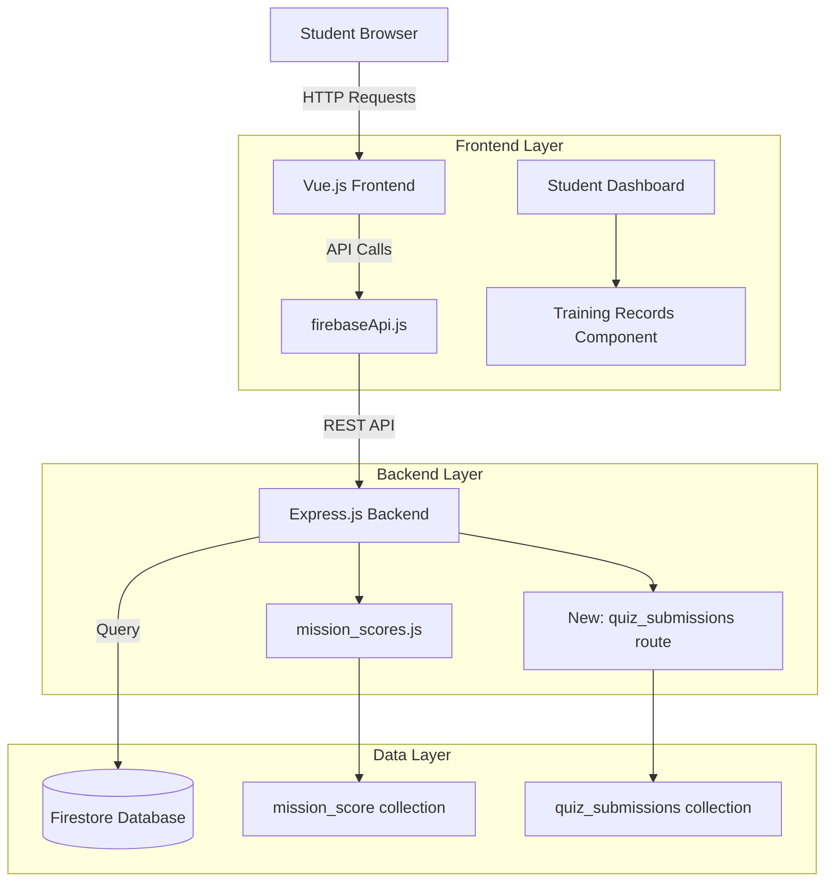
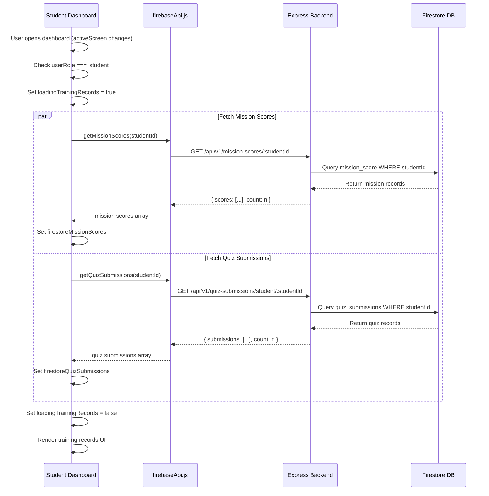

# Technical Design Document

## Overview

The Student Training Records Fetch feature enables students to view their complete training history from Firestore by implementing backend API endpoints, frontend API functions, and UI components that display mission scores and quiz submissions. This feature addresses the current issue where the Training Records tab displays "No completed missions yet" even when data exists in Firestore.

The design follows a three-tier architecture:
1. **Backend API Layer**: Express.js endpoints that query Firestore collections and return filtered training data
2. **Frontend API Layer**: Reusable JavaScript functions in `firebaseApi.js` that communicate with the backend
3. **Presentation Layer**: Vue.js components that display training records with loading states and error handling

This implementation leverages existing infrastructure patterns from the mission scores and quiz scores routes, ensuring consistency with the current codebase architecture.

## Architecture

### System Context



### Data Flow



### Component Hierarchy

```
App.vue (Student Dashboard)
├── Training Records Tab (v-show="hubTab === 'certificates'")
│   ├── Loading Indicator (v-if="loadingTrainingRecords")
│   ├── Mission Records Section
│   │   ├── Mission List (v-if="firestoreMissionScores.length")
│   │   │   └── Mission Record Item (v-for)
│   │   │       ├── Mission Title
│   │   │       ├── Score Percentage
│   │   │       ├── Completion Date
│   │   │       └── Instructor Name (if available)
│   │   └── Empty State (v-else)
│   └── Quiz Records Section
│       ├── Quiz Results List (v-if="firestoreQuizSubmissions.length")
│       │   └── Quiz Result Item (v-for)
│       │       ├── Quiz Title
│       │       ├── Score (correct/total)
│       │       ├── Submission Date
│       │       └── Module Name (if available)
│       └── Empty State (v-else)
```

## Components and Interfaces

### Backend API Components

#### 1. Mission Scores Endpoint (Existing)

**Route**: `GET /api/v1/mission-scores/:studentId`

**Location**: `backend/routes/mission_scores.js` (already implemented)

**Implementation Status**: ✅ Already exists

**Response Format**:
```json
{
  "scores": [
    {
      "id": "doc_id",
      "studentId": "student123",
      "missionId": "mission_xyz",
      "missionTitle": "Mission 1: Basic Navigation",
      "score": 85,
      "passed": true,
      "completedAt": "2024-01-15T10:30:00Z",
      "createdAt": "2024-01-15T10:30:00Z"
    }
  ],
  "count": 1
}
```

**Security**: Filters by studentId parameter from URL

#### 2. Quiz Submissions Endpoint (New)

**Route**: `GET /api/v1/quiz-submissions/student/:studentId`

**Location**: `backend/routes/quizzes.js` (new endpoint in existing file)

**Implementation Requirements**:
- Extract `studentId` from URL parameters
- Query `quiz_submissions` collection where `studentId` matches
- Order results by `submittedAt` or `completedAt` descending
- Return structured response with submissions array and count
- Handle empty results gracefully (return empty array, not error)

**Response Format**:
```json
{
  "submissions": [
    {
      "id": "submission_id",
      "quizId": "quiz123",
      "studentId": "student123",
      "studentName": "John Doe",
      "answers": [...],
      "moduleId": "module_abc",
      "score": 80,
      "correctCount": 8,
      "totalQuestions": 10,
      "submittedAt": "2024-01-15T14:20:00Z",
      "status": "graded"
    }
  ],
  "count": 1
}
```

**Error Handling**:
- 400 Bad Request: studentId parameter missing or invalid
- 500 Internal Server Error: Database query failures

**Security Considerations**:
- Only return submissions for the requested studentId
- No cross-student data leakage
- Backend validation ensures studentId is provided

### Frontend API Components

#### firebaseApi.js Functions (New)

**Location**: `src/api/firebaseApi.js`

**Function 1: getMissionScores**

```javascript
/**
 * Fetch mission scores for a specific student
 * @param {string} studentId - The student's ID
 * @returns {Promise<Object>} Response containing scores array and count
 */
export async function getMissionScores(studentId) {
  return apiFetch(`/mission-scores/${studentId}`);
}
```

**Function 2: getQuizSubmissions**

```javascript
/**
 * Fetch quiz submissions for a specific student
 * @param {string} studentId - The student's ID
 * @returns {Promise<Object>} Response containing submissions array and count
 */
export async function getQuizSubmissions(studentId) {
  return apiFetch(`/quiz-submissions/student/${studentId}`);
}
```

**Error Handling**:
- Uses existing `apiFetch` wrapper which provides:
  - Automatic JSON parsing
  - Centralized error logging
  - Promise rejection on HTTP errors
  - Consistent error format across all API calls

### Frontend State Management

#### Reactive State Variables (App.vue)

```javascript
// Located in <script> section of App.vue

// Loading state for training records fetch
const loadingTrainingRecords = ref(false);

// Firestore data storage
const firestoreMissionScores = ref([]);
const firestoreQuizSubmissions = ref([]);
```

#### State Update Function

**Function**: `fetchStudentTrainingRecords()`

**Location**: App.vue methods section

**Implementation**:

```javascript
/**
 * Fetch student training records from Firestore
 * Called when student dashboard loads
 */
async function fetchStudentTrainingRecords() {
  const studentId = currentUser.value?.id;
  
  // Guard clauses
  if (!studentId || userRole.value !== 'student' || !window.firebaseApi) {
    console.log('⚠️ Cannot fetch training records: missing student ID or Firebase API');
    return;
  }

  try {
    loadingTrainingRecords.value = true;
    console.log('📚 Fetching training records for student:', studentId);

    // Parallel fetch of mission scores and quiz submissions
    const [missionScoresResponse, quizSubmissionsResponse] = await Promise.all([
      window.firebaseApi.getMissionScores(studentId),
      window.firebaseApi.getQuizSubmissions(studentId)
    ]);

    // Update reactive state
    firestoreMissionScores.value = missionScoresResponse?.scores || [];
    firestoreQuizSubmissions.value = quizSubmissionsResponse?.submissions || [];
    
    console.log(`✅ Fetched ${firestoreMissionScores.value.length} mission scores`);
    console.log(`✅ Fetched ${firestoreQuizSubmissions.value.length} quiz submissions`);

  } catch (error) {
    console.error('❌ Failed to fetch training records:', error);
    // Set to empty arrays on error to ensure UI shows empty state
    firestoreMissionScores.value = [];
    firestoreQuizSubmissions.value = [];
  } finally {
    loadingTrainingRecords.value = false;
  }
}
```

**Trigger Mechanism**:

The function is called via a Vue watcher that monitors `activeScreen` changes:

```javascript
watch(activeScreen, (newScreen) => {
  if (newScreen === 'dashboard' && userRole.value === 'student') {
    fetchStudentTrainingRecords();
  }
});
```

### UI Components

#### Training Records Display

**Location**: App.vue template, section `v-show="hubTab === 'certificates'"`

**Loading State UI**:

```html
<div v-if="loadingTrainingRecords" class="training-records-loading">
  <div class="loading-spinner"></div>
  <p>Loading your training records...</p>
</div>
```

**Mission Records Section**:

```html
<div class="training-record-section">
  <h3 class="training-record-subtitle">📋 Completed Missions</h3>
  
  <!-- Mission List -->
  <ul v-if="firestoreMissionScores.length" class="training-record-list">
    <li v-for="score in firestoreMissionScores" :key="score.id" class="training-record-item">
      <div class="training-record-icon">✓</div>
      <div class="training-record-details">
        <strong class="training-record-title">{{ score.missionTitle || score.missionId }}</strong>
        <div class="training-record-meta">
          <span class="training-record-score">Score: {{ score.score }}%</span>
          <span class="training-record-date">{{ formatDate(score.completedAt) }}</span>
          <span v-if="score.instructorName" class="training-record-instructor">
            Instructor: {{ score.instructorName }}
          </span>
        </div>
      </div>
      <span class="training-record-badge" :class="{ 'badge-pass': score.passed, 'badge-fail': !score.passed }">
        {{ score.passed ? 'PASSED' : 'RETRY' }}
      </span>
    </li>
  </ul>
  
  <!-- Empty State -->
  <p v-else class="training-record-empty">
    No completed missions yet. Start your training to build your record!
  </p>
</div>
```

**Quiz Records Section**:

```html
<div class="training-record-section">
  <h3 class="training-record-subtitle">📝 Quiz Results</h3>
  
  <!-- Quiz List -->
  <ul v-if="firestoreQuizSubmissions.length" class="training-record-list">
    <li v-for="submission in firestoreQuizSubmissions" :key="submission.id" class="training-record-item">
      <div class="training-record-icon">📝</div>
      <div class="training-record-details">
        <strong class="training-record-title">{{ submission.quizTitle || 'Quiz' }}</strong>
        <div class="training-record-meta">
          <span class="training-record-score">
            {{ submission.correctCount }}/{{ submission.totalQuestions }} correct ({{ submission.score }}%)
          </span>
          <span class="training-record-date">{{ formatDate(submission.submittedAt) }}</span>
          <span v-if="submission.moduleName" class="training-record-module">
            Module: {{ submission.moduleName }}
          </span>
        </div>
      </div>
      <span class="training-record-badge" :class="{ 'badge-pass': submission.score >= 70, 'badge-fail': submission.score < 70 }">
        {{ submission.score >= 70 ? 'PASSED' : 'RETRY' }}
      </span>
    </li>
  </ul>
  
  <!-- Empty State -->
  <p v-else class="training-record-empty">
    No quiz results yet. Complete a quiz to see your results here!
  </p>
</div>
```

#### Helper Functions

**Date Formatting**:

```javascript
/**
 * Format Firestore timestamp for display
 * @param {Timestamp|string|Date} timestamp - Firestore timestamp or date
 * @returns {string} Formatted date string
 */
function formatDate(timestamp) {
  if (!timestamp) return 'N/A';
  
  let date;
  if (timestamp.toDate) {
    // Firestore Timestamp
    date = timestamp.toDate();
  } else if (typeof timestamp === 'string') {
    date = new Date(timestamp);
  } else {
    date = timestamp;
  }
  
  return date.toLocaleDateString('en-US', {
    year: 'numeric',
    month: 'short',
    day: 'numeric',
    hour: '2-digit',
    minute: '2-digit'
  });
}
```

## Data Models

### Mission Score Document

**Firestore Collection**: `mission_score`

**Schema**:

```typescript
interface MissionScore {
  id: string;                    // Firestore document ID
  studentId: string;             // Foreign key to students collection
  missionId: string;             // Foreign key to missions collection
  missionTitle?: string;         // Denormalized mission title for display
  score: number;                 // Percentage score (0-100)
  passed: boolean;               // True if score >= 80
  completedAt: Timestamp;        // When the mission was completed
  createdAt: Timestamp;          // Record creation timestamp
  instructorName?: string;       // Optional instructor information
}
```

**Indexes Required**:
- `studentId` (ascending) - for filtering by student
- `completedAt` (descending) - for ordering by date

**Query Pattern**:
```javascript
db.collection('mission_score')
  .where('studentId', '==', studentId)
  .orderBy('completedAt', 'desc')
  .get()
```

### Quiz Submission Document

**Firestore Collection**: `quiz_submissions`

**Schema**:

```typescript
interface QuizSubmission {
  id: string;                    // Firestore document ID
  quizId: string;                // Foreign key to quiz collection
  studentId: string;             // Foreign key to students collection
  studentName: string;           // Denormalized student name
  answers: Array<{               // Student's answers
    questionId: string;
    answer: string;
    isCorrect: boolean;
  }>;
  moduleId?: string;             // Optional module association
  score: number;                 // Percentage score (0-100)
  correctCount: number;          // Number of correct answers
  totalQuestions: number;        // Total number of questions
  submittedAt: Timestamp;        // Submission timestamp
  status: 'pending' | 'graded';  // Grading status
  attemptNumber: number;         // Which attempt this was
  quizTitle?: string;            // Denormalized quiz title for display
  moduleName?: string;           // Denormalized module name for display
}
```

**Indexes Required**:
- `studentId` (ascending) - for filtering by student
- `submittedAt` (descending) - for ordering by date

**Query Pattern**:
```javascript
db.collection('quiz_submissions')
  .where('studentId', '==', studentId)
  .orderBy('submittedAt', 'desc')
  .get()
```

### API Response Models

**Mission Scores Response**:

```typescript
interface MissionScoresResponse {
  scores: MissionScore[];
  count: number;
}
```

**Quiz Submissions Response**:

```typescript
interface QuizSubmissionsResponse {
  submissions: QuizSubmission[];
  count: number;
}
```

## Error Handling

### Backend Error Responses

**1. Validation Errors (400)**

Triggered when:
- `studentId` parameter is missing from URL
- `studentId` format is invalid

Response format:
```json
{
  "error": "Bad Request",
  "message": "studentId parameter is required",
  "timestamp": "2024-01-15T10:30:00.000Z"
}
```

**2. Server Errors (500)**

Triggered when:
- Firestore query fails
- Database connection issues
- Unexpected exceptions

Response format:
```json
{
  "error": "Server Error",
  "message": "Failed to fetch quiz submissions",
  "timestamp": "2024-01-15T10:30:00.000Z"
}
```

**3. Empty Results (200)**

When no records exist for a student, return successful response with empty array:
```json
{
  "scores": [],
  "count": 0
}
```

### Frontend Error Handling

**1. API Call Failures**

Strategy:
- Catch errors in `fetchStudentTrainingRecords()`
- Log error to console for debugging
- Set reactive state to empty arrays
- Display empty state message to user
- Do not show error modals (graceful degradation)

**2. Missing Data**

Strategy:
- Use optional chaining for nested properties
- Provide fallback values for display
- Example: `score.missionTitle || score.missionId || 'Unknown Mission'`

**3. Loading State Management**

Strategy:
- Always set `loadingTrainingRecords = false` in finally block
- Ensure loading state is cleared even if both API calls fail
- Use `Promise.all()` to wait for all fetches before clearing loading state

**4. Network Timeouts**

Strategy:
- Rely on browser's default fetch timeout
- Show empty state if timeout occurs
- Log timeout to console
- User can refresh page to retry

### Error Recovery Patterns

```javascript
async function fetchStudentTrainingRecords() {
  const studentId = currentUser.value?.id;
  
  // Guard clause pattern
  if (!studentId) {
    console.log('⚠️ Cannot fetch: missing student ID');
    return;
  }

  try {
    loadingTrainingRecords.value = true;
    
    // Parallel fetch with Promise.all for faster loading
    const [missionResponse, quizResponse] = await Promise.all([
      window.firebaseApi.getMissionScores(studentId).catch(err => {
        console.error('Mission scores fetch failed:', err);
        return { scores: [], count: 0 }; // Fallback
      }),
      window.firebaseApi.getQuizSubmissions(studentId).catch(err => {
        console.error('Quiz submissions fetch failed:', err);
        return { submissions: [], count: 0 }; // Fallback
      })
    ]);

    // Defensive data extraction with fallbacks
    firestoreMissionScores.value = missionResponse?.scores || [];
    firestoreQuizSubmissions.value = quizResponse?.submissions || [];
    
  } catch (error) {
    // Catch-all for unexpected errors
    console.error('❌ Failed to fetch training records:', error);
    firestoreMissionScores.value = [];
    firestoreQuizSubmissions.value = [];
  } finally {
    // Always clear loading state
    loadingTrainingRecords.value = false;
  }
}
```

## Testing Strategy

This feature involves primarily integration and example-based testing rather than property-based testing, as it deals with:
- External service integration (Firestore database)
- UI rendering and user interactions
- HTTP API endpoints with specific request/response formats
- Configuration and data retrieval (no complex transformations)

### Backend Testing

**Unit Tests** (`backend/routes/quizzes.test.js`):

1. **Quiz Submissions Endpoint - Success Case**
   - Test: GET `/api/v1/quiz-submissions/student/:studentId` returns submissions
   - Setup: Mock Firestore with sample quiz submission documents
   - Assert: Response status 200, submissions array matches mock data, count is correct
   - Assert: Results ordered by submittedAt descending

2. **Quiz Submissions Endpoint - Empty Result**
   - Test: GET request when student has no submissions
   - Setup: Mock Firestore to return empty query result
   - Assert: Response status 200, submissions array is empty, count is 0

3. **Quiz Submissions Endpoint - Missing Parameter**
   - Test: GET request without studentId parameter
   - Assert: Response status 400, error message about missing studentId

4. **Quiz Submissions Endpoint - Database Error**
   - Test: Firestore query throws error
   - Setup: Mock Firestore to throw exception
   - Assert: Response status 500, error message present

5. **Mission Scores Endpoint - Existing Tests**
   - Verify existing tests in `mission_scores.js` cover similar scenarios
   - Ensure consistent error handling patterns

**Integration Tests**:

1. **End-to-End Quiz Submissions Fetch**
   - Test: Query actual Firestore test database with known studentId
   - Assert: Correct number of records returned
   - Assert: All returned records match studentId filter
   - Assert: No data leakage from other students

2. **End-to-End Mission Scores Fetch**
   - Test: Query actual Firestore test database with known studentId
   - Assert: Records properly filtered and ordered
   - Assert: Security isolation verified

### Frontend Testing

**Unit Tests** (`src/api/firebaseApi.test.js`):

1. **getMissionScores - Success**
   - Test: Function makes correct API call
   - Mock: fetch returns successful response
   - Assert: Correct endpoint URL, method, and headers
   - Assert: Response data parsed correctly

2. **getMissionScores - Error**
   - Test: Function handles API errors
   - Mock: fetch returns 500 error
   - Assert: Error is caught and re-thrown
   - Assert: Error logged to console

3. **getQuizSubmissions - Success**
   - Test: Function makes correct API call
   - Mock: fetch returns successful response with submissions
   - Assert: Correct endpoint format `/quiz-submissions/student/:studentId`
   - Assert: Response data structure validated

4. **getQuizSubmissions - Error**
   - Test: Function handles network failures
   - Mock: fetch throws network error
   - Assert: Error propagated to caller
   - Assert: Error logged appropriately

**Component Tests** (`src/App.test.js`):

1. **fetchStudentTrainingRecords - Guard Clauses**
   - Test: Function returns early when studentId is missing
   - Assert: No API calls made when currentUser.value.id is undefined
   - Assert: No API calls made when userRole is not 'student'

2. **fetchStudentTrainingRecords - Loading State**
   - Test: Loading indicator shows during fetch
   - Assert: loadingTrainingRecords is true during API calls
   - Assert: loadingTrainingRecords is false after completion
   - Assert: Loading state cleared even on error

3. **fetchStudentTrainingRecords - Success**
   - Test: Data stored in reactive variables
   - Mock: API returns sample data
   - Assert: firestoreMissionScores populated correctly
   - Assert: firestoreQuizSubmissions populated correctly

4. **fetchStudentTrainingRecords - Partial Failure**
   - Test: One API call fails, other succeeds
   - Mock: Mission scores succeed, quiz submissions fail
   - Assert: Mission scores populated
   - Assert: Quiz submissions set to empty array
   - Assert: Loading state still cleared

5. **fetchStudentTrainingRecords - Complete Failure**
   - Test: Both API calls fail
   - Mock: Both endpoints return errors
   - Assert: Both arrays set to empty
   - Assert: Loading state cleared
   - Assert: No uncaught exceptions

**UI Rendering Tests**:

1. **Loading State Display**
   - Test: Loading indicator visible when loadingTrainingRecords is true
   - Assert: Loading message displayed
   - Assert: Training records content hidden

2. **Mission Records - Populated State**
   - Test: Mission list renders when data exists
   - Setup: Set firestoreMissionScores with sample data
   - Assert: Correct number of list items rendered
   - Assert: Mission titles displayed
   - Assert: Scores formatted as percentages
   - Assert: Dates formatted correctly

3. **Mission Records - Empty State**
   - Test: Empty message shown when no missions
   - Setup: Set firestoreMissionScores to empty array
   - Assert: Empty state message visible
   - Assert: No mission list rendered

4. **Quiz Records - Populated State**
   - Test: Quiz list renders when data exists
   - Setup: Set firestoreQuizSubmissions with sample data
   - Assert: Quiz titles displayed
   - Assert: Scores shown as "X/Y correct"
   - Assert: Submission dates formatted

5. **Quiz Records - Empty State**
   - Test: Empty message shown when no quizzes
   - Setup: Set firestoreQuizSubmissions to empty array
   - Assert: Empty state message visible

### Manual Testing Checklist

**Smoke Tests**:

- [ ] Student can log in successfully
- [ ] Dashboard loads without errors
- [ ] Training Records tab is clickable
- [ ] Loading indicator appears briefly
- [ ] Training records display (or empty state)
- [ ] No console errors in browser

**Functional Tests**:

- [ ] Mission scores display with correct data
- [ ] Quiz submissions display with correct data
- [ ] Dates are formatted in readable format
- [ ] Scores are displayed correctly (percentage and fraction)
- [ ] Empty states show appropriate messages
- [ ] Instructor names display when available
- [ ] Module names display when available
- [ ] Badge indicators (PASSED/RETRY) display correctly

**Security Tests**:

- [ ] Student A cannot see Student B's training records
- [ ] Attempting to request other studentIds is blocked
- [ ] Backend properly filters by studentId parameter
- [ ] No cross-student data leakage in UI

**Performance Tests**:

- [ ] Parallel API calls complete in reasonable time (<2 seconds)
- [ ] Large record sets (50+ records) render smoothly
- [ ] Loading state clears after both fetches complete
- [ ] Browser doesn't freeze during data fetch

**Error Scenario Tests**:

- [ ] Network offline: Empty state displays gracefully
- [ ] Backend server down: Empty state displays
- [ ] Invalid studentId: Empty state displays
- [ ] Partial failure (one endpoint fails): Other data still displays
- [ ] Firestore query timeout: Loading state clears

## Security Considerations

### Authentication and Authorization

**Student Identity Verification**:

1. **Frontend Guards**
   - `currentUser.value.id` must be present before API calls
   - `userRole.value` must equal `'student'` to trigger fetch
   - Guards implemented in `fetchStudentTrainingRecords()` function

2. **Backend Validation**
   - Extract `studentId` from URL parameters (not request body)
   - Validate `studentId` format before querying database
   - Return 400 error if validation fails

**Cross-Student Data Protection**:

1. **Query Filtering**
   - All Firestore queries MUST filter by `studentId`
   - No endpoint should return unfiltered collections
   - Each query validates studentId matches URL parameter

2. **Response Scrubbing**
   - Responses only include data for requested student
   - No instructor-only or admin-only fields exposed
   - Sensitive fields (like raw passwords) never included

### Data Access Patterns

**Principle of Least Privilege**:

```javascript
// Mission Scores Route - Filtered Query
router.get('/:studentId', async (req, res) => {
  const { studentId } = req.params;
  
  // Validation
  if (!studentId) {
    return res.status(400).json({ error: 'Bad Request', message: 'studentId required' });
  }
  
  // Query MUST include studentId filter
  const snapshot = await db.collection('mission_score')
    .where('studentId', '==', studentId)  // Security-critical filter
    .orderBy('completedAt', 'desc')
    .get();
  
  // Only return filtered results
  const scores = snapshot.docs.map(doc => ({ id: doc.id, ...doc.data() }));
  res.json({ scores, count: scores.length });
});
```

**Quiz Submissions Route - Secure Implementation**:

```javascript
// NEW: Quiz Submissions Route
router.get('/student/:studentId', async (req, res) => {
  const { studentId } = req.params;
  
  // Validation
  if (!studentId) {
    return res.status(400).json({ 
      error: 'Bad Request', 
      message: 'studentId parameter is required' 
    });
  }
  
  // Query with security filter
  const snapshot = await db.collection('quiz_submissions')
    .where('studentId', '==', studentId)  // Enforce student isolation
    .orderBy('submittedAt', 'desc')
    .get();
  
  const submissions = snapshot.docs.map(doc => ({ id: doc.id, ...doc.data() }));
  res.json({ submissions, count: submissions.length });
});
```

### Frontend Security Measures

**1. Secure State Management**

```javascript
// State variables scoped to current user
const firestoreMissionScores = ref([]);
const firestoreQuizSubmissions = ref([]);

// Clear state on logout
function handleLogout() {
  firestoreMissionScores.value = [];
  firestoreQuizSubmissions.value = [];
  currentUser.value = null;
  // ... other cleanup
}
```

**2. API Request Validation**

```javascript
// Frontend guard prevents unnecessary API calls
async function fetchStudentTrainingRecords() {
  const studentId = currentUser.value?.id;
  
  // Don't make API calls if:
  if (!studentId) return;                        // No student ID
  if (userRole.value !== 'student') return;      // Not a student
  if (!window.firebaseApi) return;               // API not loaded
  
  // Proceed with secure fetch...
}
```

**3. XSS Prevention**

- Vue.js automatically escapes text interpolation: `{{ score.missionTitle }}`
- No `v-html` directives used in training records display
- User-generated content (mission titles, quiz titles) sanitized by Vue
- No direct DOM manipulation with user data

### Data Privacy Compliance

**Student Data Protection**:

1. **Minimal Data Exposure**
   - Only display data relevant to the logged-in student
   - No sharing of aggregate statistics that might identify other students
   - No leaderboard data in training records section

2. **Audit Trail**
   - Backend logs all training record queries
   - Log format: `"Fetching training records for student: {studentId}"`
   - Helps identify unauthorized access attempts

3. **Session Security**
   - Training records only fetched when student is authenticated
   - Data cleared from memory on logout
   - No persistent storage of training records in localStorage

### Firestore Security Rules

**Required Firestore Rules** (for defense-in-depth):

```javascript
rules_version = '2';
service cloud.firestore {
  match /databases/{database}/documents {
    // Mission scores - students can only read their own
    match /mission_score/{scoreId} {
      allow read: if request.auth != null && 
                     resource.data.studentId == request.auth.uid;
      allow write: if request.auth != null; // Backend handles writes
    }
    
    // Quiz submissions - students can only read their own
    match /quiz_submissions/{submissionId} {
      allow read: if request.auth != null && 
                     resource.data.studentId == request.auth.uid;
      allow write: if request.auth != null; // Backend handles writes
    }
  }
}
```

**Note**: While backend API enforces security at the application layer, Firestore security rules provide an additional layer of protection against direct database access.

### Threat Mitigation

| Threat | Mitigation |
|--------|------------|
| Cross-student data access | Query filtering by studentId, backend validation |
| Parameter tampering | studentId from URL params, validated before query |
| Unauthorized API access | Frontend role checks, backend authentication |
| Data exposure in logs | Sensitive data not logged, only IDs logged |
| XSS attacks | Vue.js automatic escaping, no v-html usage |
| CSRF attacks | CORS configuration, origin validation |
| SQL injection | N/A (Firestore NoSQL, parameterized queries) |
| Mass assignment | Explicit field mapping, no direct request body use |

## Implementation Notes

### Backend Route Registration

**File**: `backend/server.js`

**Current State**: Quiz scores route exists at `/api/v1/quiz-scores`

**Required Change**: Add new quiz submissions endpoint to quizzes route

**Implementation**:

The new endpoint will be added to `backend/routes/quizzes.js`, which is already registered in `server.js`:

```javascript
// Existing registration (no change needed)
app.use(`${API_PREFIX}/quizzes`, quizzesRoutes);
```

The new endpoint `GET /student/:studentId` will be accessible at:
```
/api/v1/quiz-submissions/student/:studentId
```

**Route Handler Location**: Add to `backend/routes/quizzes.js` after existing endpoints

### Frontend API Integration

**File**: `src/api/firebaseApi.js`

**Location**: Add new functions in the appropriate section (after existing quiz functions)

**Pattern**: Follow existing `apiFetch` wrapper pattern for consistency

```javascript
// Add these functions to firebaseApi.js

// =============================================================================
// TRAINING RECORDS API
// =============================================================================

export async function getMissionScores(studentId) {
  return apiFetch(`/mission-scores/${studentId}`);
}

export async function getQuizSubmissions(studentId) {
  return apiFetch(`/quiz-submissions/student/${studentId}`);
}
```

### State Initialization

**File**: `src/App.vue`

**Location**: Add to existing reactive state variables (around line 5680)

**Pattern**: Follow existing ref() pattern for reactive state

```javascript
// Add near other Firestore-related state variables
const firestoreMissionScores = ref([]);
const firestoreQuizSubmissions = ref([]);
const loadingTrainingRecords = ref(false);
```

### Trigger Implementation

**File**: `src/App.vue`

**Location**: Add watcher in the same section as other screen watchers

**Pattern**: Use existing Vue 3 watch() API

```javascript
// Watch for dashboard screen activation
watch(() => [activeScreen.value, userRole.value], ([screen, role]) => {
  if (screen === 'dashboard' && role === 'student') {
    fetchStudentTrainingRecords();
  }
});
```

**Alternative**: Use existing `watch(activeScreen, ...)` and add conditional logic

### UI Template Updates

**File**: `src/App.vue`

**Location**: Replace existing Training Records section (around line 1768)

**Current State**: Displays placeholder text "Quiz results will appear here after completion"

**Required Changes**:
1. Add loading state conditional rendering
2. Replace mission list to use `firestoreMissionScores` instead of `studentCertificateList`
3. Add quiz submissions list using `firestoreQuizSubmissions`
4. Update empty state messages per requirements

### CSS Styling

**File**: `src/App.vue` (style section)

**Location**: Training Records styles section (around line 16928)

**Existing Classes**:
- `.training-record-section`
- `.training-record-subtitle`
- `.training-record-list`
- `.training-record-item`
- `.training-record-details`
- `.training-record-meta`

**New Classes Needed**:
- `.training-records-loading` - Loading state container
- `.loading-spinner` - Animated spinner
- `.badge-pass` / `.badge-fail` - Score badge variants

**Styling Pattern**: Follow existing glass-card and motivation-block styling

### Data Flow Optimization

**Parallel Fetching**:

Use `Promise.all()` to fetch mission scores and quiz submissions simultaneously:

```javascript
const [missionResponse, quizResponse] = await Promise.all([
  window.firebaseApi.getMissionScores(studentId),
  window.firebaseApi.getQuizSubmissions(studentId)
]);
```

**Benefits**:
- Reduces total load time from sequential (2x) to parallel (max of both)
- Improves perceived performance
- Loading state cleared only after both complete

**Trade-off**: If one fails, both must be caught individually to prevent complete failure

### Caching Considerations

**Current Implementation**: No caching

**Future Enhancement Options**:

1. **Session-level caching**:
   - Cache training records in memory during session
   - Refresh only when explicitly requested
   - Clear cache on logout

2. **Stale-while-revalidate**:
   - Show cached data immediately
   - Fetch fresh data in background
   - Update UI when fresh data arrives

3. **Firestore real-time listeners** (not recommended for this use case):
   - Real-time updates increase complexity
   - Training records don't change frequently enough to justify

**Recommendation**: Start without caching, add if performance issues arise

### Error Recovery UI

**Current Implementation**: Log to console, show empty state

**Future Enhancement**:

Add retry button when fetch fails:

```html
<div v-if="trainingRecordsFetchError" class="training-records-error">
  <p>Unable to load training records. Please try again.</p>
  <button @click="fetchStudentTrainingRecords" class="retry-btn">
    🔄 Retry
  </button>
</div>
```

**Implementation**: Add `trainingRecordsFetchError` reactive ref to track error state

### Performance Considerations

**Firestore Query Costs**:

Each training records fetch costs:
- 1 read per mission score document
- 1 read per quiz submission document
- Typical student: 5-20 reads per fetch

**Optimization Strategies**:

1. **Pagination** (if needed for students with 100+ records):
   ```javascript
   .limit(50)  // Show most recent 50 records
   ```

2. **Lazy loading**: Fetch only when Training Records tab is selected
   - Requires tab change watcher instead of dashboard load
   - Reduces initial dashboard load time

3. **Firestore composite indexes**: Required for `where + orderBy` queries
   - Firestore will prompt to create index on first query
   - Index creation is automatic via console link

### Date Formatting Best Practices

**Implementation**:

```javascript
function formatDate(timestamp) {
  if (!timestamp) return 'N/A';
  
  let date;
  
  // Handle Firestore Timestamp
  if (timestamp?.toDate) {
    date = timestamp.toDate();
  }
  // Handle ISO string
  else if (typeof timestamp === 'string') {
    date = new Date(timestamp);
  }
  // Handle Date object
  else if (timestamp instanceof Date) {
    date = timestamp;
  }
  else {
    return 'Invalid date';
  }
  
  // Check for invalid date
  if (isNaN(date.getTime())) {
    return 'Invalid date';
  }
  
  // Format with locale
  return date.toLocaleDateString('en-US', {
    year: 'numeric',
    month: 'short',
    day: 'numeric',
    hour: '2-digit',
    minute: '2-digit'
  });
}
```

**Output Examples**:
- `"Jan 15, 2024, 10:30 AM"`
- `"Dec 3, 2023, 2:45 PM"`

### Backend Logging Standards

**Pattern**: Use emoji prefixes for log clarity

```javascript
console.log('📚 Fetching training records for student:', studentId);
console.log(`✅ Fetched ${scores.length} mission scores`);
console.error('❌ Failed to fetch quiz submissions:', error);
console.warn('⚠️ Student ID missing in request');
```

**Log Levels**:
- `console.log()` - Normal operations
- `console.warn()` - Recoverable issues
- `console.error()` - Failures requiring attention

### API Versioning

**Current Version**: `/api/v1`

**Endpoint Stability**:
- Mission scores: Stable (existing endpoint)
- Quiz submissions: New endpoint (v1)

**Future Considerations**:
- If response format needs breaking changes, create `/api/v2`
- Maintain v1 for backward compatibility
- Document deprecation timeline

### Database Migration Notes

**No migration required** - This feature reads existing data:
- `mission_score` collection already exists
- `quiz_submissions` collection already exists
- No schema changes needed
- No data backfill required

**Index Creation**:
Firestore will automatically create indexes when first query runs:
- `mission_score` index on `(studentId, completedAt DESC)`
- `quiz_submissions` index on `(studentId, submittedAt DESC)`

**Verification**:
After first deployment, verify indexes in Firebase Console:
- Navigate to Firestore > Indexes
- Confirm composite indexes are created
- Check index status is "Enabled"

---

**Design Document Version**: 1.0  
**Last Updated**: 2024-01-15  
**Author**: Kiro AI Agent  
**Status**: Ready for Implementation
