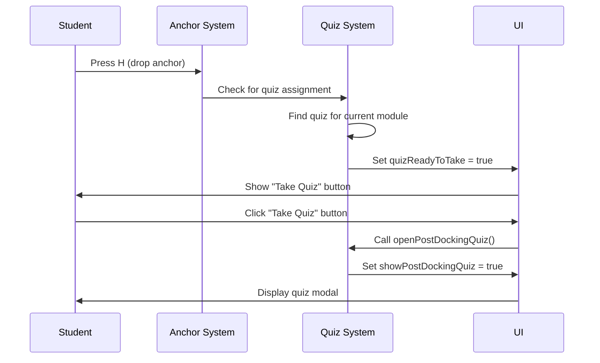

# Take Quiz Button Implementation

## Summary

Changed the post-docking quiz system from **auto-opening** to **button-triggered**, allowing students to take the quiz when they're ready after dropping anchor at the harbor.

## Changes Made

### 1. Added New Reactive Variable

**File**: `capstone/src/App.vue`

**Location**: Line ~7687

**Change**: Added `quizReadyToTake` flag to track when the quiz button should be shown

```javascript
/**
 * Flag tracking whether the quiz button should be shown (anchor deployed, quiz available).
 * @type {Ref<boolean>}
 */
const quizReadyToTake = ref(false);
```

### 2. Added `openPostDockingQuiz()` Function

**File**: `capstone/src/App.vue`

**Location**: Line ~8006

**Change**: New function to open the quiz modal when the student clicks the "Take Quiz" button

```javascript
/**
 * Opens the post-docking quiz modal when the student clicks "Take Quiz" button.
 * 
 * @function openPostDockingQuiz
 * @returns {void}
 */
function openPostDockingQuiz() {
  if (postDockingQuizData.value) {
    showPostDockingQuiz.value = true;
    postDockingQuizTriggered.value = true;
  }
}
```

### 3. Modified Quiz Trigger Logic

**File**: `capstone/src/App.vue`

**Location**: Line ~13805

**Before**: Automatically opened quiz modal when anchor was deployed
```javascript
// Show the quiz modal
postDockingQuizData.value = quiz;
showPostDockingQuiz.value = true;  // ❌ Auto-open
postDockingQuizTriggered.value = true;
```

**After**: Shows "Take Quiz" button instead
```javascript
// Store quiz data and show the "Take Quiz" button
postDockingQuizData.value = quiz;
quizReadyToTake.value = true;  // ✅ Show button
```

### 4. Added "Take Quiz" Button UI

**File**: `capstone/src/App.vue`

**Location**: Line ~2891 (before Report Mission button)

**Change**: Added overlay with "Take Quiz" button (similar to Report Mission button)

```vue
<!-- Take Quiz Button - CENTER OVERLAY (appears when anchor is deployed and quiz is available) -->
<transition name="fade">
  <div v-if="quizReadyToTake && anchor.deployed && !showPostDockingQuiz" class="report-mission-overlay">
    <div class="report-mission-card">
      <div class="report-icon">📝</div>
      <h2>Quiz Available!</h2>
      <p>You've anchored at the harbor. Ready to take the quiz?</p>
      <button
        class="report-mission-btn-large"
        @click="openPostDockingQuiz"
      >
        📝 Take Quiz
      </button>
    </div>
  </div>
</transition>
```

### 5. Updated Cleanup Logic

**File**: `capstone/src/App.vue`

**Locations**: 
- Line ~10502 (mission reset)
- Line ~13840 (anchor retracted)

**Change**: Reset both `postDockingQuizTriggered` and `quizReadyToTake` when anchor is raised or mission ends

```javascript
// Reset quiz trigger flag and button when anchor is raised
postDockingQuizTriggered.value = false;
quizReadyToTake.value = false;
```

## How It Works

### User Flow

1. **Student completes mission objectives** (visits all buoys)
2. **Student returns to harbor and drops anchor** (presses H key)
3. **"Take Quiz" button appears** in center of screen with message "Quiz Available!"
4. **Student clicks "Take Quiz" button** when ready
5. **Quiz modal opens** with questions
6. **Student answers questions and submits**
7. **Quiz results modal shows** score and feedback
8. **"Report Mission" button appears** (if mission is complete)

### Technical Flow



### Conditions for "Take Quiz" Button to Appear

The button appears when **ALL** of these conditions are met:

1. ✅ `quizReadyToTake === true` (quiz data is loaded)
2. ✅ `anchor.deployed === true` (anchor is deployed)
3. ✅ `!showPostDockingQuiz` (quiz modal is not already open)
4. ✅ Student is in training mode (`activeTrainingModule.value` exists)
5. ✅ Quiz assignment exists for current module
6. ✅ Quiz has questions (not empty)

### Button Hides When

The button hides when **ANY** of these occur:

1. ❌ Student raises anchor (presses H again)
2. ❌ Quiz modal opens (student clicked "Take Quiz")
3. ❌ Mission ends / student exits simulation
4. ❌ Student quits to dashboard

## UI Appearance

**Button Style**: Same as "Report Mission" button
- **Position**: Center overlay
- **Icon**: 📝 (clipboard emoji)
- **Title**: "Quiz Available!"
- **Message**: "You've anchored at the harbor. Ready to take the quiz?"
- **Button Text**: "📝 Take Quiz"
- **Animation**: Fade in/out transition

## Testing

### Test Case 1: Normal Quiz Flow
1. Start a mission with an assigned quiz
2. Complete mission objectives (visit all buoys)
3. Return to harbor
4. Press H to drop anchor
5. **Expected**: "Take Quiz" button appears
6. Click "Take Quiz" button
7. **Expected**: Quiz modal opens
8. Answer questions and submit
9. **Expected**: Results modal shows score

### Test Case 2: No Quiz Assigned
1. Start a mission with NO assigned quiz
2. Return to harbor and drop anchor
3. **Expected**: No "Take Quiz" button appears
4. **Expected**: "Report Mission" button appears directly

### Test Case 3: Raise Anchor Before Taking Quiz
1. Drop anchor (Take Quiz button appears)
2. Press H to raise anchor
3. **Expected**: Take Quiz button disappears
4. Drop anchor again
5. **Expected**: Take Quiz button reappears

### Test Case 4: Multiple Anchor Drops
1. Drop anchor (button appears)
2. Click "Take Quiz" and complete quiz
3. Close results modal
4. Raise anchor
5. Drop anchor again
6. **Expected**: Button does NOT reappear (quiz already completed)

## Files Modified

- `capstone/src/App.vue` (5 changes)
  1. Added `quizReadyToTake` ref
  2. Added `openPostDockingQuiz()` function
  3. Modified quiz trigger logic (line ~13805)
  4. Added "Take Quiz" button UI (line ~2891)
  5. Updated cleanup logic (lines ~10502, ~13840)

## No Breaking Changes

- ✅ Existing quiz modal (`PostDockingQuizModal.vue`) unchanged
- ✅ Existing quiz results modal (`QuizResultsModal.vue`) unchanged
- ✅ Existing quiz submission logic unchanged
- ✅ Existing quiz scoring logic unchanged
- ✅ All other mission functionality unchanged

## User Benefit

**Before**: Quiz opens automatically → student might not be ready → confusing UX

**After**: "Take Quiz" button appears → student clicks when ready → better UX, more control

## Screenshot Reference

The user's screenshot shows:
- Boat anchored at harbor
- "IN ZONE" indicator visible
- Training steps panel on right side
- This is where the "Take Quiz" button will now appear (center overlay)
