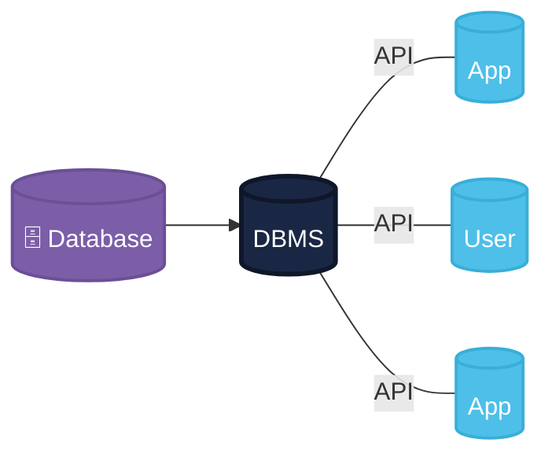
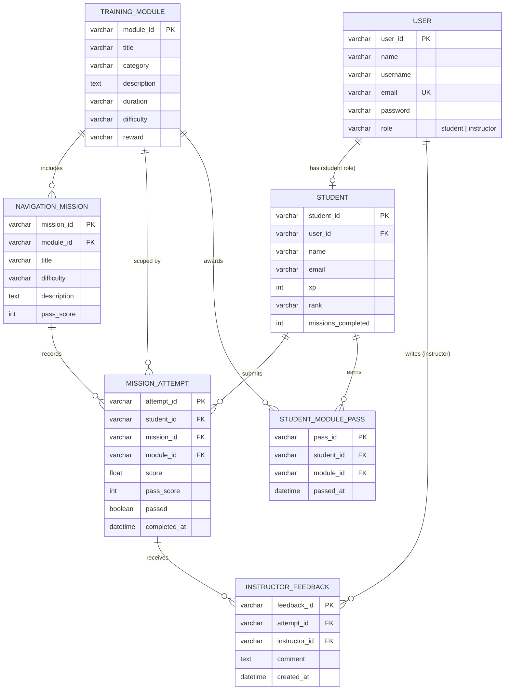
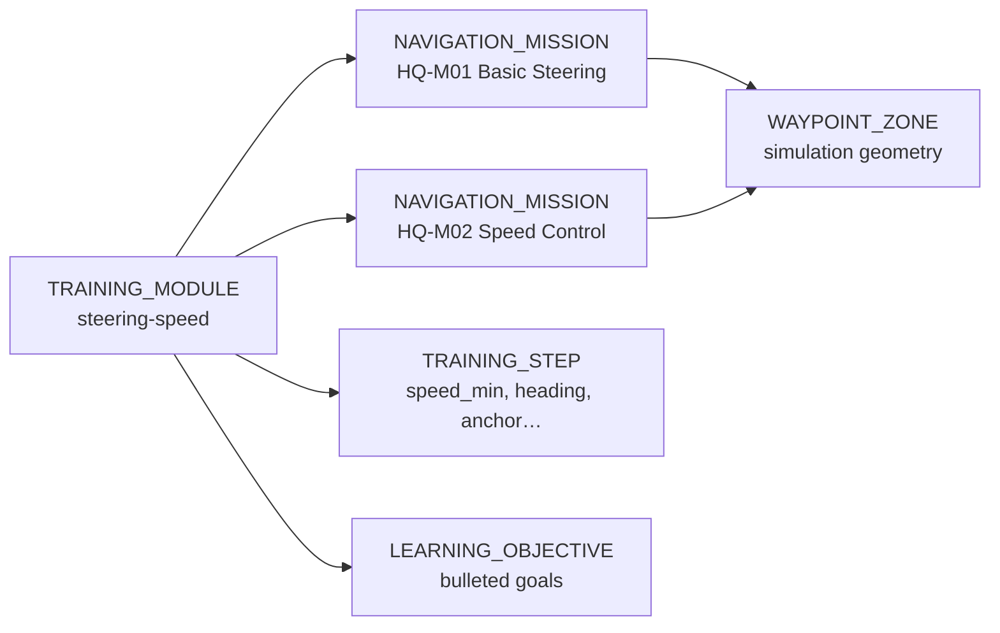
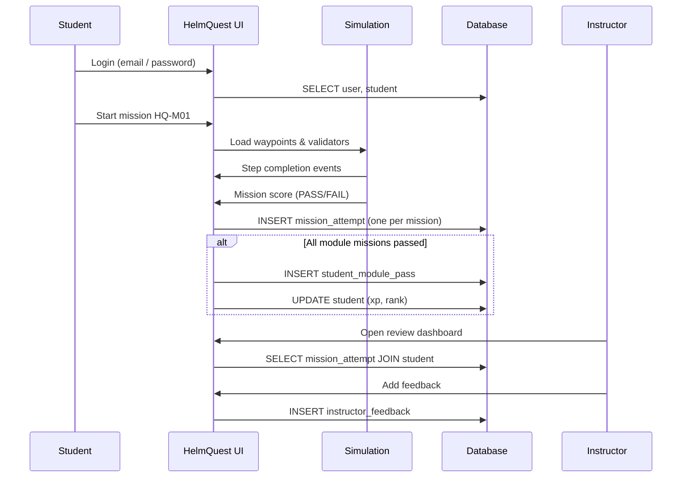

# HelmQuest — Database Management System Chart

Maritime navigation training platform (`HelmQuest`). This document is the **DBMS reference chart**: architecture, entity relationships, tables, and how data maps from the current browser app to a production database.

**Quick export:** paste [`helmquest-schema.dbml`](./helmquest-schema.dbml) into [dbdiagram.io](https://dbdiagram.io) for a PNG/PDF ERD.

---

## 1. DBMS architecture

Classic DBMS layout: **Database → DBMS → API → App / User**.

**Open the visual diagram:** [`dbms-diagram.html`](./dbms-diagram.html) (open in a browser — matches the reference style with purple Database, central DBMS hub, and blue App/User nodes linked by API).



### HelmQuest mapping

| Node | HelmQuest component |
|------|---------------------|
| **Database** | PostgreSQL — `user`, `student`, `training_module`, `navigation_mission`, `mission_attempt`, `student_module_pass`, `instructor_feedback` |
| **DBMS** | Database engine — SQL queries, transactions, constraints, backups |
| **API** | REST/GraphQL layer — auth, progress, catalog, instructor feedback endpoints |
| **App** (top) | Student HelmQuest client (`App.vue` — training hub + simulation) |
| **User** | Student or instructor account |
| **App** (bottom) | Instructor review dashboard |

**Today (prototype):** the student app reads/writes `localStorage` directly — no API or server DB yet. The diagram above is the **target production architecture**.

| Layer | Today | Target |
|-------|-------|--------|
| Database | — | PostgreSQL |
| DBMS | — | Managed PostgreSQL / RDS |
| API | — | Node or Python backend |
| App | `App.vue` + `progressStore.js` | Same UI, calls API |
| User | Demo login (`student@` / `instructor@`) | Real accounts |

---

## 2. Entity relationship diagram (logical schema)

Seven core tables for accounts, training catalog, graded attempts, and instructor feedback.



### Relationship summary

| # | Parent | Child | Cardinality | Business rule |
|---|--------|-------|-------------|---------------|
| 1 | USER | STUDENT | 1 : 0..1 | Only student-role accounts have a student profile |
| 2 | TRAINING_MODULE | NAVIGATION_MISSION | 1 : N | Each module contains multiple missions |
| 3 | STUDENT | MISSION_ATTEMPT | 1 : N | **One attempt per mission per student** (enforced in app) |
| 4 | NAVIGATION_MISSION | MISSION_ATTEMPT | 1 : N | Attempts reference the mission graded |
| 5 | STUDENT | STUDENT_MODULE_PASS | 1 : N | Module pass when all missions in module pass |
| 6 | MISSION_ATTEMPT | INSTRUCTOR_FEEDBACK | 1 : N | Instructors comment on submitted attempts |

---

## 3. Training content hierarchy

Catalog data is static today (`App.vue`); in a DBMS it normalizes into module → mission → steps.



| Entity | Example ID | Stored today |
|--------|------------|--------------|
| TRAINING_MODULE | `docking-anchoring` | `trainingModules[]` in App.vue |
| NAVIGATION_MISSION | `HQ-M04` | `navigationMissions[]` in App.vue |
| TRAINING_STEP | step 0…N | `module.steps[]` |
| WAYPOINT_ZONE | `dock-parallel` | `missionWaypoints.js` |

---

## 4. Table definitions

### 4.1 USER

| Column | Type | Key | Description |
|--------|------|-----|-------------|
| user_id | VARCHAR | PK | e.g. `student-alex`, `instructor-helen` |
| name | VARCHAR | | Display name |
| username | VARCHAR | | Login handle |
| email | VARCHAR | UK | e.g. `student@helmquest.local` |
| password | VARCHAR | | Hash in production (demo: plain) |
| role | VARCHAR | | `student` or `instructor` |

### 4.2 STUDENT

| Column | Type | Key | Description |
|--------|------|-----|-------------|
| student_id | VARCHAR | PK | Matches `user_id` for student accounts |
| user_id | VARCHAR | FK → USER | Owning account |
| name | VARCHAR | | |
| email | VARCHAR | | |
| xp | INT | | Experience points |
| rank | VARCHAR | | e.g. Deck Hand, Helmsman |
| missions_completed | INT | | Count of passed missions |

### 4.3 TRAINING_MODULE

| Column | Type | Key | Description |
|--------|------|-----|-------------|
| module_id | VARCHAR | PK | e.g. `steering-speed` |
| title | VARCHAR | | |
| category | VARCHAR | | e.g. Fundamentals |
| description | TEXT | | |
| duration | VARCHAR | | Estimated time label |
| difficulty | VARCHAR | | Beginner…Hard |
| reward | VARCHAR | | e.g. +100 XP |

### 4.4 NAVIGATION_MISSION

| Column | Type | Key | Description |
|--------|------|-----|-------------|
| mission_id | VARCHAR | PK | e.g. `HQ-M01` |
| module_id | VARCHAR | FK → TRAINING_MODULE | Parent module |
| title | VARCHAR | | |
| difficulty | VARCHAR | | |
| description | TEXT | | |
| pass_score | INT | | Minimum % to pass |

### 4.5 MISSION_ATTEMPT

| Column | Type | Key | Description |
|--------|------|-----|-------------|
| attempt_id | VARCHAR | PK | e.g. `session-steering-seed` |
| student_id | VARCHAR | FK → STUDENT | |
| mission_id | VARCHAR | FK → NAVIGATION_MISSION | |
| module_id | VARCHAR | FK → TRAINING_MODULE | Denormalized for queries |
| score | FLOAT | | 0–100 |
| pass_score | INT | | Required score at attempt time |
| passed | BOOLEAN | | |
| completed_at | DATETIME | | ISO timestamp |

**Optional JSON column (future):** `metadata` — elapsed seconds, max speed, steps completed, review mode (see `helmquest-design-schema.json`).

### 4.6 STUDENT_MODULE_PASS

| Column | Type | Key | Description |
|--------|------|-----|-------------|
| pass_id | VARCHAR | PK | |
| student_id | VARCHAR | FK → STUDENT | |
| module_id | VARCHAR | FK → TRAINING_MODULE | |
| passed_at | DATETIME | | When module fully completed |

### 4.7 INSTRUCTOR_FEEDBACK

| Column | Type | Key | Description |
|--------|------|-----|-------------|
| feedback_id | VARCHAR | PK | |
| attempt_id | VARCHAR | FK → MISSION_ATTEMPT | |
| instructor_id | VARCHAR | FK → USER | Instructor account |
| comment | TEXT | | |
| created_at | DATETIME | | |

---

## 5. Data flow (mission lifecycle)



---

## 6. Current app → table mapping

| DB table | Current storage | File |
|----------|-----------------|------|
| USER | `DEMO_USERS` + session | `helpers/progressStore.js` |
| STUDENT | `progress.students[]` | `helpers/progressStore.js` |
| TRAINING_MODULE | `trainingModules` ref | `App.vue` |
| NAVIGATION_MISSION | `navigationMissions` ref | `App.vue` |
| MISSION_ATTEMPT | `progress.sessions[]` | `helpers/progressStore.js` |
| STUDENT_MODULE_PASS | `progress.completedModules` | `helpers/progressStore.js` |
| INSTRUCTOR_FEEDBACK | Not persisted | Planned |

**localStorage key:** `helmquest-progress-v1`

---

## 7. ASCII ERD (print-friendly)

```
┌──────────────┐       ┌──────────────┐       ┌───────────────────┐
│     USER     │ 1─0..1│   STUDENT    │ 1─N   │  MISSION_ATTEMPT  │
├──────────────┤       ├──────────────┤──────►├───────────────────┤
│ user_id   PK │       │ student_id PK│       │ attempt_id     PK │
│ email     UK │       │ user_id   FK │       │ student_id     FK │
│ role         │       │ xp, rank     │       │ mission_id     FK │
└──────┬───────┘       └──────┬───────┘       │ module_id      FK │
       │ writes               │ earns         │ score, passed     │
       │                      ▼               └─────────┬─────────┘
       │               ┌──────────────┐                 │ receives
       │               │STUDENT_MODULE│                 ▼
       │               │    _PASS     │       ┌───────────────────┐
       │               ├──────────────┤       │INSTRUCTOR_FEEDBACK│
       └──────────────►│ pass_id   PK │       ├───────────────────┤
                       │ student_id FK│       │ feedback_id    PK │
┌──────────────────┐   │ module_id  FK│       │ attempt_id     FK │
│ TRAINING_MODULE  │   └──────▲───────┘       │ instructor_id  FK │
├──────────────────┤          │ awards        └───────────────────┘
│ module_id     PK │          │
│ title, reward    │          │
└────────┬─────────┘          │
         │ includes           │
         ▼                    │
┌──────────────────┐          │
│NAVIGATION_MISSION│ records  │
├──────────────────┤──────────┘
│ mission_id    PK │
│ module_id     FK │
│ pass_score       │
└──────────────────┘
```

---

## Related files

| File | Purpose |
|------|---------|
| [`dbms-diagram.html`](./dbms-diagram.html) | **Visual DBMS chart** (Database → DBMS → API → App/User) |
| [`helmquest-schema.dbml`](./helmquest-schema.dbml) | DBML for dbdiagram.io |
| [`erd.md`](./erd.md) | Extended ERD notes and variants |
| [`json/helmquest-entities.json`](./json/helmquest-entities.json) | Full entity catalog |
| [`json/helmquest-design-schema.json`](./json/helmquest-design-schema.json) | Sample JSON document shape |
| [`data-flow.md`](./data-flow.md) | Application data flow |
