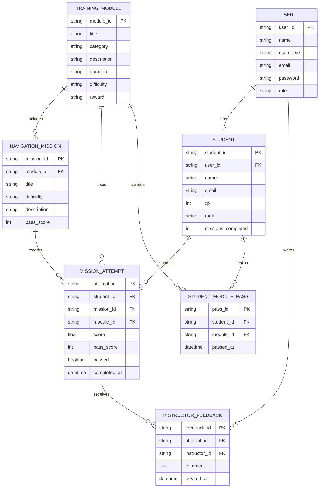
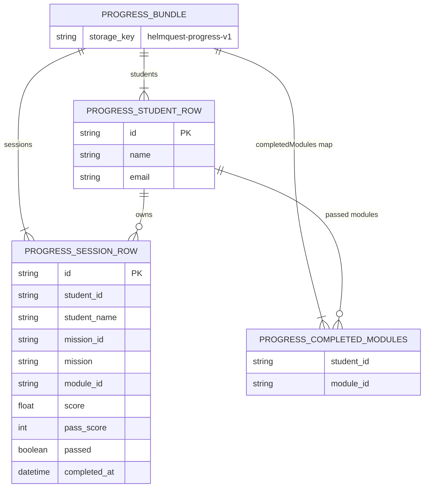
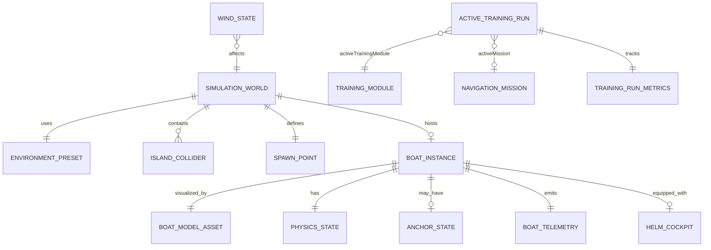
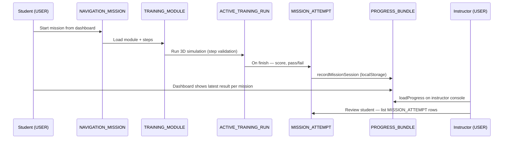

# HelmQuest — Entity Relationship Diagram

Database-style ERD for HelmQuest (maritime navigation training), laid out like a classic schema diagram with **PK**, **FK**, and labeled relationships.

**Current implementation:** mission attempts and module passes persist in browser `localStorage` (`helmquest-progress-v1`); catalog data lives in `App.vue`; simulation state is in-memory only.

---

## 1. Database-style ERD (main schema)

This mirrors a typical academic/project ERD: one **User** account table, **Student** profiles, training content, graded **Mission Attempts**, and optional **Instructor Feedback**.



### Relationship labels (like reference diagram)

| From | To | Label | Cardinality |
|------|-----|-------|-------------|
| **USER** | **STUDENT** | has | 1 : 0..1 (student accounts only) |
| **STUDENT** | **MISSION_ATTEMPT** | submits | 1 : N |
| **TRAINING_MODULE** | **NAVIGATION_MISSION** | includes | 1 : N |
| **NAVIGATION_MISSION** | **MISSION_ATTEMPT** | records | 1 : N |
| **TRAINING_MODULE** | **MISSION_ATTEMPT** | uses | 1 : N |
| **STUDENT** | **STUDENT_MODULE_PASS** | earns | 1 : N |
| **TRAINING_MODULE** | **STUDENT_MODULE_PASS** | awards | 1 : N |
| **MISSION_ATTEMPT** | **INSTRUCTOR_FEEDBACK** | receives | 1 : N |
| **USER** (instructor) | **INSTRUCTOR_FEEDBACK** | writes | 1 : N |

### Map to your app (today)

| Table | Stored in | Example |
|-------|-----------|---------|
| USER | `DEMO_USERS` + session (`currentUser`) | `student@helmquest.local` |
| STUDENT | `progress.students[]` + `demoStudent` | Alex Rivera |
| TRAINING_MODULE | `trainingModules` in App.vue | `steering-speed` |
| NAVIGATION_MISSION | `navigationMissions` in App.vue | `HQ-M01` |
| MISSION_ATTEMPT | `progress.sessions[]` | score 85.75%, PASS |
| STUDENT_MODULE_PASS | `progress.completedModules` | `steering-speed` for student |
| INSTRUCTOR_FEEDBACK | *planned* | UI shows count `0` |

---

## 2. Visual layout (reference-style)

Same schema as above, shown as connected boxes:

```
┌─────────────────┐         ┌─────────────────┐
│      USER       │   has   │     STUDENT     │
├─────────────────┤ 1──0..1 ├─────────────────┤
│ user_id    PK   │────────►│ student_id PK   │
│ name            │         │ user_id    FK   │
│ username        │         │ name            │
│ email           │         │ email           │
│ password        │         │ xp              │
│ role            │         │ rank            │
└────────┬────────┘         └────────┬────────┘
         │ writes                    │ submits
         │                           ▼
         │                  ┌─────────────────┐
         │                  │ MISSION_ATTEMPT │
         │                  ├─────────────────┤
         │                  │ attempt_id PK   │
         │                  │ student_id FK   │
         │    ┌─────────────│ mission_id FK   │
         │    │             │ module_id  FK   │
         │    │             │ score           │
         │    │             │ pass_score      │
         │    │             │ passed          │
         │    │             │ completed_at    │
         │    │             └────────┬────────┘
         │    │ records              │ receives
         │    │                      ▼
         │    │             ┌─────────────────┐
         └────┼────────────►│INSTRUCTOR_FEEDBACK│
              │             ├─────────────────┤
              │             │ feedback_id PK  │
              │             │ attempt_id FK   │
              │             │ instructor_id FK│
              │             │ comment         │
              │             │ created_at      │
              │             └─────────────────┘
              │
┌─────────────┴───────────┐         ┌──────────────────────┐
│   NAVIGATION_MISSION    │ includes│   TRAINING_MODULE    │
├─────────────────────────┤◄────────┤──────────────────────┤
│ mission_id         PK   │   N──1  │ module_id       PK   │
│ module_id          FK   │         │ title                │
│ title                   │         │ category             │
│ difficulty              │         │ difficulty           │
│ description             │         │ reward               │
│ pass_score              │         └──────────┬───────────┘
└─────────────────────────┘                    │ awards
                                               ▼
                                    ┌──────────────────────┐
                                    │  STUDENT_MODULE_PASS   │
                                    ├──────────────────────┤
                                    │ pass_id           PK   │
                                    │ student_id        FK   │
                                    │ module_id         FK   │
                                    │ passed_at              │
                                    └──────────────────────┘
```

---

## 3. Core application ERD (detailed)

```mermaid
erDiagram
    USER {
        string id PK
        string email UK
        string password
        enum role "student | instructor"
        string name
    }

    STUDENT {
        string id PK
        string user_id FK
        string name
        string email UK
    }

    INSTRUCTOR {
        string id PK
        string user_id FK
        string name
        string email UK
    }

    STUDENT_PROFILE {
        string student_id PK_FK
        int xp
        string rank
        int missions_completed
        float accuracy_percent
        float xp_progress_percent
    }

    TRAINING_MODULE {
        string id PK
        string title
        string category
        string description
        string duration
        string difficulty
        string reward
        boolean completed_runtime
    }

    LEARNING_OBJECTIVE {
        string id PK
        string module_id FK
        int sort_order
        string text
    }

    TRAINING_STEP {
        string id PK
        string module_id FK
        int step_index
        string instruction
        string validator_type
        json validator_config
        boolean placeholder
    }

    NAVIGATION_MISSION {
        string id PK
        string title
        string difficulty
        string description
        int pass_score
        string module_id FK
    }

    MISSION_ATTEMPT {
        string id PK
        string student_id FK
        string mission_id FK
        string module_id FK
        string mission_title
        float score
        int pass_score
        boolean passed
        datetime completed_at
    }

    STUDENT_MODULE_PASS {
        string student_id FK
        string module_id FK
        datetime first_passed_at
    }

    INSTRUCTOR_FEEDBACK {
        string id PK
        string student_id FK
        string instructor_id FK
        string mission_attempt_id FK
        text comment
        datetime created_at
    }

    USER ||--o| STUDENT : "is (role=student)"
    USER ||--o| INSTRUCTOR : "is (role=instructor)"
    STUDENT ||--|| STUDENT_PROFILE : has
    STUDENT ||--o{ MISSION_ATTEMPT : submits
    INSTRUCTOR ||--o{ INSTRUCTOR_FEEDBACK : writes
    TRAINING_MODULE ||--|{ LEARNING_OBJECTIVE : contains
    TRAINING_MODULE ||--|{ TRAINING_STEP : contains
    TRAINING_MODULE ||--o{ NAVIGATION_MISSION : "linked by"
    NAVIGATION_MISSION ||--o{ MISSION_ATTEMPT : "graded as"
    TRAINING_MODULE ||--o{ MISSION_ATTEMPT : "uses"
    STUDENT ||--o{ STUDENT_MODULE_PASS : "earns"
    TRAINING_MODULE ||--o{ STUDENT_MODULE_PASS : "awarded for"
    MISSION_ATTEMPT ||--o| INSTRUCTOR_FEEDBACK : "may receive"
```

### Relationship notes

| Relationship | Cardinality | Description |
|--------------|-------------|-------------|
| USER → STUDENT / INSTRUCTOR | 1 : 0..1 | One account has one role profile. |
| STUDENT → MISSION_ATTEMPT | 1 : N | Each simulation run that is graded creates an attempt. |
| NAVIGATION_MISSION → TRAINING_MODULE | N : 1 | Several missions can share one module (e.g. HQ-M01 and HQ-M03 → `steering-speed`). |
| MISSION_ATTEMPT → NAVIGATION_MISSION | N : 1 | Attempts are keyed by `missionId` (e.g. `HQ-M04`). |
| STUDENT → STUDENT_MODULE_PASS | N : M | Unlocked when any passed attempt completes a module. |
| INSTRUCTOR_FEEDBACK | optional | Column exists in UI (`feedback: 0`); not implemented yet. |

---

## 4. Progress persistence (browser `localStorage`)

Aggregate document stored under key `helmquest-progress-v1` in `helpers/progressStore.js`.



---

## 5. Runtime simulation ERD (in-memory / scene graph)

Active only during `activeScreen === 'simulation'`. Not persisted except via `MISSION_ATTEMPT` summary.



| Runtime object | Vue / code location |
|----------------|---------------------|
| ACTIVE_TRAINING_RUN | `activeTrainingModule`, `currentTrainingStep`, `isTrainingReviewMode` |
| TRAINING_RUN_METRICS | `trainingRunMetrics` (time, steps, max speed) |
| BOAT_TELEMETRY | `stats` ref |
| PHYSICS_STATE | `physics` ref + `speedVel`, `speedRot` |
| ANCHOR_STATE | `anchor` ref |

---

## 6. End-to-end flow (student attempt → instructor view)



---

## 7. Entity definitions (core)

### USER
| Attribute | Type | Notes |
|-----------|------|-------|
| id | string PK | e.g. `student-alex`, `instructor-helen` |
| email | string UK | `student@helmquest.local`, `instructor@helmquest.local` |
| password | string | Demo only; `authenticateUser()` in `progressStore.js` |
| role | enum | `student` \| `instructor` |
| name | string | Display name |

### STUDENT / INSTRUCTOR
| Attribute | Type | Notes |
|-----------|------|-------|
| id | string PK | Same as USER.id in demo |
| user_id | FK → USER | 1:1 |
| name, email | string | Copied in `progress.students[]` for students |

### STUDENT_PROFILE
| Attribute | Type | Notes |
|-----------|------|-------|
| student_id | PK/FK | |
| xp, rank | number, string | `demoStudent` ref (not in localStorage) |
| missions_completed | int | Derived from passed missions |
| accuracy_percent, xp_progress_percent | number | Mock HUD stats |

### NAVIGATION_MISSION
| Attribute | Type | Notes |
|-----------|------|-------|
| id | string PK | e.g. `HQ-M01` |
| title | string | e.g. Basic Steering |
| difficulty | enum | BEGINNER, INTERMEDIATE, ADVANCED |
| description | text | |
| pass_score | int | Percent required to pass |
| module_id | FK → TRAINING_MODULE | |

### TRAINING_MODULE
| Attribute | Type | Notes |
|-----------|------|-------|
| id | string PK | e.g. `steering-speed` |
| title, category, description | string | |
| duration, difficulty, reward | string | |
| completed_runtime | boolean | Session flag; restored from `completedModules` |

### TRAINING_STEP
| Attribute | Type | Notes |
|-----------|------|-------|
| module_id | FK | |
| step_index | int | `currentTrainingStep` |
| instruction | string | |
| validator_type | enum | speed, heading, anchor, placeholder |
| placeholder | boolean | Buoy/gate steps — time + movement |
| check | function | In-memory only; not serializable |

### MISSION_ATTEMPT
| Attribute | Type | Notes |
|-----------|------|-------|
| id | string PK | `session-{timestamp}-…` |
| student_id | FK | |
| mission_id | FK | Per-mission result on dashboard |
| module_id | FK | Training content used |
| mission_title | string | Denormalized for instructor list |
| score | float | From `calculateMissionScore()` |
| pass_score | int | From mission |
| passed | boolean | `score >= pass_score` |
| completed_at | datetime ISO | |

### STUDENT_MODULE_PASS
| Attribute | Type | Notes |
|-----------|------|-------|
| student_id | FK | |
| module_id | FK | Stored in `completedModules[studentId][]` |

### INSTRUCTOR_FEEDBACK (planned)
| Attribute | Type | Notes |
|-----------|------|-------|
| id | PK | Not implemented |
| student_id, instructor_id | FK | |
| mission_attempt_id | FK | |
| comment | text | UI shows `feedback: 0` |

---

## 8. Implementation mapping (today)

| Logical entity | Code / storage | Persisted? |
|----------------|----------------|------------|
| USER | `DEMO_USERS`, `currentUser`, `userRole` | No (demo credentials in JS) |
| STUDENT | `progress.students[]`, `demoStudent` | Students list in localStorage |
| MISSION_ATTEMPT | `progress.sessions[]` | Yes — localStorage |
| STUDENT_MODULE_PASS | `progress.completedModules` | Yes — localStorage |
| NAVIGATION_MISSION | `navigationMissions` constant | No (catalog in App.vue) |
| TRAINING_MODULE | `trainingModules` ref | Completion flags synced from localStorage |
| TRAINING_STEP | `module.steps[]` | No |
| ACTIVE_TRAINING_RUN | `activeTrainingModule`, `activeMission` | No |
| BOAT_INSTANCE, PHYSICS_STATE, … | Three.js / refs | No |

---

## 9. Cardinality summary

| From | To | Relationship |
|------|-----|--------------|
| USER | STUDENT / INSTRUCTOR | 1 : 0..1 |
| STUDENT | MISSION_ATTEMPT | 1 : N |
| NAVIGATION_MISSION | TRAINING_MODULE | N : 1 |
| NAVIGATION_MISSION | MISSION_ATTEMPT | 1 : N |
| TRAINING_MODULE | TRAINING_STEP | 1 : N |
| TRAINING_MODULE | LEARNING_OBJECTIVE | 1 : N |
| STUDENT | STUDENT_MODULE_PASS | N : M |
| INSTRUCTOR | INSTRUCTOR_FEEDBACK | 1 : N (planned) |

---

## 10. Future backend (target physical model)

When moving off `localStorage`, the recommended tables are:

- `users`, `students`, `instructors`
- `training_modules`, `training_steps`, `learning_objectives`
- `navigation_missions`
- `mission_attempts` (replaces `progress.sessions`)
- `student_module_passes` (replaces `completedModules` map)
- `instructor_feedback`

Simulation entities (boat, physics, islands) remain **client-only**; only `MISSION_ATTEMPT` summaries sync to the server.

---

## 11. Cross-references

- **Export PNG/PDF (like sample diagram):** paste [helmquest-schema.dbml](./helmquest-schema.dbml) into [dbdiagram.io](https://dbdiagram.io)
- **JSON Design Schema (nested cards):** paste [json/helmquest-design-schema.json](./json/helmquest-design-schema.json) into [jsoncrack.com/editor](https://jsoncrack.com/editor)
- Machine-readable entities: [json/helmquest-entities.json](./json/helmquest-entities.json)
- JSON Schema types: [json/helmquest-schemas.json](./json/helmquest-schemas.json)
- Data flow: [data-flow.md](./data-flow.md)
- System planning: [system-planning.md](./system-planning.md)
