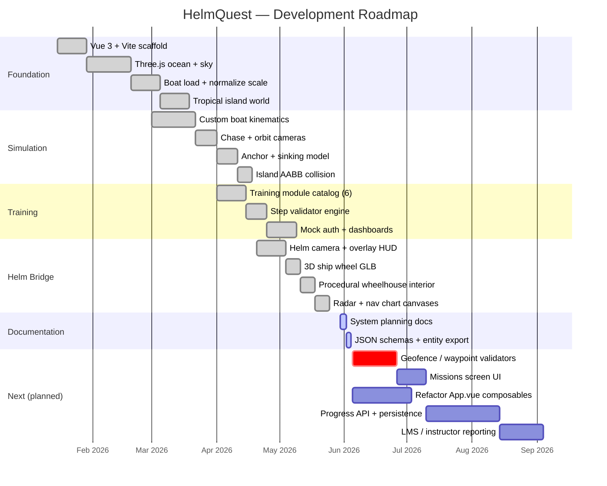
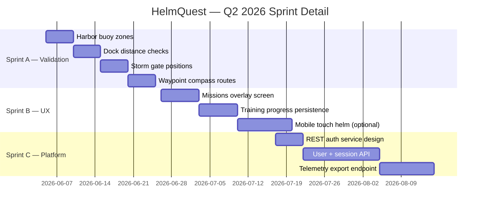
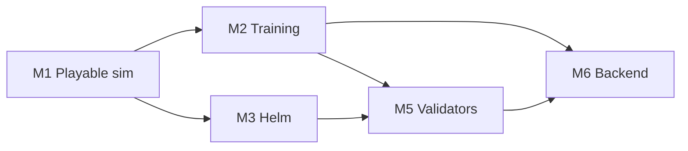

# HelmQuest — Gantt Chart

Timeline for planning and roadmap communication. Dates are illustrative from **May 2026**; adjust `dateFormat` and task dates to match your sprint calendar.

> **Paper-style Gantt (Figure 9 format):** see **[helmquest-gantt-chart.md](./helmquest-gantt-chart.md)** and import **[helmquest-gantt.csv](./helmquest-gantt.csv)** into Excel for colored timeline bars (Apr 2026 – Mar 2027).

## Project phases (overview)

## Sprint breakdown (detail)

## Milestones

| Milestone | Target | Deliverable |
|-----------|--------|-------------|
| M1 — Playable sim | Complete | Ocean, boat, islands, WASD |
| M2 — Training alpha | Complete | 6 modules, mock LMS UI |
| M3 — Helm MVP | Complete | Helm camera, wheel, MFDs, interior |
| M4 — Docs package | 2026-05-30 | `docs/` planning set |
| M5 — Validation beta | 2026-06-26 | Geo/step checks live |
| M6 — Backend MVP | 2026-08-15 | Auth + progress API |

## Dependencies

## Resource assumptions

- 1 full-stack developer (Vue + Three.js)
- Optional: 3D artist for interior/textures (Sprint B+)
- Optional: backend developer from Sprint C
