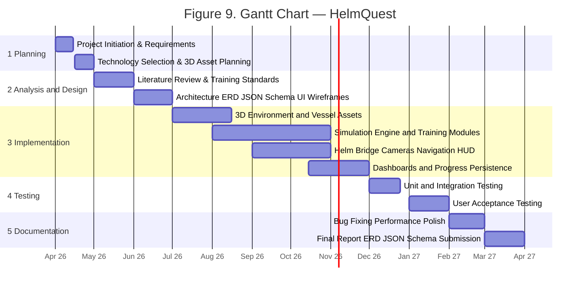

# HelmQuest — Gantt Chart (Project Schedule)

**Figure reference:** Academic project timeline (Apr 2026 – Mar 2027)  
**System:** HelmQuest — browser-based 3D marine navigation training (Vue 3, Three.js, WebGL)

---

## Table 1 — Work breakdown schedule

| WBS ID | Task Name | Start Date | End Date | Duration (Weeks) |
|--------|-----------|------------|----------|------------------|
| **1** | **Planning Phase** | | | |
| 1.1 | Project Initiation & Requirements Scoping | Apr 1, 2026 | Apr 15, 2026 | 2 |
| 1.2 | Technology Selection & 3D Asset Planning | Apr 16, 2026 | Apr 30, 2026 | 2 |
| **2** | **Analysis & Design Phase** | | | |
| 2.1 | Literature Review & Navigation Training Standards | May 1, 2026 | May 31, 2026 | 4 |
| 2.2 | System Architecture, ERD, JSON Schema & UI Wireframes | Jun 1, 2026 | Jun 30, 2026 | 4 |
| **3** | **Implementation Phase (Agile Sprints)** | | | |
| 3.1 | 3D Environment & Vessel Assets (Ocean, Islands, Trawler GLB) | Jul 1, 2026 | Aug 15, 2026 | 6 |
| 3.2 | Simulation Engine & Training Modules (Physics, Steps, Missions) | Aug 1, 2026 | Oct 31, 2026 | 13 |
| 3.3 | Student/Instructor Dashboards & Progress Persistence | Oct 15, 2026 | Nov 30, 2026 | 6 |
| 3.4 | Helm Bridge, Cameras & Navigation HUD | Sep 1, 2026 | Oct 31, 2026 | 8 |
| **4** | **Testing & Evaluation Phase** | | | |
| 4.1 | Unit & Integration Testing (Simulation & UI) | Dec 1, 2026 | Dec 24, 2026 | 3 |
| 4.2 | User Acceptance Testing (Students & Instructors) | Jan 1, 2027 | Jan 31, 2027 | 4 |
| **5** | **Documentation & Project Closure** | | | |
| 5.1 | Bug Fixing, Performance Tuning & Polish | Feb 1, 2027 | Feb 28, 2027 | 4 |
| 5.2 | Final Report, ERD, JSON Schema & Submission | Mar 1, 2027 | Mar 31, 2027 | 4 |

### Phase colors (for Excel / Google Sheets bars)

| Phase | Suggested fill color |
|-------|----------------------|
| 1 — Planning | Blue `#4472C4` |
| 2 — Analysis & Design | Green `#70AD47` |
| 3 — Implementation | Orange `#ED7D31` |
| 4 — Testing & Evaluation | Purple `#7030A0` |
| 5 — Documentation & Closure | Gray `#A5A5A5` |

---

## Visual timeline (Mermaid)

---

## Task descriptions (for report narrative)

### 1 — Planning Phase
- **1.1** Define HelmQuest goals (student training, instructor monitoring), stakeholders (fisheries students, instructors), and scope (web SPA, no native install).
- **1.2** Confirm stack (Vue 3, Vite, Three.js), list 3D assets (trawler GLB, islands, ship wheel), and deployment model (static hosting).

### 2 — Analysis & Design Phase
- **2.1** Review maritime training practices, pass/fail grading, and similar simulators.
- **2.2** Produce use-case flow, **ERD** (dbdiagram.io), **JSON design schema**, screen wireframes (auth, student dashboard, instructor console, simulation HUD).

### 3 — Implementation Phase
- **3.1** Ocean shader, sky, archipelago, boat loading and scale normalization.
- **3.2** Boat kinematics, cameras (chase/orbit/helm), island collision, anchor, 6 training modules with step validators, mission grading popup.
- **3.3** Mock auth, student mission hub with results, instructor console, `localStorage` progress sync, student review modal.
- **3.4** Helm interior, wheel, radar and nav chart canvases, compass HUD.

### 4 — Testing & Evaluation Phase
- **4.1** Test training steps, login rules, progress save/load, simulation stability (WebGL).
- **4.2** Pilot with sample students/instructors; collect feedback on UX and grading clarity.

### 5 — Documentation & Project Closure
- **5.1** Fix review-mode auto-complete, scoring accuracy, UI polish.
- **5.2** Final paper with ERD, JSON design schema, Gantt chart, user manual, and submission package.

---

## Milestones

| ID | Milestone | Target date | Deliverable |
|----|-----------|-------------|-------------|
| M1 | Design complete | Jun 30, 2026 | ERD, JSON schema, architecture |
| M2 | Playable simulation | Aug 15, 2026 | Ocean, boat, islands, WASD |
| M3 | Training alpha | Oct 31, 2026 | Modules, missions, grading |
| M4 | Dashboard beta | Nov 30, 2026 | Student + instructor views |
| M5 | Testing complete | Jan 31, 2027 | UAT sign-off |
| M6 | Project submission | Mar 31, 2027 | Final report + deployed demo |

---

## How to build the chart in Excel (like your sample)

1. Open Excel or Google Sheets.
2. Copy the **Table 1** columns (WBS ID through Duration).
3. Add columns for each month: Apr 26, May 26, Jun 26 … Mar 27.
4. Use **Conditional formatting** or fill colored bars in the timeline columns using the phase colors above.
5. Title the sheet **Figure 9. Gantt Chart — HelmQuest**.

CSV for import: [helmquest-gantt.csv](./helmquest-gantt.csv) (all rows including phase headers)  
Tasks only (best for Excel Gantt): [helmquest-gantt-tasks-only.csv](./helmquest-gantt-tasks-only.csv)

### If Start Date / End Date / Duration look empty in Excel

1. **Re-import the updated CSV** — phase rows (1, 2, 3…) now include dates too.
2. Use **`helmquest-gantt-tasks-only.csv`** if you only want task rows **1.1–5.2** (no section headers).
3. After opening in Excel, select columns **C, D, E** → **Format Cells** → **Date** (for C and D) and **Number** (for E).
4. For a timeline chart: select columns **Task Name, Start Date, End Date** → **Insert** → **Bar chart** → **Stacked bar**, or use **Insert → Chart → Timeline** (Microsoft 365).

---

## Related docs

- Development roadmap: [gantt.md](./gantt.md)
- System planning: [system-planning.md](./system-planning.md)
