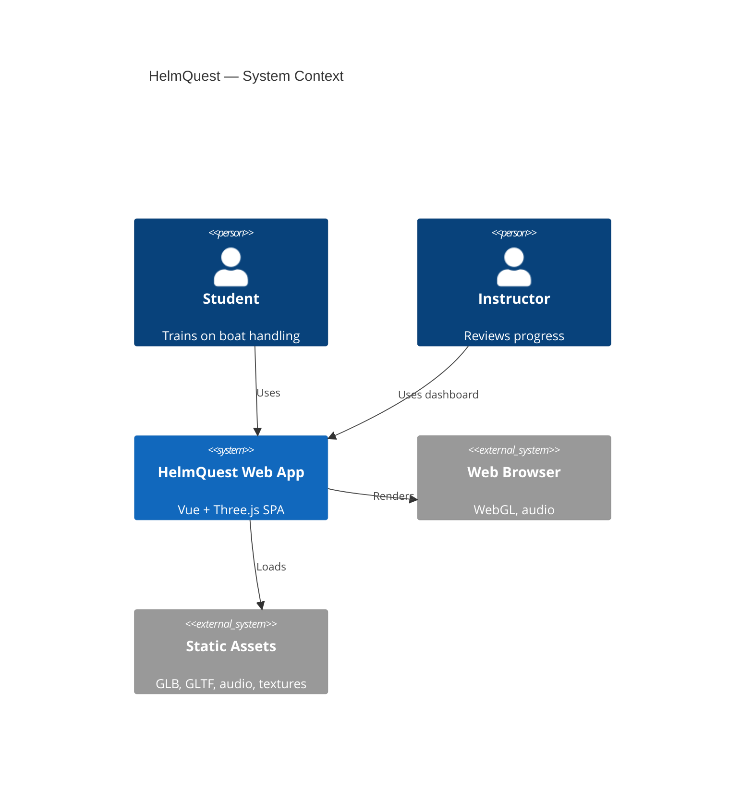
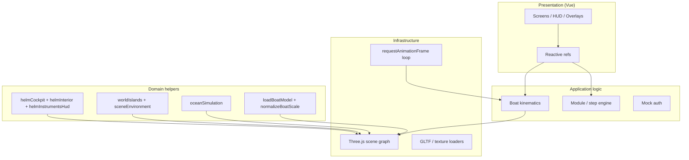

# HelmQuest — System Planning

**Product:** HelmQuest (package: `threejs-ocean`)  
**Type:** Client-only 3D marine navigation trainer  
**Stack:** Vue 3 · Vite 5 · Three.js 0.163  
**Primary artifact:** `App.vue` + `helpers/*`

---

## 1. Vision & goals

### Vision
Deliver a browser-based fisheries navigation trainer where students practice steering, compass work, docking, and emergency procedures in a realistic ocean environment—without installing native software.

### Goals
| ID | Goal | Success metric |
|----|------|----------------|
| G1 | Realistic boat feel | Smooth thrust, drag, turn-radius vs speed |
| G2 | Training progression | 6 modules with step validation |
| G3 | Immersive helm | First-person bridge, wheel, radar/chart HUD |
| G4 | Safe exploration | Island collision, anchor, sinking model |
| G5 | Instructor readiness | Dashboard KPIs (mock today; API later) |

### Non-goals (current release)
- Multiplayer / networked sim
- Real authentication or LMS grade passback
- Mobile-optimized touch helm
- Physics engine integration (Cannon/Ammo listed but unused)

---

## 2. Stakeholders

| Role | Needs |
|------|--------|
| Fisheries student | Guided modules, clear HUD, free roam |
| Instructor | Progress, accuracy, module completion |
| Developer | Modular helpers, documented data model |
| Institution (future) | SSO, progress API, audit logs |

---

## 3. System context

**Deployment model:** Static SPA (`npm run build` → `dist/`). No application server required.

---

## 4. Functional scope

### 4.1 Screen flow

| Screen ID | Purpose | Auth |
|-----------|---------|------|
| `landing` | Cinematic intro | No |
| `mainmenu` | Hub | No |
| `play-options` | Free roam vs training | Partial |
| `training` | Module picker | Yes |
| `auth` | Login (mock) | — |
| `dashboard` | Student/instructor stats | Yes |
| `simulation` | 3D world + HUD | No (roam) / Yes (training) |
| `missions` | **Planned** — UI stub only | Yes |

### 4.2 Simulation features

| Feature | Module / location |
|---------|-------------------|
| Ocean & waves | `helpers/oceanSimulation.js` |
| Sky & lighting presets | `App.vue` (`day` / `sunset`) |
| Archipelago | `helpers/worldIslands.js` |
| Boat load & scale | `loadBoatModel.js`, `normalizeBoatScale.js` |
| Custom kinematics | `App.vue` `updateBoatPhysics` |
| Cameras chase / orbit / helm | `App.vue`, `helpers/helmCockpit.js` |
| Helm interior & wheel | `helmInterior.js`, `ship_wheel.glb` |
| Radar & nav chart | `helmInstrumentsHud.js` |
| Anchor | `App.vue` `anchor` ref |
| Storm mode | Amplifies wind/waves |
| Training steps | `trainingModules` + `checkTrainingStep` |

### 4.3 Controls (simulation)

| Input | Action |
|-------|--------|
| W / S | Forward / reverse |
| A / D | Turn |
| C | Cycle camera |
| H | Anchor deploy/retract |
| Mouse | Look (chase/helm) |
| `` ` `` (hold) | Exit to dashboard |

---

## 5. Technical architecture

### 5.1 Layered view

### 5.2 Key files

| Path | Responsibility |
|------|----------------|
| `main.js` | Vue bootstrap |
| `App.vue` | UI, state, render loop, physics, training |
| `helpers/oceanSimulation.js` | Water shader plane |
| `helpers/sceneEnvironment.js` | Spawn, waterline constants |
| `helpers/worldIslands.js` | Island GLTF, AABB collision |
| `helpers/loadBoatModel.js` | Vessel loading |
| `helpers/normalizeBoatScale.js` | LOA scale, `BoatPivot` |
| `helpers/helmCockpit.js` | Wheel, helm camera constants |
| `helpers/helmInterior.js` | Procedural wheelhouse |
| `helpers/helmDeckRails.js` | Rail visibility in helm |
| `helpers/helmInstrumentsHud.js` | Canvas MFDs |
| `public/assets/trawler (1).glb` | Default vessel |
| `public/assets/ship_wheel.glb` | Helm wheel |

### 5.3 Runtime data stores

| Store | Persistence | Contents |
|-------|-------------|----------|
| Vue `ref()` / `reactive()` | Session (RAM) | UI, physics params, training |
| Three.js scene graph | Session | Meshes, lights, cameras |
| `localStorage` | None used | — |
| Backend DB | None | — |

---

## 6. Quality attributes

| Attribute | Approach |
|-----------|----------|
| Performance | Single renderer; helm hides exterior meshes |
| Maintainability | **Risk:** monolithic `App.vue` (~5k lines) |
| Accessibility | Partial ARIA on helm canvases |
| Security | Client-only; mock auth — no secrets |
| Scalability | Static hosting; future API for progress |

---

## 7. Risks & mitigations

| Risk | Impact | Mitigation |
|------|--------|------------|
| Monolithic `App.vue` | Hard to test/refactor | Extract composables (scene, physics, training) |
| Placeholder step checks (`() => true`) | Weak training validation | Waypoints, geofences, buoys |
| Missing `missions` screen | Broken nav from dashboard | Implement or redirect to training |
| Unused deps (`cannon`, `ammo`) | Bundle noise | Remove or integrate |
| Asset path drift | Load failures | Document `public/assets` contract |
| No progress persistence | Resets on refresh | Backend + `helmquest-schemas` Session API |

---

## 8. Workstreams & priorities

| Priority | Workstream | Status |
|----------|------------|--------|
| P0 | Core sim + rendering | Done |
| P0 | Training modules (6) | Done (partial validators) |
| P1 | Helm bridge (3D + HUD) | Done |
| P1 | Island collision | Done |
| P2 | Mission screen | Not started |
| P2 | Position-based step validation | Not started |
| P3 | Backend / auth / persistence | Not started |
| P3 | Code split / composables | Not started |

See [gantt.md](./gantt.md) for timeline.

---

## 9. Acceptance criteria (release checklist)

- [ ] App loads from `landing` → `simulation` without console errors
- [ ] Trawler GLB spawns at correct waterline and heading
- [ ] W/A/S/D/C/H behave as documented
- [ ] All three cameras functional; helm hides hull, shows interior
- [ ] Each training module advances steps when validators pass
- [ ] Storm toggle affects waves/wind visibly
- [ ] `npm run build` succeeds
- [ ] Documentation in `docs/` matches implemented screens and entities

---

## 10. References

- [data-flow.md](./data-flow.md)
- [erd.md](./erd.md)
- [json/helmquest-project.json](./json/helmquest-project.json)
